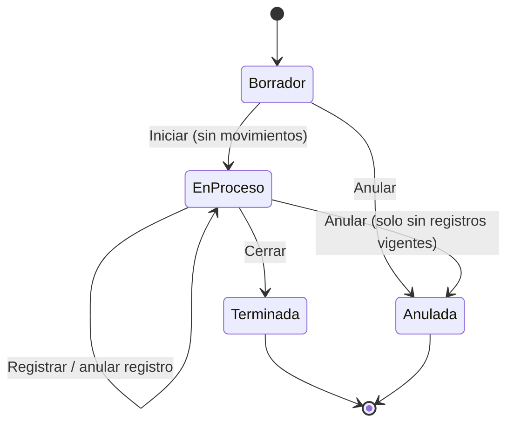

# Alcance candidato de V1 — Módulo de Producción

> **Errata (auditoría 3, 2026-10-13)** — §5 (entidades) y R15 (numeración) quedan superadas por [PRODUCTION-DATA-MODEL-REVISED.md](PRODUCTION-DATA-MODEL-REVISED.md) y ADR-06; R10 (idempotencia) por ADR-05; R14 (auditoría) por ADR-10. El resto del alcance sigue como candidato.
> Detalle y evidencia: [PRODUCTION-ARCHITECTURE-DECISION-RECORD.md](PRODUCTION-ARCHITECTURE-DECISION-RECORD.md) §2 y [PRODUCTION-ARCHITECTURE-OPTIONS-AUDIT.md](PRODUCTION-ARCHITECTURE-OPTIONS-AUDIT.md) §2. El texto original se conserva.

> **PROPUESTA PARA APROBACIÓN. No está aprobada.** El nombre del archivo indica que es un candidato; se vuelve alcance vigente solo si usted lo aprueba explícitamente.
> Sustituye en lo que difiera a [PRODUCTION-MODULE-PROPOSAL.md](PRODUCTION-MODULE-PROPOSAL.md) (conservada como evidencia). Razones de cada cambio: [PRODUCTION-FINAL-CRITICAL-REVIEW.md](PRODUCTION-FINAL-CRITICAL-REVIEW.md). Decisiones abiertas: [PRODUCTION-FINAL-DECISIONS.md](PRODUCTION-FINAL-DECISIONS.md).

## 1. Principio
Mínima complejidad sin comprometer integridad del inventario ni trazabilidad. Un único flujo: **receta → orden → registrar producción → costo → historial/anulación**.

## 2. Clasificación de funcionalidades

| Funcionalidad | Clasificación | Razón |
|---|---|---|
| Recetas de un nivel (insumos, componentes, envases) con cantidad, unidad y % de desperdicio | **V1 obligatoria** | Base de todo; validada por CONSTRUMARKET [V-datos] |
| Snapshot de la receta en la orden | **V1 obligatoria** | La receta cambia en el tiempo; hace reproducible la fabricación |
| Órdenes con 4 estados | **V1 obligatoria** | Control mínimo del trabajo pendiente/terminado |
| Disponibilidad de materiales (necesario/disponible/faltante sobre lo **pendiente**) | **V1 obligatoria** | Evita registrar lo imposible; el backend igual valida |
| Registrar producción parcial o total | **V1 obligatoria** | Caso habitual; unidad atómica de movimiento e idempotencia |
| Consumo editable con diferencia vs receta visible | **V1 obligatoria** | Es el mecanismo de merma/desperdicio sin funcionalidades extra |
| Costo por registro (materiales reales + mano de obra y otros del registro), costo unitario | **V1 obligatoria** | El legacy no tenía costos; es el valor central |
| Anulación de registros y de órdenes por contramovimientos | **V1 obligatoria** | Corrección sin perder trazabilidad |
| Permisos, auditoría, módulo por plan | **V1 obligatoria** | Seguridad y comercialización |
| Cantidad defectuosa con motivo (informativa; no ingresa a stock) | **V1 opcional** | Aporta valor de gestión; CONSTRUMARKET nunca la usó |
| Reportes: órdenes, faltantes, estimado vs real, pérdida (defectuosas/exceso) | **V1 opcional (mínimo: lista de órdenes y costo por orden)** | Los reportes finos pueden entrar tras el núcleo |
| Referencia a pedido/cliente (texto y fecha compromiso) | **V1 opcional** | Cubre «producción por pedido» sin reservas |
| Semiterminados encadenados | **V1 (sin desarrollo adicional)** | Son productos normales con su receta y orden |
| Importación de recetas legacy | **V1.5 / manual** | Solo 8 recetas activas conocidas |
| Variantes (matriz talla/color) | **V1.5 y posterior** | Sin evidencia; riesgo de datos en presentaciones |
| Lotes | **V1.5 y posterior** | El ERP no tiene lotes (solo series) [V-código] |
| Productos recuperables / segunda calidad | **V1.5 y posterior** | Hipótesis sin evidencia |
| Reservas de inventario para pedidos | **V1.5 y posterior** | Complejidad de reservas y liberaciones |
| Sugerencias de compra / «Producir desde venta» | **V1.5 y posterior** | La evidencia de CONSTRUMARKET no es concluyente |
| Política de consumo configurable (al iniciar) | **V1.5 y posterior** | Triplica pruebas; el consumo por registro cubre el caso general |
| Costo de ventas = costo de producción | **Fuera de V1 (decisión D-03)** | Cambia reportes existentes |
| Centros de trabajo, rutas, MRP, WIP contable, subproductos, tarifa por hora | **Posterior** | Exceden a una pyme |

## 3. Estados y operaciones permitidas

| Operación | Borrador | En proceso | Terminada | Anulada |
|---|---|---|---|---|
| Editar producto/cantidad/receta (refrescar snapshot) | ✅ | ❌ | ❌ | ❌ |
| Editar fecha, referencia, presupuesto informativo | ✅ | ✅ | ❌ | ❌ |
| Aumentar cantidad planificada (autoriza excedente, auditado, `production.manage`) | ✅ | ✅ | ❌ | ❌ |
| Registrar producción | ❌ | ✅ | ❌ | ❌ |
| Anular un registro | ❌ | ✅ | ✅ (`production.void`; solo si hay stock del terminado) | ❌ |
| Cerrar | ❌ | ✅ (con confirmación si producido < planificado) | — | ❌ |
| Anular orden | ✅ | ✅ solo sin registros vigentes | ❌ | — |
| Producir más después de cerrar | — | — | Crear **orden nueva** (puede indicar «orden de origen») | — |

Sin «Reabrir». Los registros anulados permanecen visibles con usuario, fecha y motivo.

## 4. Reglas de negocio

**R1 — Cantidades.** `planificado` (editable por permiso), `producido = Σ buenas` de registros vigentes, `defectuosas` informativas, `pendiente = max(0, planificado − producido)`. Registrar buenas > pendiente está **bloqueado**; se autoriza aumentando la cantidad planificada.

**R2 — Receta.** Línea: insumo (producto con `ManageStock`, no servicio, sin series, sin variantes), cantidad por unidad terminada (decimal(15,6)), unidad (base o `SaleUnit` del insumo), % desperdicio sobre neto (0–100). Sin ciclos (incluidos transitivos entre semiterminados). El terminado debe tener `ManageStock` y no tener variantes.

**R3 — Snapshot.** Al crear la orden se copian las líneas ya convertidas a unidad base: `bruto_por_unidad = neto × (1 + %)`. La receta maestra puede cambiar sin afectar órdenes. En Borrador, «actualizar a receta vigente».

**R4 — Disponibilidad.** `necesario = bruto_por_unidad × pendiente`; `disponible` = stock de la sucursal de la orden (base); `faltante = max(0, necesario − disponible)`; «puedes producir hasta N» = mínimo de `⌊disponible / bruto_por_unidad⌋`. Informativa; la validación definitiva ocurre al registrar. Sin reservas.

**R5 — Registro.** Entrada: buenas (≥0), defectuosas (≥0, con motivo si >0), consumo real por línea (precargado = `bruto_por_unidad × (buenas + defectuosas)`, redondeado una sola vez a 3 decimales, editable), mano de obra y otros costos del registro (opcionales), fecha, clave de idempotencia. Al menos buenas+defectuosas > 0. Aviso (no bloqueo) si el consumo difiere más de 5 % de lo teórico (parámetro).

**R6 — Movimientos.** En **una transacción**: bloquea la orden; revisa la clave de idempotencia; para cada insumo, salida `PRODUCTION_OUT` con `UnitCost` = costo promedio vigente; ingreso `PRODUCTION_IN` de las **buenas** con `UnitCost` = costo unitario del registro. Cada movimiento lleva `production_entry_id`. Falta de stock en cualquier línea → rollback total. Insumos ordenados por `(sucursal, producto)` al bloquear.

**R7 — Costos.** Por línea: `costo_línea = consumo_real × costo_promedio_insumo_en_ese_momento` (se guarda `unit_cost` y `origen`: `average | last_purchase | none`). `costo_registro = Σ costo_línea + mano_de_obra + otros`. `costo_unitario = costo_registro / buenas` (si buenas = 0 no hay ingreso; el costo queda como pérdida del registro, solo informativo). Costo de la orden = Σ registros vigentes. Costo previsto (informativo) = Σ necesario × costo promedio actual. Etiqueta: «costo de gestión». Base: sin IGV (D-04).

**R8 — Defectuosas y mermas.** No ingresan a stock. Reporte de pérdida: `defectuosas × costo teórico unitario` + `(consumo real − consumo teórico de buenas+defectuosas) × costo`. Todo el costo se absorbe en las buenas (D-05).

**R9 — Anulación de registro.** Genera `IN` de cada insumo al costo con que salió, y `OUT` del terminado al `unit_cost` del ingreso original; ambos con `production_entry_id` y referencia «ANULACION PRODUCCION/…». Si no hay stock suficiente del terminado → bloqueado con mensaje. El registro pasa a `anulado`; los acumulados se recalculan. Permitido en cualquier orden cronológico mientras haya stock.

**R10 — Idempotencia.** Se revisa antes que el estado. UNIQUE `(orden, clave)`. Mismo payload → devuelve el registro existente. Payload distinto → 409. El frontend genera la clave al abrir el modal y deshabilita el botón al enviar.

**R11 — Concurrencia.** Orden bloqueada con `FOR UPDATE`; stock según el endurecimiento (T-01). Mientras ese endurecimiento no esté activo en el tenant, Producción **no se habilita en producción**.

**R12 — Sucursal.** Una orden pertenece a una sucursal (= almacén); insumos y terminado se mueven allí. Traslados previos si hace falta.

**R13 — Permisos.** `production.view`, `production.manage` (recetas y órdenes, incluye aumentar planificado), `production.execute` (registrar), `production.void` (anular registros/órdenes), `production.costs` (ver costos: columnas de costo ocultas en API y UI sin este permiso). Backfill solo al rol Administrador.

**R14 — Auditoría.** `WriteAuditLog` con `TenantID` en crear, iniciar, cerrar, anular, registrar, anular registro y cambios de cantidad planificada; además `created_by/closed_by/voided_by` y fechas en tablas.

**R15 — Numeración.** Contador propio por sucursal con UNIQUE `(sucursal, número)`; formato `OP-0001`.

## 5. Entidades (conceptual; el diseño de tablas se fija al implementar)
`production_recipes` + `_lines` · `production_orders` (+ `_lines` snapshot) · `production_entries` (buenas, defectuosas, motivo, mano de obra/otros, costo total/unitario, `idempotency_key`, estado) · `production_entry_consumptions` (consumo real, unit_cost, origen del costo) · columna `production_entry_id` nullable en `tenant_stock_movements` · tipo de operación `PRODUCTION_IN` · costo promedio por (producto, sucursal) (entrega previa «en sombra»).

## 6. Pantallas mínimas
Recetas (lista + edición con costo estimado) · Órdenes (lista con avance, faltantes y costo) · Detalle de orden (materiales, registros, costos) · Modal «Registrar producción» (precargado, un botón) · Reportes mínimos dentro de Órdenes.

## 7. Datos de ejemplo (comprobados a mano)

Receta por par (neto + desperdicio): tela 0.5 m (5 %) @ S/8 · suela 1 u @ S/12 · pegamento 0.05 L (10 %) @ S/40 → bruto 0.525 m, 1 u, 0.055 L → **S/ 18.40 teórico por par**.

| Caso | Entrada | Resultado esperado |
|---|---|---|
| A. Sencilla | Orden 100; stock tela 60, suela 150, pegamento 8; registro: 100 buenas, consumo propuesto, mano de obra S/300 | Salidas: tela 52.5, suela 100, pegamento 5.5; ingreso 100 @ **S/ 21.40** ((420+1200+220+300)/100); stock final tela 7.5, suela 50, pegamento 2.5 |
| B. Faltantes | Stock tela 40, suela 80, pegamento 8; orden 100 | Faltan 12.5 m y 20 u; «puedes producir hasta **76**» (min(76, 80, 145)); registrar 77 → rechazo total sin movimientos |
| C. Parcial | Orden 100; reg. 1: 60 buenas, MO S/180; reg. 2: 40 buenas, MO S/120 | Reg. 1: tela 31.5, suela 60, peg. 3.3 → costo (252+720+132+180)=1,284 → **21.40**; reg. 2: tela 21, suela 40, peg. 2.2 → (168+480+88+120)=856 → **21.40**; producido 100/100; pendiente 0 |
| D. Mermas y defectos | Se empiezan 100: 95 buenas + 5 defectuosas; consumo real tela 54, suela 100, peg. 5.5 | Materiales 432+1,200+220 = 1,852 → **1,852 / 95 = S/ 19.4947**; producido 95/100 (cerrar con confirmación o registrar 5 buenas más); pérdida informativa: defectuosas 5×18.40 = 92 + exceso de tela 1.5×8 = 12 → **S/ 104**; aviso «tela +2.9 %» |
| E. Por pedido | Orden 30 con cliente y fecha | Mismo flujo; sin reserva; limitación: otra venta puede consumir el stock antes |
| F. Variantes | Producto con variantes | **No soportado en V1**: el sistema lo rechaza y sugiere productos separados |
| G. Corrección | G1 borrador mal creado → editar/anular. G2 en proceso sin registros → anular. G3 anular reg. 1 (60 pares) con 20 vendidos y 40 en stock → **bloqueado** (stock insuficiente: requiere 60, hay 40); tras devolución/ajuste → IN tela 31.5 @8, suela 60 @12, peg. 3.3 @40 y OUT 60 pares @21.40. G4 doble clic → mismo registro, un solo juego de movimientos |

## 8. Criterios de aceptación de V1

**Inventario y concurrencia**
1. Registrar producción mueve stock **exactamente una vez** (reintento y doble clic; payload idéntico → mismo registro; payload distinto → 409).
2. Dos usuarios registrando concurrentemente sobre el mismo insumo → stock final correcto, nunca negativo, kardex con balances consecutivos (prueba con MySQL real).
3. Falta de un solo insumo → **ningún** movimiento.
4. Consumir exactamente el stock disponible (p. ej. 0.018 × 86) **no** se rechaza por coma flotante.
5. Cada movimiento de producción tiene `operation_code`, `production_entry_id`, `UnitCost` y el saldo cuadra con el kardex (productos sin variantes).
6. Un producto con variantes (insumo o terminado) es rechazado con mensaje claro.

**Estados y cantidades**
7. Tabla de transiciones de §3 cumplida; operaciones prohibidas devuelven error.
8. `producido` cuenta solo buenas; Caso D deja la orden en 95/100; cerrar con faltante pide confirmación.
9. Registrar más que el pendiente se bloquea; aumentar la planificada lo autoriza y queda auditado.
10. El snapshot no cambia si se edita la receta maestra; «actualizar» solo en Borrador.
11. Insumo comprado en saco y consumido en kg se descuenta correctamente en unidad base; cantidades pequeñas no se pierden por redondeo (receta en 6 decimales, consumo redondeado una vez por registro).

**Costos**
12. Casos A, C y D reproducen **21.40; 21.40/21.40; 19.4947** (4 decimales) en pruebas automatizadas.
13. El origen del costo (`average | last_purchase | none`) se guarda por línea; líneas sin costo se marcan.
14. Mano de obra del registro entra al costo de ese ingreso y no se edita después.
15. Anular un registro usa los costos guardados (insumos y terminado) y respeta el bloqueo por falta de stock del terminado.
16. Sin `production.costs` no se ve ningún costo (API y UI).
17. Ningún reporte de utilidad existente cambia (modo sombra).

**Seguridad y despliegue**
18. Permisos por rol; backfill solo a Administrador; tenant sin módulo → 403.
19. Auditoría de todas las acciones de estado, con tenant y usuario.
20. «Registrar» con 15 insumos < 1 s y sin agotar el pool (prueba de carga ligera).
21. Migraciones aditivas, con test, desplegadas antes del backend; reversión documentada.

## 9. Criterios de éxito del piloto
- Un usuario nuevo completa el Caso A **sin manual en menos de 5 minutos**.
- 3 tandas reales: consumo registrado vs pesaje real dentro de la tolerancia acordada (p. ej. ±3 %); diferencias explicadas.
- Costo unitario de 2 registros recalculado a mano coincide con el sistema y es revisado por el contador (base sin IGV).
- Stock inicial validado por conteo físico antes de producir; cero registros rechazados por falta de stock **no justificada**.
- Dos semanas de uso sin movimientos duplicados, sin saldos ni kardex inconsistentes (consultas de conciliación).
- El responsable de producción prefiere el flujo al anterior (cualitativo).

## 10. Limitaciones conocidas de este alcance
Sin reservas ni planificación; sin variantes, lotes ni segunda calidad; costo de gestión (no contable); promedio móvil no restaurado exactamente tras anulaciones; el costo de producción no se refleja en utilidades de venta (D-03).
