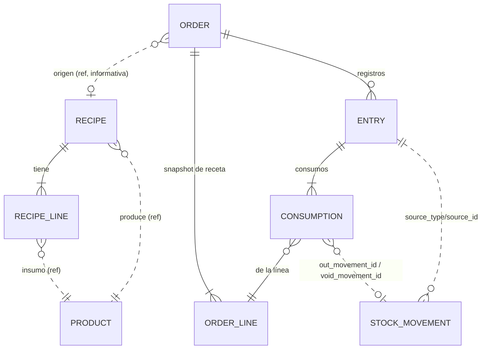

# Modelo de datos revisado — Módulo de Producción

> **Propuesta para aprobación. Nada se creó ni migró.** Sustituye en lo que difiera a §8 de [PRODUCTION-MODULE-PROPOSAL.md](PRODUCTION-MODULE-PROPOSAL.md) y a la sección 5 de [PRODUCTION-APPROVED-SCOPE-CANDIDATE.md](PRODUCTION-APPROVED-SCOPE-CANDIDATE.md). Contrato con Inventario: [PRODUCTION-DECOUPLED-INVENTORY-INTEGRATION.md](PRODUCTION-DECOUPLED-INVENTORY-INTEGRATION.md). Los nombres y tipos son **conceptuales**: se fijan al implementar, tras la medición y la aprobación.
> Convenciones del repo respetadas: prefijo `tenant_`, sin `tenant_id` (BD por tenant), cantidades `decimal(15,3)` salvo receta/snapshot en `(15,6)`, costos `decimal(15,6)`, soft-delete donde el catálogo lo usa [V-código: Gap §7].

## 1. Clasificación de los datos

| Clase | Qué es | Tablas |
|---|---|---|
| **Datos maestros** (cambian con el tiempo; no son historia) | Recetas y sus líneas | `tenant_production_recipes`, `tenant_production_recipe_lines` |
| **Datos operativos** (viven mientras la orden está abierta) | Orden y su snapshot de receta | `tenant_production_orders`, `tenant_production_order_lines` |
| **Registros históricos** (inmutables salvo anulación) | Cada fabricación y su consumo real | `tenant_production_entries`, `tenant_production_consumptions` |
| **Referencias a datos existentes** (sin FK dura) | Producto, sucursal, usuario, cliente, unidad de venta | columnas `*_id` indexadas |
| **Movimientos oficiales de inventario** | Kardex y saldos | `tenant_stock_movements` (+ `source_type`, `source_id`), tablas de stock existentes — **propiedad de Inventario** |

Por qué referencias **sin FK dura**: evita bloqueos y orden de migración entre módulos, y los productos se desactivan o eliminan (soft-delete); la integridad se valida en el servicio y la historia se protege con **snapshots** de nombre, unidad y costos.

## 2. Diagrama

(Línea continua = FK interna del módulo; punteada = referencia lógica sin FK dura.)

## 3. Tablas

### 3.1 `tenant_production_recipes` — maestro
| Campo | Tipo/nota |
|---|---|
| id | PK |
| product_id | producto terminado (ref). Una receta **activa** por producto (validado en servicio; MySQL no tiene índice único parcial) |
| name | texto opcional |
| **output_quantity** | decimal(15,6), default 1: «las cantidades de las líneas rinden esta cantidad de terminado». Permite recetas **por lote** (ej. mezcla de 100 kg) sin dividir a mano |
| active | bool |
| notes | texto |
| created_by, created_at, updated_by, updated_at | trazabilidad |

**Justificación:** única entidad que no existe en el ERP [V-código: no hay BOM/recetas]. `TenantComboGroup` no sirve (es selección en venta, sin costo ni inventario). No se versiona la receta: el **snapshot** de cada orden preserva la historia, así que una tabla de versiones sería redundante.

### 3.2 `tenant_production_recipe_lines` — maestro
`id`, `recipe_id`, `component_product_id` (ref), `quantity decimal(15,6)`, `sale_unit_id` (ref, nullable; si es null = unidad base), `waste_percent decimal(7,3)` (sobre cantidad neta; 0–100), `sort_order`, `notes`.
Validaciones de servicio: componente con `ManageStock`, no servicio, sin series, sin variantes; sin ciclos (incluidos transitivos entre semiterminados); el componente ≠ terminado.

### 3.3 `tenant_production_orders` — operativo
| Campo | Nota |
|---|---|
| id, number | `number` = `OP-` + ID con relleno (derivado; sin tabla de contadores ni correlativo sin huecos) |
| branch_id | ref; sucursal = almacén [V-código] |
| product_id | terminado (ref) + **snapshots** `product_name`, `product_sku`, `unit_symbol` |
| recipe_id | ref informativa (la receta puede cambiar o eliminarse); `recipe_name`, **`output_quantity_snapshot`** |
| planned_quantity | decimal(15,3) |
| produced_quantity, defective_quantity | acumulados de registros vigentes (caché mantenida bajo el lock de la orden; se concilia con entradas) |
| status | `draft`, `in_process`, `closed`, `voided` |
| planned_date, due_date | fechas de negocio |
| customer_id (nullable), reference_text | pedido/cliente opcional (producción por pedido, sin reservas) |
| origin_order_id (nullable) | orden previa si es continuación |
| notes | |
| created_by/at, started_by/at, closed_by/at, voided_by/at, void_reason | trazabilidad dentro del tenant, misma transacción |

### 3.4 `tenant_production_order_lines` — operativo (snapshot de receta)
`id`, `order_id`, `component_product_id` (ref) + snapshots `component_name`, `component_sku`; `sale_unit_id`, **`quantity_commercial`** (cantidad por unidad de receta tal como se definió), **`conversion_factor_snapshot`**, **`quantity_base`** (ya convertida), `waste_percent`, **`gross_per_output_unit`** (= `quantity_base ÷ output_quantity_snapshot × (1 + waste%)`), `reference_unit_cost_at_creation` (estimado informativo).
**Por qué tabla y no JSON:** se consultan para disponibilidad y reportes (faltantes de órdenes abiertas), se enlazan con consumos y se indexan. **Por qué guarda factor:** si el factor de la unidad de venta cambia después, la fabricación histórica sigue siendo reproducible (se decide **no** volver a resolver la conversión en cada registro, a diferencia de ventas).

### 3.5 `tenant_production_entries` — histórico (una fabricación)
| Campo | Nota |
|---|---|
| id, order_id, branch_id (copia), sequence_no | secuencia dentro de la orden |
| entry_date | fecha de negocio (informativa; el Kardex conserva su `created_at`) |
| good_quantity, defective_quantity, defective_reason | buenas = producido; defectuosas informativas |
| labor_cost, other_direct_cost, other_cost_notes | del registro; no se editan después |
| material_cost, total_cost, unit_cost | calculados y **congelados** al registrar |
| cost_complete (bool) | falso si alguna línea tiene `cost_source = none` |
| status | `applied`, `voided` (V1.5: `pending_approval`, `rejected`) — columna `varchar`, sin cambio de esquema para ampliar |
| idempotency_key varchar(64) NULL, request_hash | `UNIQUE(user_id, idempotency_key)` (patrón v150 [V-código]) |
| finished_movement_id, void_finished_movement_id | enlace al Kardex |
| created_by/at, voided_by/at, void_reason | |

### 3.6 `tenant_production_consumptions` — histórico (consumo real por registro)
`id`, `entry_id`, `order_line_id`, `component_product_id` + snapshot de nombre, **`theoretical_quantity`** (gross × (buenas+defectuosas)), **`actual_quantity`**, `unit_cost`, `cost_source` (`average` | `last_purchase` | `none`), `line_cost`, `out_movement_id`, `void_movement_id`. `UNIQUE(entry_id, order_line_id)` → como máximo un `OUT` por insumo por registro.

### 3.7 Cambios en tablas existentes (propiedad de Inventario)
`tenant_stock_movements`: `source_type varchar(32) NULL`, `source_id bigint unsigned NULL`, índice `(source_type, source_id)`. Aditivo, sin backfill, sin FK. Un tipo de operación nuevo `PRODUCTION_IN`. Costo promedio por (producto, sucursal) en sombra: entrega aparte (C1) en las tablas de saldo.

## 4. Lo que NO se crea y por qué
| Posible tabla | Decisión |
|---|---|
| Contador de órdenes | No: número derivado del ID |
| Tabla de eventos/estado | No en V1: los cambios de estado quedan en columnas `*_by/*_at` de orden y registro, que son inmutables; el historial de registros es la propia tabla `entries` |
| Tabla de versiones de receta | No: el snapshot por orden cumple esa función |
| Tabla de motivos de defectuosas | No: texto/lista corta en código |
| Saldos o kardex propios | **No**: duplicarían la fuente de verdad (ver auditoría de opciones) |
| Reservas | No (no existen en el ERP; fuera de V1) |
| Aprobación/QC | No en V1; columna `status` ya admite los estados futuros |
| Costos por trabajador/tiempos | No en V1 |

Resultado: **6 tablas nuevas + 2 columnas** en una tabla existente + 1 fila de catálogo (`PRODUCTION_IN`).

## 5. Qué se congela (snapshots) y para qué
| Dato | Congelado en | Permite auditar |
|---|---|---|
| Composición, cantidades, % de desperdicio, factor de conversión | `order_lines` | Qué receta se usó, aunque cambie o se elimine |
| Nombre/SKU/unidad del producto e insumos | orden, líneas y consumos | Leer la fabricación aunque el catálogo cambie |
| Cantidad teórica vs real por insumo | `consumptions` | Desviaciones de consumo |
| Costo unitario y origen del costo por línea | `consumptions` | Reproducir el costo sin depender del promedio actual |
| Mano de obra, otros costos, costo total y unitario | `entries` | Costo de la fabricación sin recalcular |
| Movimientos asociados | `entries`/`consumptions` + `source` en Kardex | Cruzar con inventario oficial |
| Usuario y fecha de cada acción | columnas de orden/registro | Quién hizo qué, dentro del tenant |

**Auditoría meses después:** dado un `entry_id`, se reconstruye receta usada, consumos reales y teóricos, costos, movimientos del Kardex (`source_type='production_entry'`), quién lo registró y, si se anuló, quién y por qué; nada depende de la receta vigente ni del costo actual del producto.

## 6. Índices (conceptuales)
`orders(branch_id, status)`, `orders(product_id)`, `orders(customer_id)`; `order_lines(order_id)`; `entries(order_id, sequence_no)` único, `entries(user_id, idempotency_key)` único, `entries(status)`; `consumptions(entry_id, order_line_id)` único, `consumptions(component_product_id)`; `recipes(product_id, active)`; `tenant_stock_movements(source_type, source_id)`.

## 7. Migraciones
Orden sugerido (números al implementar; la última del repo es V160 [V-código]): (1) columnas de origen en movimientos; (2) tablas de Producción; (3) `PRODUCTION_IN` vía `SeedInventoryOperationTypes`; (4) permisos y backfill al Administrador; (5) `manufacturing` a `Implemented:true` con `Requires: products,inventory` **sin asignarlo a planes**. Todas **aditivas e idempotentes** (`HasTable/HasColumn/HasIndex`): las migraciones tenant no son transaccionales y un aborto deja DDL parcial [V-código: `runner.go:50-66`]. Una tabla nueva requiere su propia `vNNN`; no basta agregarla al baseline [V-código: `provision.go`]. Medir tiempo de DDL en copia con volumen antes de la flota; sin autorización no se ejecuta nada.

## 8. Reglas de integridad dentro del modelo
- `produced_quantity` = Σ `good_quantity` de entradas `applied` (conciliable; prueba automática).
- Un registro `voided` conserva sus filas y cantidades originales; el efecto se obtiene filtrando por `status`.
- `status` de orden `closed`/`voided` impide nuevos registros (servicio, bajo lock).
- Ningún borrado físico de órdenes, registros ni consumos en V1.

## 9. No verificado / pendientes
Tipos exactos y collation según convención del repo; si algún reporte actual de utilidad debería leer costos de Producción (decisión D-03, no incluida); confirmación del código SUNAT de `PRODUCTION_IN`; impacto de `source_id` en consultas de Kardex grandes [NV] (índice previsto).
