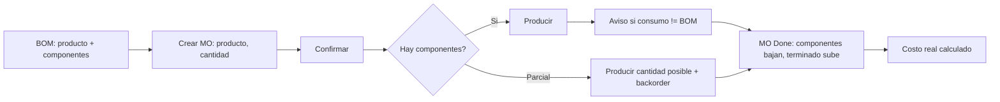
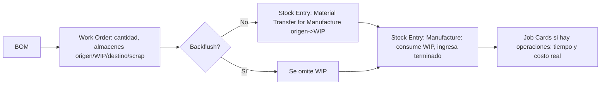
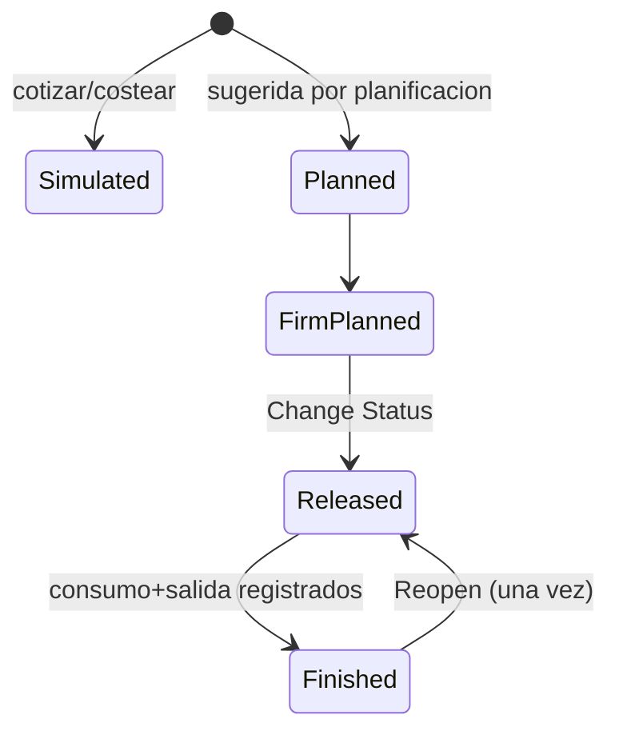

# Benchmark de módulos de manufactura ERP para un módulo de Producción simple (Bendey ERP)

Fecha de investigación: 13-oct-2026. Investigador: agente de producto (Claude).

## Convenciones de este documento

- **[VERIFICADO]**: lo leí directamente en una página que abrí con WebFetch (documentación oficial, ayuda del proveedor o hilo de foro). Está parafraseado.
- **[BÚSQUEDA]**: dato que solo vi en el resumen de un resultado de búsqueda, sin abrir la página. Es menos fiable; se marca siempre.
- **[INTERPRETACIÓN]**: conclusión o recomendación mía, no un hecho de la fuente.
- **[NO PUDE VERIFICAR]**: lo busqué y no lo encontré, o la página no lo cubría.
- Sección 9 lista las fuentes. Separé "abiertas" de "solo vistas en resultados de búsqueda". Ninguna fuente de la primera lista se cita sin haberla abierto.

Limitaciones honestas: las páginas se leen a través de un modelo que resume, así que los detalles finos (nombres exactos de campos, estados) pueden faltar; cuando una página no los cubría lo digo. La doc de Odoo 18 para varias páginas daba 404 con URL adivinada; usé las versiones 19.0/master/saas-19.4 cuando fue lo que pude abrir (la versión está indicada en cada enlace).

---

## 1. Resumen ejecutivo

**Patrón común [VERIFICADO en los 3 sistemas grandes + Katana/MRPeasy]**:
`Artículo terminado + Lista de materiales (BOM/receta) → Orden de producción (cantidad, fecha) → disponibilidad de componentes → consumo de componentes (manual o automático) → registro de producto terminado (total o parcial) → stock actualizado (componentes bajan, terminado sube) → costo real calculado`.

**Diferencias clave**:
1. **Cuándo se descuenta la materia prima**: Odoo exige confirmar consumo al producir (con aviso si no coincide con la BOM); ERPNext separa "transferir a WIP" y "fabricar" (dos movimientos de stock) pero permite saltarse el WIP (backflush); Business Central ofrece Manual / Forward (al liberar) / Backward (al terminar) por artículo; Katana descuenta al completar usando cantidades reales editables.
2. **Estados de la orden**: BC tiene 5 explícitos (Simulada, Planificada, Firme, Liberada, Terminada) porque separa planificación de ejecución. Los sistemas pyme reducen a "no iniciada / en curso / terminada".
3. **Merma**: Odoo no tiene % de merma en la BOM en la página de BOM que leí (la merma se registra como "scrap" a ubicación virtual); ERPNext tiene % de merma por línea y "process loss" en el producto terminado; BC tiene Scrap % por línea de BOM y por operación, más códigos de merma.
4. **Complejidad**: BC y ERPNext modelan WIP, centros de trabajo, rutas y costeo estándar; MRPeasy/Katana se concentran en BOM + ruta + programación; Business Central incluso separa "Assembly BOM" (ensamble simple) de "Production BOM" (con rutas).

**Conclusión [INTERPRETACIÓN]**: para pymes peruanas (el caso típico de Bendey: panadería, confección, carpintería, ensamblados), el valor está en BOM simple + orden de producción con 3 estados + consumo automático editable + producción parcial + merma registrada + costo real por orden. Rutas, centros de trabajo, MRP completo, WIP contable y variantes complejas deben quedar fuera del MVP.

---

## 2. Sistemas elegidos y por qué

| Sistema | Por qué |
|---|---|
| **Odoo Manufacturing** | Pedido explícito; referencia de UX para pymes; docs oficiales muy completas; tiene modo simple (solo MO + BOM) y avanzado (work orders). |
| **ERPNext** | Pedido explícito; open source; modela claramente el flujo de dos movimientos de stock (transferir a WIP, fabricar) y el backflush. |
| **Dynamics 365 Business Central** | Pedido explícito; referencia de rigor: estados, métodos de "flushing", costeo estándar vs real, separación Assembly/Production. |
| **Katana MRP** | Elegido por ser un producto pyme moderno, orientado a talleres/ecommerce, cuyo flujo es el más cercano a un MVP simple (MO + ingredientes + operaciones + batch). |
| **MRPeasy** | Elegido como contraste pyme: BOM + ruta + estaciones con programación automática; útil para saber qué NO copiar en v1. |
| Dolibarr MRP | Intenté usarlo (open source, pyme) pero **la wiki oficial solo trae una página de activación del módulo, sin flujo** [VERIFICADO]. Queda fuera del análisis comparativo por falta de documentación verificable. |

No cubrí Zoho, NetSuite, SAP B1, Fishbowl, Xero ni QuickBooks: **no los investigué** (tiempo/alcance), por lo que no hay afirmaciones sobre ellos.

---

## 3. Ficha por sistema

### 3.1 Odoo Manufacturing

**1-2. Definición de materiales y listas (BOM) [VERIFICADO]** (doc BOM 18.0)
- Se crea en Manufacturing > Products > Bills of Materials. Tipo "Manufacture this Product" (los kits tienen otra página que no abrí).
- Pestaña Components: una línea por componente. Columnas opcionales: *Apply on Variants* (limita el componente a ciertas variantes), *Consumed in Operation*, *Manual Consumption* (el operario debe confirmar).
- Operaciones solo si se activa el ajuste Work Orders: operación + centro de trabajo + duración (manual o calculada de órdenes pasadas).
- Pestaña Miscellaneous: *Manufacturing readiness* (empezar cuando haya los componentes de la primera operación o todos), *Flexible consumption* (bloqueado / permitido / permitido con aviso), lead time.
- By-products: se activa por ajuste; líneas con producto, cantidad y UdM.
- La página de BOM **no cubre** porcentaje de merma.

**3. Órdenes de producción (estados) [VERIFICADO parcial]**
- Crear: Manufacturing > Operations > Manufacturing Orders > New; elegir producto y la BOM se carga sola con componentes y órdenes de trabajo; se confirma la orden (doc one-step 18.0 y saas-19.4).
- **Lista exacta de estados NO PUDE VERIFICARla en la doc**. Los resultados de búsqueda y foros mencionan Draft / Confirmed / In Progress / To Close / Done, pero el hilo que lo menciona es de Odoo 14 y no confirma 18 [BÚSQUEDA / NO PUDE VERIFICAR].

**4. Planificación de cantidades [VERIFICADO]**
- Cantidad en la MO. Reabastecimiento: reglas de reorden (mín/máx, genera MO con ruta Manufacture) o MTO (genera MO al confirmar una venta, aunque haya stock) (doc MTO 19.0; el resto de la página quedó sin leer, >100.000 caracteres).

**5. Disponibilidad [VERIFICADO parcial]**
- La BOM controla "readiness" (primera operación vs todos los componentes). La página de MO que abrí no cubría la vista de disponibilidad por estados.

**6. Consumo [VERIFICADO]**
- Se marcan componentes como consumidos; con *Manual Consumption* se exige confirmación. Si producís menos o consumís distinto, aparece un aviso: mantener lo consumido o actualizar cantidades al producido.

**7. Producción parcial y backorders [VERIFICADO]** (doc backorders master/18.0)
- Se ingresa la cantidad que se puede producir hoy, se pulsa Produce, se elige "crear backorder"; la MO se divide en dos: la primera cubre lo hecho y se cierra, la segunda queda abierta para el resto (referencia con sufijo "-002").

**8. Mermas [VERIFICADO]** (scrap 19.0)
- Scrap manual desde la MO: componentes mientras está en Draft/Confirmed; producto terminado solo cuando la MO está Done. Va a una ubicación virtual "Scrap"; opcional "reponer cantidades scrapeadas" (solo en 2 o 3 pasos). Un botón "Scraps" lista los scrap de la MO.
- Hilo de foro (Odoo 18): alguien pidió scrap automático por % al cerrar la MO; las respuestas apuntaban a docs de by-products y scrap sin dar solución automática; el autor dijo que solo eran manuales [VERIFICADO el contenido del hilo; es experiencia de un usuario, no prueba de que sea imposible].
- Hilo de Odoo 12 citado en una búsqueda: scrap en work order no genera demanda de reposición [BÚSQUEDA, versión antigua, no relevante como hecho actual].
- **Unbuild**: desarmar un producto terminado devuelve componentes según BOM y baja el terminado; advierte si no hay stock; componentes dañados se retiran con scrap [VERIFICADO] (unbuild 19.0).

**9. Costos estimados vs reales [VERIFICADO]** (MO costs 18.0, production analysis 19.0)
- Costo MO esperado: componentes (costo medio de compra) + operaciones (tarifa hora del centro × duración) + empleados. Al terminar la MO se actualiza al real. Reporte Production Analysis: costo/unidad, costo componentes, operación, empleados, subcontratación, by-products, cantidad demandada vs producida, % rendimiento (yield).

**10. Movimientos y valoración [VERIFICADO parcial]**
- En manufactura de 1 paso no se crean transferencias de componentes ni de terminado; el inventario cambia igual (one-step 18.0). By-products con *cost share*: según resultados de búsqueda existe desde v15 [BÚSQUEDA, no abrí la página oficial].

**11. Para pedido vs para stock [VERIFICADO]**
- MTO (por venta, con reserva a esa venta) vs reglas de reorden (por nivel de stock, sin vínculo a la venta) (doc MTO/reorden 19.0 vía búsqueda y fetch parcial). Si se cancela la MO no se genera otra.

**12. Variantes [VERIFICADO]** (product variants 18.0)
- Una sola BOM para varias variantes; cada componente/operación/by-product se asigna a variantes; sin asignación aplica a todas. En ventas, la MO lista solo los componentes de la variante vendida.

**13. Operaciones [VERIFICADO]**
- Work orders por operación, con inicio/pausa/hecho y cronómetro; Shop Floor como interfaz de operario. Requiere activar el ajuste Work Orders.

**14. Reportes [VERIFICADO]**: Production Analysis (ver 9).

**Edición Community vs Enterprise [BÚSQUEDA]**: blogs de socios indican que MOs, BOMs, rutas y work orders están en ambas, y PLM (control de cambios) y algunas herramientas de piso son solo Enterprise; datos de versiones antiguas (v10 a v18), verificar [NO PUDE VERIFICAR en doc oficial].

**Ejemplo end-to-end (usuario vs sistema)**: el usuario crea BOM (componentes + cantidades), crea MO eligiendo producto y cantidad y confirma. El sistema carga componentes y operaciones de la BOM, reserva stock, y al pulsar Produce descuenta componentes, ingresa terminado, avisa diferencias, divide en backorder si fue parcial y actualiza el costo al real.

---

### 3.2 ERPNext Manufacturing

**1-2. BOM [VERIFICADO]** (BOM doc)
- Campos: ítem y cantidad producida, tabla de ítems (cantidad, operación, BOM propia si es sub-ensamble, almacén origen, **% de merma esperada por línea**), *With Operations*, *Transfer Material Against* (Work Order o Job Card), *Consume Components Based On* (BOM o lo transferido).
- Flags: Is Active, Is Default, Inspection Required, Allow Alternative Item, Phantom BOM, Do Not Explode (por línea).
- Cantidades por porcentaje (deben sumar 100%, un ítem "balance").
- Una BOM enviada no se edita: se cancela, duplica y reenvía [VERIFICADO].
- Multinivel: tabla explotada (todas las materias primas) vs no explotada.

**3. Orden de producción (Work Order) [VERIFICADO]** (work order doc)
- Se crea con ítem, BOM (por defecto), cantidad, fecha de inicio planificada, y almacenes: **origen, WIP, destino y scrap**. Se puede guardar borrador sin almacenes, pero son obligatorios para enviar.
- La lista completa de estados **no está en la página** (solo Stopped y estados de operación Pending / Work In Progress / Completed) [NO PUDE VERIFICAR la lista completa].
- Se puede detener solo si no hay material en WIP.

**4. Planificación [VERIFICADO]** (Production Plan doc)
- Production Plan: toma Órdenes de Venta o Solicitudes de Material, solo ítems con BOM; calcula materia prima neta (resta stock y entrante); sub-ensambles con tipo de fabricación (Work Order, subcontrato o compra); desde el plan se generan Work Orders y Material Requests.

**5. Disponibilidad**: tabla Required Items con almacenes origen editables; el Production Plan resta stock existente [VERIFICADO]. Cálculo de disponibilidad por orden no cubierto en la página.

**6. Consumo [VERIFICADO]** (work order, settings, material consumption docs)
- Flujo estándar de 2 pasos: *Material Transfer for Manufacture* (origen → WIP, en cantidades parciales si se quiere) y luego *Manufacture* (consume desde WIP, ingresa terminado).
- Alternativas: *Skip Material Transfer* y *Backflush Raw Materials from WIP*: crea la entrada Manufacture directamente descontando del origen.
- Ajuste global: backflush basado en BOM o en lo transferido.
- *Material Consumption* (opcional): varias entradas de consumo contra una orden, para productos de producción larga. Entradas no cancelables tras completar la orden.
- Devolver sobrante de WIP: *Return Components*.

**7. Parcial [VERIFICADO]**: se puede finalizar (Finish) con cantidad parcial; Consumed Qty se actualiza. *Overproduction %* limita cuánto se puede exceder lo planificado.

**8. Mermas [VERIFICADO]** (BOM doc, job card doc)
- Merma esperada en cada línea de la BOM; tabla de scrap items (con tarifa si es vendible). Si el ítem de scrap es el mismo que el producido, se trata como **process loss** y se resta de la salida. En v16 la tabla se reemplaza por "Secondary Items".
- Job Card: antes de v16 la cantidad no completada se contaba como process loss y bloqueaba enviar parciales; v16 agrega *Pending Qty* para evitarlo.

**9. Costos [VERIFICADO]**
- BOM: costo aproximado = materiales (según Valuation Rate, Last Purchase Rate o Price List) + operaciones. Botón *Update Cost*.
- Work Order: costo operativo planificado (de BOM), real (de Job Cards), adicional (manual) y total.

**10. Movimientos [VERIFICADO]**: dos Stock Entries (transferencia a WIP, Manufacture); almacén WIP intermedio; en backflush se omite el WIP.

**11. Para pedido vs stock**: Work Order manual, desde Sales Order o desde Production Plan [VERIFICADO]. Reglas de reorden/MRP no abiertas.

**12. Variantes [VERIFICADO]**: BOM de plantilla (template) y BOM de variante creada desde la plantilla; un componente plantilla permite elegir la variante.

**13. Operaciones [VERIFICADO]**: operaciones y estaciones de trabajo, Job Cards (una por operación) con time logs y cantidad completada; planificación de capacidad serial desde la fecha de inicio (ventana de 30 días por defecto).

**14. Reportes**: informe *Work Order Consumed Materials* mencionado [VERIFICADO]; otros no abiertos.

**Dificultades documentadas [VERIFICADO el hilo; interpretación aparte]**: en el foro de Frappe (hilo iniciado dic-2018, ERPNext v11), un usuario de microcervecería reportó que con backflush "según material transferido" la entrada Manufacture sugería las cantidades de la BOM en vez de lo transferido; usuarios posteriores (v12, v13, v14, hasta 2023) dijeron tener el mismo comportamiento y **el hilo no contiene una solución confirmada**. Eso es evidencia de un problema reportado repetidamente, no prueba de que persista hoy; la doc actual describe *Material Consumption* como camino previsto [BÚSQUEDA para la parte de "si está corregido"].

**Ejemplo end-to-end**: el usuario define BOM y almacenes, crea Work Order, transfiere materiales (total o por tandas), pulsa Finish con la cantidad hecha. El sistema calcula materia prima requerida, crea las Stock Entries, programa operaciones y calcula costo planificado vs real.

---

### 3.3 Microsoft Dynamics 365 Business Central

**1-2. BOMs: Assembly vs Production [VERIFICADO / BÚSQUEDA]**
- Production BOM [VERIFICADO] (doc production BOMs): "recetas" con cantidad por unidad, **Scrap % por línea** (se suma a la cantidad esperada de consumo), código de ruta (vincula componente a operación), fórmula de cantidad (largo, ancho, peso, cantidad fija), BOM fantasma (phantom), **versiones** con fecha de inicio, y estado Nuevo / En desarrollo / **Certificado** (debe estar certificada para usarse en producción o planificación). Costo unitario solo se calcula si padre y componentes usan costeo *Standard*.
- Assembly BOM vs Production BOM: la distinción (ensamble simple, pocos o ningún recurso, ligado a ventas; vs producción con rutas y centros) está confirmada en la doc de Assembly Management que abrí ("combinar componentes en procesos simples sin usar características de manufactura") [VERIFICADO], y el detalle comparativo lo vi en un resumen de búsqueda de las páginas inventory-how-work-boms y assembly-how-work-assembly-boms, que **no abrí** [BÚSQUEDA].

**3. Estados [VERIFICADO]** (about production orders)
- Simulated (what-if para cotizar/costear; MRP no la considera), Planned (sugerida por planificación; se borra en la siguiente corrida), Firm Planned (placeholder que no se borra), Released (ejecución: se registra consumo y producción; solo aquí aplica el flushing automático), Finished (completa el ciclo de costos).
- El estado no se edita a mano: se usa la acción *Change Status*. Una orden Finished se puede **reabrir una sola vez**.

**4. Planificación [VERIFICADO]**: órdenes por Planning Worksheet, Order Planning o Sales Order Planning (quedan reservadas y rastreadas a la demanda); creación manual con Source Type (Item, Family, Sales Header), cantidad y fecha de vencimiento; fechas de inicio/fin calculadas desde la ruta (create production orders).

**6. Consumo: métodos de flushing [VERIFICADO]** (flush components + about production orders)
- *Manual*: diario de consumo. *Forward*: se consume lo esperado al **liberar** la orden. *Backward*: se consume al **terminar**, según lo realmente producido. Con *routing link codes*, el consumo se dispara por operación (forward al iniciarla; backward según salida registrada de esa operación).
- Se pueden mezclar métodos (p. ej. forward para tornillos, manual para scrap o artículos caros). El método se copia del artículo al refrescar la orden y se puede cambiar por componente en la orden.
- Desventaja documentada del flushing automático: puede no registrarse con exactitud la merma.

**7. Salida y finalización [VERIFICADO]** (output journal)
- *Output journal* o *Production journal*: registra cantidades, merma, tiempos de preparación y ejecución por operación; el inventario del terminado solo sube cuando se registra salida de la **última operación**; marcar "Finished" cierra la operación.

**8. Merma [VERIFICADO]**: Scrap % por línea de BOM (componentes) y por operación de la ruta (salida); *Scrap codes* (causas) y *Stop codes* (paradas) en el diario de salida; la merma se postea como ajuste negativo en el libro de artículos.

**9. Costos [VERIFICADO]** (finished production order costs)
- La orden Finished junta costo real de materiales, capacidad, subcontratación y overhead. Con costeo estándar, WIP sube con consumo y baja con el costo estándar del producido; la diferencia (variación) se concilia con el trabajo por lotes *Adjust Cost - Item Entries*, que solo considera órdenes **Finished**.

**10. Movimientos [VERIFICADO]**: consumo = entradas de artículo negativas; salida = positivas; tiempos = entradas de capacidad. Valoración se genera en paralelo conforme avanza la orden (según la doc de flushing).

**By-products [VERIFICADO]**: BC **no tiene función dedicada**; se registran con consumo negativo en el diario, acreditando WIP (reduce el costo del principal); se recomienda costeo Standard para estabilidad.

**11. Para pedido vs stock [VERIFICADO]**: órdenes desde Sales Order Planning (MTO); Assemble-to-Order vs Assemble-to-Stock en ensamble.

**12. Variantes**: la doc enlaza gestión de variantes; **no la abrí** [NO PUDE VERIFICAR el detalle].

**13. Operaciones [VERIFICADO]**: rutas, centros de trabajo y de máquina, *Explode Routing* para generar líneas por operación.

**14. Reportes**: estadísticas y listas de órdenes, Power BI de lista de órdenes (títulos vistos en búsqueda) [BÚSQUEDA]. Reglas fuertes: el estado Finished es el que habilita el costeo.

**Limitaciones comentadas [BÚSQUEDA, blogs de consultoras que venden complementos; tratar como opinión]**: programación estándar con capacidad infinita (empieza "en el pasado"); el backflush no asigna lotes/series automáticamente; sustituciones a mitad de orden no actualizan la lógica de flushing.

**Ejemplo end-to-end**: el usuario crea artículo + Production BOM certificada + ruta; crea orden Firm Planned (fuente: artículo o pedido de venta, cantidad, fecha), la libera; el sistema calcula componentes y fechas, hace forward flush si está configurado, el usuario registra salida (y merma) en el diario, y al terminar pasa a Finished y el batch de ajuste de costos concilia WIP.

---

### 3.4 Katana MRP [VERIFICADO parcial: solo la página "Completing a manufacturing order"]

- **MO**: estados incluyen Not started, In progress, Partially done, Done (los dos primeros y el reverso surgen del texto de la ayuda; la lista oficial completa no la pude verificar).
- **Completar**: manual (marcar Done) o automático al terminar todas las operaciones (no si hay trazabilidad por lote).
- **Parcial**: se puede completar por partes, cada una con su asignación de lote.
- **Cantidades reales**: el usuario puede editar cantidad real consumida en la tabla de Ingredientes (o registrarla en la app de piso). Si producido real ≠ planificado, aparece un cuadro para confirmar y ajustar.
- **Stock**: el terminado sube por lo realmente producido, baja la cantidad "esperada" por lo planificado, componentes bajan según uso real, y **la merma o sobreconsumo queda registrada**.
- **Revertir**: una MO terminada puede volver a estado anterior y se revierten los movimientos de inventario.
- **Costos**: la página **no cubre costos** [NO PUDE VERIFICAR].

### 3.5 MRPeasy [VERIFICADO parcial: video/páginas de configuración y planificación]

- Orden de configuración: estaciones de trabajo (capacidad, tarifa hora) → artículos → BOM → ruta (operaciones con tiempos, orden y estación).
- MO: cabecera (producto, cantidad, duración, costos, estado), partes (materiales con disponibilidad, se pueden agregar/ajustar/devolver sobrante), operaciones (estación, trabajadores, tiempos planificados y reportados), notas, vínculos a pedidos de cliente.
- Programación automática **forward** por defecto (primer hueco libre); backward desde edición Enterprise.
- Make-to-stock: manual, desde alertas de stock crítico (punto de reorden), pronósticos o MPS; make-to-order: desde líneas de pedido.
- Cambios en BOM o ruta **no se propagan** a MOs existentes; solo se replanifican las no iniciadas.
- Con trazabilidad por lotes activada, hay que reservar ("book") materiales por lote antes de consumirlos; sin trazabilidad no es necesario.
- Cierre: "Finish production as planned" usa tiempos planificados y materiales reservados.
- Lista exacta de estados: **no la pude verificar**.

### 3.6 Dolibarr [NO PUDE VERIFICAR]
La wiki oficial (Module BOM, Module Manufacturing Orders) solo explica que los módulos vienen incluidos, que MO requiere BOM y cómo activarlos; no documenta flujo. El campo ID del módulo BOM es 650. No hay más datos fiables en esta investigación.

---

## 4. MATRIZ COMPARATIVA (proceso × sistema)

Leyenda: **C** = común (lo hacen casi todos); **A** = avanzado; **V** = lo vi verificado; **B** = solo búsqueda; **?** = no verificado.

| # | Proceso | Odoo | ERPNext | Business Central | Katana / MRPeasy | Común/Avanzado | Ventajas | Complejidad |
|---|---|---|---|---|---|---|---|---|
| 1 | Definición de BOM | BOM por producto, tipo Manufacture, componentes con variantes y operación (V) | BOM con merma %, defecto, activa, fantasma, % cantidad (V) | Production BOM certificable, con versiones por fecha y fórmulas (V) | Receta/BOM por artículo (V Katana MRPeasy, detalles ?) | C | Reutilizar receta | Baja a media |
| 2 | Listas / multinivel | Multinivel, kits, fantasma (V parcial) | Explotada y no explotada, Do Not Explode (V) | Phantom anidable (V) | MRPeasy: subensamble con su BOM y ruta, sin límite de niveles (V) | C (multinivel) / A (fantasma) | Sub-ensambles | Media |
| 3 | Estados de la orden | Lista exacta ? (B) | Solo Stopped y estados de operación en la página (V) | 5 estados explícitos (V) | Katana: no iniciada/en curso/parcial/terminada (V parcial) | C: pocos estados | Control de lo que se puede editar | BC alta, otros baja |
| 4 | Planificación de cantidades | Cantidad en MO; reglas de reorden, MTO (V) | Production Plan desde pedidos/solicitudes (V) | Planning Worksheet, MRP, fechas por ruta (V) | MRPeasy: programación automática (V) | C: cantidad manual; A: MRP | MRP evita quiebres | Alta |
| 5 | Disponibilidad | Readiness por operación o total (V) | Requerido por ítem, resta stock (V) | Reserva y seguimiento a demanda (V) | MRPeasy: estado de disponibilidad por parte (V) | C | Evita iniciar sin material | Media |
| 6 | Consumo | Marcar consumido; aviso si difiere de la BOM (V) | Transferir a WIP + Manufacture, o backflush (V) | Manual / Forward / Backward / por operación (V) | Katana: cantidad real editable; MRPeasy: reservar y reportar (V) | C: automático desde BOM + ajuste; A: por operación | Menos captura manual | BC alta |
| 7 | Producción parcial | Backorder: divide la MO (V) | Finish con cantidad parcial; sobreproducción % (V) | Salida por operación; última operación mete stock (V) | Katana parcial por tandas (V) | C | Realismo | Media |
| 8 | Mermas | Scrap manual a ubicación virtual; sin % en BOM leída; unbuild (V) | % por línea; process loss; secondary items (V) | Scrap % en BOM y ruta; códigos de causa (V) | Katana registra waste/overuse (V) | C: registrar; A: % y causas | Trazabilidad de pérdidas | Media |
| 9 | Costo estimado vs real | MO cost estimado → real al cerrar; reporte de análisis (V) | Costo BOM + costo operativo planificado/real/adicional (V) | Estándar vs real, variación, Adjust Cost (V) | Katana: no cubierto (?) | C: estimado y real; A: variaciones y WIP | Margen real | BC alta |
| 10 | Movimientos / valoración | Sin transferencias en 1 paso; valoración según costeo (V parcial) | Stock Entries + almacén WIP (V) | Entradas de artículo/capacidad; WIP; entradas paralelas (V) | Katana: terminado sube, componentes bajan (V) | C: movimientos de stock; A: WIP contable | Trazabilidad | ERPNext/BC media a alta |
| 11 | Para pedido vs stock | MTO vs reglas de reorden (V) | WO desde venta o plan (V) | Planificación desde ventas; ATO/ATS en ensamble (V) | MRPeasy: stock crítico/MPS vs líneas de pedido (V) | C | Reservas a pedido | Media |
| 12 | Variantes | Una BOM con componentes por variante (V) | BOM plantilla + BOM variante (V) | Variantes (doc enlazada, ?) | ? | A | Menos BOMs | Alta |
| 13 | Operaciones/etapas | Work orders y Shop Floor, requiere ajuste (V) | Job Cards, estaciones, capacidad (V) | Rutas, centros de trabajo y máquina, diarios (V) | MRPeasy: ruta con estaciones y Gantt (V) | A | Capacidad y tiempo real | Alta |
| 14 | Reportes | Production Analysis (V) | Consumed Materials report (V parcial) | Estadísticas, Power BI de lista (B) | MRPeasy: calendario y Gantt (V) | C: listado por estado | Seguimiento | Media |

---

## 5. Dificultades y discusiones técnicas (hechos vs experiencias)

**Hechos documentados [VERIFICADO en doc oficial]**
- ERPNext: una BOM enviada no se edita (cancelar y duplicar); antes de v16 el process loss del Job Card bloqueaba parciales (se corrigió con Pending Qty).
- BC: el flushing automático puede ocultar la merma; Backward con ruta consume proporcional a la salida; la orden solo entra a ajuste de costos si está Finished; reabrir solo una vez; BC no tiene función nativa de by-products.
- Odoo: scrap de terminado solo con MO Done; scrap manual; unbuild advierte con stock cero.
- MRPeasy: cambios en BOM/ruta no se propagan a MOs existentes.
- Katana: la trazabilidad por lote impide el cierre automático.

**Experiencias individuales [VERIFICADO que existen, no son prueba general]**
- Foro Frappe: el backflush "según lo transferido" sugiere cantidades de BOM; reportado de v11 a v14 sin solución confirmada en el hilo.
- Foro Odoo 18: pedido de scrap automático por %, sin respuesta que lo resuelva.

**Solo en resultados de búsqueda [BÚSQUEDA, no abierto]**: consultoras de BC (programación sin capacidad, lotes en backflush); blogs de socios Odoo sobre Community vs Enterprise.

---

## 6. Qué adaptar a Bendey [INTERPRETACIÓN / RECOMENDACIÓN]

1. **BOM simple por producto terminado** con componentes (insumo, cantidad por unidad, UdM), **% de merma por línea** (ERPNext/BC) y opcional nombre/versión. Congelar la BOM aplicada en la orden (copia a la orden al crearla), como hacen Odoo y BC, para que cambios posteriores no alteren órdenes en curso; MRPeasy lo confirma como comportamiento (cambios no se propagan).
2. **Orden de producción con 3 a 4 estados**: Borrador, En proceso, Terminada, Anulada (simplificación del patrón BC/Katana). Edición de componentes solo hasta que sea Terminada.
3. **Consumo automático al terminar (backflush) con cantidades reales editables**, tomando el modelo de Katana y la opción *Consume based on BOM* de ERPNext; mostrar aviso si real ≠ BOM como Odoo.
4. **Producción parcial**: registrar cantidades producidas en varias entradas contra una misma orden (modelo ERPNext/Katana) en vez de dividir la orden en backorders (Odoo); es más simple de implementar y de entender. Esta es una decisión de diseño mía, no consenso de los sistemas.
5. **Merma como movimiento propio** (componentes perdidos y terminados defectuosos), con motivo (catálogo corto, tomado de los *scrap codes* de BC) y reporte.
6. **Costo estimado y real por orden**: estimado = suma de costo de insumos de la BOM (con merma); real = insumos realmente consumidos + otros costos (mano de obra / indirectos opcionales manuales, como el "Additional Operating Cost" de ERPNext); el costo unitario del terminado = costo total / cantidad buena.
7. **Disponibilidad**: semáforo por componente al crear/iniciar la orden (suficiente / parcial / falta), por almacén/sucursal según el modelo multi-sucursal de Bendey.
8. **Producción por pedido y para stock**: botón "Producir" desde una venta o cotización sin stock (equivalente MTO), y creación manual para stock. Sin reglas de reorden en v1.
9. **Movimientos de inventario** ligados a la orden (salida de insumos y entrada de terminado), reutilizando el kardex existente; **anular** debe revertirlos (Katana permite revertir; BC permite reabrir una vez).
10. **Reporte básico**: lista de órdenes por estado, consumo real vs BOM (variación), merma por motivo, costo por unidad.

## 7. Qué NO incluir en la primera versión [INTERPRETACIÓN]

- Rutas, centros de trabajo, estaciones, capacidad, Gantt, tiempos de preparación/ejecución, Job Cards, Shop Floor (alto costo y valor bajo para pymes que fabrican por lotes simples; todos los sistemas lo marcan como opcional).
- MRP / planificación automática, MPS, reglas de reorden, Production Plan.
- Subcontratación / maquila.
- Almacén WIP con contabilidad de trabajo en proceso y variaciones contables (BC, ERPNext); costeo estándar con ajuste por lotes.
- Variantes en BOM (una BOM por variante, es decir, un producto = una receta, basta en v1).
- By-products y co-productos con reparto de costos, fantasma/phantom, versiones de BOM con vigencia, control de cambios (PLM), BOM por porcentajes.
- Trazabilidad por lote/serie en producción (Katana, MRPeasy y BC muestran que complica cierre y flushing).
- Unbuild / desarme, inspecciones de calidad.

## 8. Puntos abiertos [NO PUDE VERIFICAR]
- Lista oficial de estados de MO en Odoo 18; lista completa de estados del Work Order en ERPNext; estados exactos de Katana y MRPeasy.
- Costeo de Katana; flujo de Dolibarr; detalles de variantes en BC.
- Documentación sobre cómo Odoo valora la diferencia entre consumo planificado y real (la búsqueda solo devolvió módulos de terceros).
- Edición Community vs Enterprise de Odoo según doc oficial actual.

---

## 9. Fuentes

### 9.1 Páginas que ABRÍ con WebFetch (consultadas)

**Odoo**
- BOM (18.0): https://www.odoo.com/documentation/18.0/applications/inventory_and_mrp/manufacturing/basic_setup/bill_configuration.html
- Backorders (master): https://www.odoo.com/documentation/master/applications/inventory_and_mrp/manufacturing/workflows/manufacturing_backorders.html
- Scrap en manufactura (19.0): https://www.odoo.com/documentation/19.0/applications/inventory_and_mrp/manufacturing/workflows/scrap_manufacturing.html
- Unbuild (19.0): https://www.odoo.com/documentation/19.0/applications/inventory_and_mrp/manufacturing/workflows/unbuild_orders.html
- MTO (19.0, lectura parcial): https://www.odoo.com/documentation/19.0/applications/inventory_and_mrp/inventory/warehouses_storage/replenishment/mto.html
- Production Analysis (19.0): https://www.odoo.com/documentation/19.0/applications/inventory_and_mrp/manufacturing/reporting/production_analysis.html
- Costos de MO (18.0): https://www.odoo.com/documentation/18.0/applications/inventory_and_mrp/manufacturing/basic_setup/mo_costs.html
- Variantes en BOM (18.0): https://www.odoo.com/documentation/18.0/applications/inventory_and_mrp/manufacturing/advanced_configuration/product_variants.html
- Manufactura de un paso (18.0): https://www.odoo.com/documentation/18.0/applications/inventory_and_mrp/manufacturing/basic_setup/one_step_manufacturing.html
- MO y work orders (saas-19.4, lectura parcial): https://www.odoo.com/documentation/saas-19.4/applications/inventory_and_mrp/manufacturing/basic_setup/manufacturing_work_orders.html
- Foro, scrap automático Odoo 18: https://www.odoo.com/forum/help-1/how-to-automatically-scrap-excess-material-after-completing-a-manufacturing-order-in-odoo-18-282315

**ERPNext / Frappe**
- Work Order: https://docs.frappe.io/erpnext/user/manual/en/work-order
- Bill of Materials: https://docs.frappe.io/erpnext/user/manual/en/bill-of-materials
- Production Plan: https://docs.frappe.io/erpnext/user/manual/en/production-plan
- Job Card: https://docs.frappe.io/erpnext/user/manual/en/job-card
- Manufacturing Settings: https://docs.frappe.io/erpnext/user/manual/en/manufacturing-settings
- Material Consumption: https://docs.frappe.io/erpnext/user/manual/en/material_consumption
- Foro, backflush v11: https://discuss.frappe.io/t/version-11-backflushing-raw-materials-based-on-material-transfer-bug/43922

**Business Central (Microsoft Learn)**
- Create production orders: https://learn.microsoft.com/en-us/dynamics365/business-central/production-how-to-create-production-orders
- About production orders: https://learn.microsoft.com/en-us/dynamics365/business-central/production-about-production-orders
- Flush components according to operation output: https://learn.microsoft.com/en-us/dynamics365/business-central/production-how-to-flush-components-according-to-operation-output
- About finished production order costs: https://learn.microsoft.com/en-us/dynamics365/business-central/finance-about-finished-production-order-costs
- Batch post output and run times: https://learn.microsoft.com/en-us/dynamics365/business-central/production-how-to-post-output-quantity
- Assembly Management: https://learn.microsoft.com/en-us/dynamics365/business-central/assembly-assemble-items
- Create production BOMs: https://learn.microsoft.com/en-us/dynamics365/business-central/production-how-to-create-production-boms

**Katana, MRPeasy, Dolibarr**
- Katana, completing a manufacturing order: https://support.katanamrp.com/en/articles/5914331-completing-a-manufacturing-order
- MRPeasy, setup of items, BOMs, routings, workstations: https://mrpeasy.com/setting-up-manufactured-items-boms-routings-workstations
- MRPeasy, production planning: https://www.mrpeasy.com/?p=4178
- Dolibarr, Module Manufacturing Orders: https://wiki.dolibarr.org/index.php/Module_Manufacturing_Orders
- Dolibarr, Module BOM: https://wiki.dolibarr.org/index.php/Module_BOM

### 9.2 Solo vistas en RESULTADOS DE BÚSQUEDA (no abiertas; datos marcados [BÚSQUEDA])
- BC, BOMs: https://learn.microsoft.com/en-us/dynamics365/business-central/inventory-how-work-boms
- BC, assembly BOMs: https://learn.microsoft.com/en-us/dynamics365/business-central/assembly-how-work-assembly-boms
- Blog Cybrosys, Odoo 18 community vs enterprise: https://www.cybrosys.com/blog/what-are-the-differences-between-odoo-18-community-and-enterprise-in-manufacturing
- Foro de Odoo sobre by-product cost share: https://www.odoo.com/forum/help-1/how-to-distribute-the-cost-of-the-manufacturing-order-on-by-product-158554
- ArcherPoint, scrap en BC: https://archerpoint.com/handling-scrap-in-production-orders-in-business-central/
- Dev.to InsightWorks, flushing en BC: https://dev.to/insight_works/mastering-flushing-in-business-central-getting-consumption-right-for-every-operation-l2i
- Dev.to InsightWorks, scheduling en BC: https://dev.to/insight_works/why-business-centrals-standard-scheduling-isnt-enough-for-complex-production-planning-4212
- Katana, batches en MO: https://support.katanamrp.com/en/articles/642-selecting-ingredients-from-batches-on-manufacturing-orders
