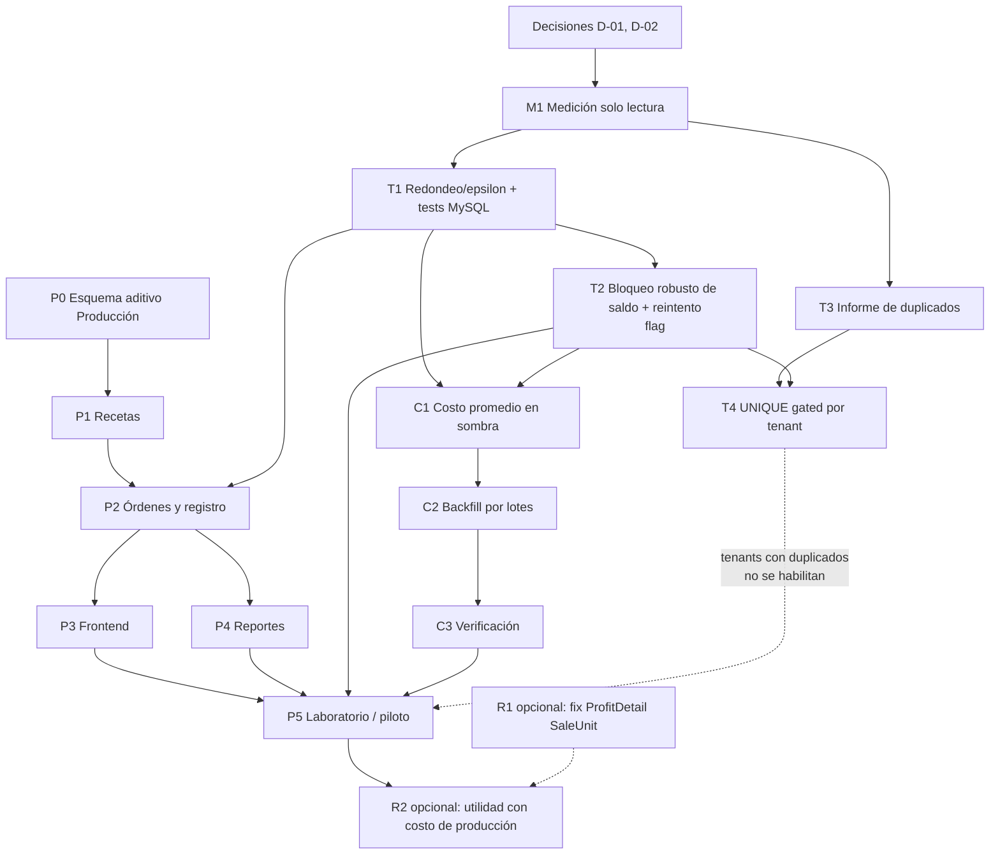

# Roadmap revisado — Módulo de Producción de Bendey ERP

> **Errata (auditoría 3, 2026-10-13)** — este roadmap queda reemplazado por [PRODUCTION-ROADMAP-DECOUPLED-REVISED.md](PRODUCTION-ROADMAP-DECOUPLED-REVISED.md) (11 etapas). La afirmación de que el módulo queda apagado por `Implemented:false` es incorrecta: solo lo oculta del catálogo de sesión.
> Detalle y evidencia: [PRODUCTION-ARCHITECTURE-DECISION-RECORD.md](PRODUCTION-ARCHITECTURE-DECISION-RECORD.md) §2 y [PRODUCTION-ARCHITECTURE-OPTIONS-AUDIT.md](PRODUCTION-ARCHITECTURE-OPTIONS-AUDIT.md) §2. El texto original se conserva.

> **PLAN PARA APROBACIÓN. No se ha implementado ni desplegado nada.** Reemplaza al [roadmap original](PRODUCTION-IMPLEMENTATION-ROADMAP.md) (conservado como evidencia). Base: [revisión crítica](PRODUCTION-FINAL-CRITICAL-REVIEW.md), [decisiones](PRODUCTION-FINAL-DECISIONS.md) y [alcance candidato](PRODUCTION-APPROVED-SCOPE-CANDIDATE.md).
> Regla transversal: **cada acceso a producción, migración o despliegue necesita autorización expresa y específica.** Aprobar este plan no la otorga.

## 1. Qué cambia respecto al roadmap anterior
- La «Fase 0» única se separa en **cuatro pistas independientes** (transversal de inventario, costos, producción, reportes opcionales) que se pueden probar y desplegar por separado.
- Antes de cualquier endurecimiento hay una **fase de medición de solo lectura** (requiere D-01).
- Cada entrega transversal tiene **flag de activación, canary, métricas de observación y reversión** definidos.
- El módulo de Producción queda **sin asignar a ningún plan** hasta el piloto: su despliegue no lo habilita para ningún tenant.
- Numeración de migraciones: se asigna al implementar (la última del repo es V160); aquí se fija **orden y dependencias**, no números.

## 2. Separación explícita de tipos de trabajo

| Tipo | Elementos |
|---|---|
| **Correcciones transversales del ERP** (afectan ventas, compras, traslados) | T1 redondeo/epsilon · T2 bloqueo robusto de saldo · T3 informe y conciliación de duplicados · T4 UNIQUE en stock · T5 (opcional) `Transfer()` atómico |
| **Costos** (aditivo, en sombra) | C1 columnas de costo promedio y actualización dentro de `RecordMovementTx` · C2 backfill por lotes · C3 verificación contra `WeightedAverageUnitCosts` |
| **Funcionalidad específica de Producción** | P0 esquema aditivo + tipo de operación + permisos + flag de módulo · P1 recetas · P2 órdenes y registro · P3 frontend · P4 reportes · P5 laboratorio y piloto |
| **Cambios opcionales a reportes existentes** | R1 corregir `ProfitDetail` con SaleUnit (D-09) · R2 ventas usan costo de producción (D-03b) |
| **Validación contable** (no la hace el equipo técnico) | Base sin IGV (D-04) · merma/defectuosas (D-05) · código SUNAT (D-06) |
| **Verificaciones que necesitan acceso a producción** | M1 medición de solo lectura (consultas del [Anexo B](PRODUCTION-FINAL-REVIEW-ANNEX-B-CODE-VERIFICATION.md)) · M2 versión de esquema aplicada por tenant · M3 `sql_mode`, aislamiento, `DB_TENANT_MAX_OPEN` reales |
| **Despliegues que necesitan autorización** | Cada release de T/C/P y cada `migrate-fleet` |

## 3. Visión general y dependencias

**Dependencias técnicas clave:** (1) P2 necesita T1 (consumos decimales pequeños). (2) **Producción no se habilita en un tenant de producción hasta que T2 esté activo y T4 aplicado (o el tenant verificado sin duplicados).** (3) C1 usa el mismo punto de entrada que T2: mismo cambio de `RecordMovementTx`, por eso se hacen en ese orden. (4) P0 es independiente de T/C: son columnas y tablas nuevas.

## 4. Fases

### Fase M — Medición (solo lectura; requiere D-01)
- **Qué:** ejecutar en una muestra de tenants las consultas 1–9 y 11 del Anexo B: duplicados de saldo (producto y presentación), diferencia saldo vs. suma de kardex, saltos de `Balance`, movimientos con `unit_cost=0`, productos sin costo, stock negativo, líneas de compra con IGV incluido, `sql_mode`/aislamiento/`max_connections`, versión de esquema.
- **Cómo:** usuario de solo lectura temporal (el existente), túnel temporal, horario valle, sin leer `.env`, consultas pesadas (3c) acotadas por producto/fechas; al terminar, cerrar el túnel y borrar credenciales.
- **Salida:** informe `PRODUCTION-MEASUREMENT-REPORT.md` con tenants afectados.
- **Aceptación:** consultas ejecutadas son exactamente las aprobadas; ningún `INSERT/UPDATE/DELETE`; informe entregado.
- **Riesgo:** carga sobre BD; mitigación: muestra, `LIMIT`, valle. **Sin esta fase no se libera T2/T4 ni se habilita Producción.**

### Pista T — Endurecimiento transversal (requiere D-02; cada entrega con su autorización)

**T1 — Redondeo y pruebas con MySQL (sin esquema).**
- Redondear cantidad y saldo a 3 decimales antes de comparar en `RecordMovementTx`; introducir pruebas de concurrencia con MySQL desechable (`INVENTORY_MYSQL_DSN`, `t.Skip` si falta; nunca producción) que **reproducen** hoy el lost update.
- **Pruebas:** barrido aritmético (consumos exactos de stock con 0.018, 0.0004, 0.125… × n); regresión de Compras/Ventas/Traslados/Documentos de inventario con SQLite y MySQL; test que demuestra el fallo actual (debe fallar antes del cambio, pasar después).
- **Aceptación:** 0 rechazos falsos en el barrido; la suite existente verde; tests de concurrencia ejecutables en CI opcional.
- **Reversión:** revert del commit; sin migración.

**T2 — Bloqueo robusto de saldo (tras M).**
- Cambios: *ensure-row* con `INSERT … ON DUPLICATE KEY` (requiere UNIQUE, ver T4; mientras tanto reintento tolerante) + `SELECT … FOR UPDATE` (o `UPDATE quantity = quantity ± ? WHERE … AND quantity >= ?`); `RecordMovementsTx([]MovementInput)` que ordena por `(sucursal, producto, presentación)`; reintento acotado ante errores 1213/1205; `Transfer()` en una sola transacción (T5, opcional).
- **Flag** `INVENTORY_STRICT_LOCKING` (por entorno y, si es viable, por tenant): apagado = comportamiento actual intacto.
- **Pruebas:** los 3 tests de concurrencia de T1 (saldo final, una sola fila, pares cruzados sin errores no reintentados); regresión completa; prueba de latencia de venta con 15 líneas; prueba con pool pequeño (6 conexiones) para verificar que el lock no agota conexiones.
- **Aceptación:** con flag activo, 0 pérdidas de actualización en 1,000 repeticiones; sin deadlocks no recuperados; p95 de latencia de venta sin degradación >10 %.
- **Observación posterior:** conteo de errores 1213/1205, tasa de «stock insuficiente», tiempos de espera de pool, trabajo de conciliación saldo-kardex (consulta 3) por tenant canary.
- **Reversión:** apagar el flag (el código previo sigue presente).

**T3 — Informe y procedimiento de conciliación (sin cambios de datos).**
- Herramienta de solo lectura que, por tenant, lista duplicados y diferencias saldo/kardex. Procedimiento escrito: revisión humana → script de consolidación **revisable** (suma de saldos en la fila de menor `id`, registro de lo hecho en tabla de auditoría) → aprobación → ejecución por tenant. **Nunca automática.**
- **Aceptación:** el informe reproduce los resultados de M; el script se prueba en copia de datos y es reversible desde la tabla de auditoría.

**T4 — UNIQUE en stock (tras T2 y T3).**
- Migración aditiva que **comprueba duplicados antes de crear el índice**; si hay duplicados, **aborta para ese tenant**, deja registro (no modifica datos) y el tenant queda «sin endurecer».
- «No asumir que idempotente = segura»: antes de desplegar, medir el tiempo de creación del índice sobre una copia con volumen real (`tenant_product_stocks` suele ser pequeña, pero verificarlo); ejecutar por lotes de tenants con pausa; abortar si el tiempo o los bloqueos exceden el umbral.
- **Pruebas:** migración con y sin duplicados (test dedicado), reaplicación, tenant nuevo (baseline).
- **Reversión:** script `DROP INDEX` preparado y probado; no hay cambio de datos que revertir.

### Pista C — Costos en sombra

**C1 — Costo promedio por (producto, sucursal).**
- Columnas aditivas (producto/sucursal y presentación/sucursal); actualización dentro de `RecordMovementTx` bajo un flag propio; reglas: entradas con `UnitCost>0` ponderan; entradas con costo 0 no alteran el promedio; salida a cero conserva el promedio; origen del costo registrado. **No toca** `purchase_price`, kardex histórico ni reportes.
- **Pruebas:** tablas de casos (entrada con/sin costo, salida a cero, entrada tras cero, traslado, devolución, anulación de compra); consistencia con `WeightedAverageUnitCosts` en conjuntos de prueba.
- **Aceptación:** con el flag activo, los reportes de utilidad existentes producen exactamente los mismos números que antes (prueba de regresión).

**C2 — Backfill por lotes (fuera de migración).** Proceso por tenant que reproduce el kardex con la lógica de `WeightedAverageUnitCosts`, marca `origen=backfill`, con pausa y reanudación; sin reescribir movimientos.
**C3 — Verificación.** Comparación C1 vs. reproducción para una muestra; informe de productos sin costo.
**D-04 (base sin IGV)** se resuelve con M (consulta 7) antes de definir qué valor alimenta el promedio.

### Pista P — Producción

**P0 — Esquema aditivo y catálogo.** Tablas de recetas, órdenes, líneas, registros y consumos; columna `production_entry_id` (nullable, sin FK dura) en `tenant_stock_movements`; tipo `PRODUCTION_IN` (SUNAT `99` provisional, D-06) vía `SeedInventoryOperationTypes`; permisos `production.*` con backfill a Administrador; `manufacturing` a `Implemented: true` con `Requires: products,inventory` y **sin asignarlo a ningún plan**. Todas las migraciones aditivas, con test y registradas en `registry.go`. Orden: tablas → columna → tipo de operación → permisos. **Dependencia de despliegue:** `PRODUCTION_IN` debe existir antes del backend que lo usa (si no, `ErrOperationTypeNotFound`).
- **Aceptación:** migraciones idempotentes y probadas; tenant nuevo y tenant existente quedan iguales funcionalmente (el módulo no aparece).

**P1 — Recetas (API + validaciones).** R2 del alcance: sin variantes, sin series, sin ciclos (transitivos), unidades convertibles, decimal(15,6). **Aceptación:** conversión saco→kg; rechazo de variantes; costo estimado de receta correcto.

**P2 — Órdenes y registro (núcleo).** Transacción única, bloqueo de orden, idempotencia, consumo editable, costos por registro, anulación con costos guardados, excedentes por aumento de planificado. **Pruebas:** los casos A–G del alcance con los números exactos (21.40; 21.40/21.40; 76; 19.4947; 104; bloqueo con 20 vendidas); doble envío; dos usuarios concurrentes (MySQL real, requiere T1/T2 activos); rollback por un insumo faltante; consumo exacto del stock sin rechazo falso; snapshot inmutable; transiciones prohibidas; permisos y ocultación de costos; auditoría. **Aceptación:** criterios 1–17 del alcance.

**P3 — Frontend.** Recetas, Órdenes, Detalle, Modal de registro, mensajes de bloqueo claros, clave de idempotencia por apertura del modal, deshabilitar botón al enviar, ocultar costos sin permiso. **Aceptación:** criterio de 5 minutos del piloto; móvil/tablet utilizable.

**P4 — Reportes mínimos.** Lista de órdenes con costo y avance, faltantes de abiertas, estimado vs. real, pérdida (defectuosas y exceso). Consultas indexadas y paginadas (evitar O(n²), incidente gyl).

**P5 — Laboratorio y piloto (D-11).** Primero tenant de laboratorio con datos de prueba reales (recetas de CONSTRUMARKET); luego un cliente real. Antes de producir: stock inicial por conteo físico, compras de insumos cargadas, costos sin IGV. Habilitación por tenant solo si: T2 activo, T4 aplicado o tenant sin duplicados, C1 activo y verificado.

### Pista R — Opcional (cada una con su decisión)
- **R1** corregir `ProfitDetail` con SaleUnit (D-09), con prueba de regresión.
- **R2** ventas con costo de producción para productos fabricados (D-03b): cambia `resolveSaleItemPurchasePrice` en dos sitios; solo después de R1 y C3; comunicar el cambio de números.

## 5. Estrategia de despliegue, pruebas y reversión (aplica a T, C y P)

1. **Local/staging:** suite completa + pruebas MySQL. Nada llega a producción sin pasar.
2. **Orden de despliegue por release con migración:** `migrate-central` → backend → `migrate-fleet`, siempre con autorización específica.
3. **Canary:** 3 tenants (uno grande, uno mediano, uno pequeño) 48 h antes de la flota; criterios de parada: aumento de errores 1213/1205, p95 de venta +10 %, discrepancias en conciliación saldo-kardex, errores de «stock insuficiente» anómalos.
4. **Flags:** T2 y C1 se liberan apagados y se encienden por entorno/tenant; reversión = apagar.
5. **Migraciones:** aditivas; sin cambios de datos implícitos; chequeo previo de duplicados; medición de tiempo en copia con volumen; ejecución en valle por lotes; script de reversión para cada índice/columna.
6. **Observación posterior (7 días por entrega):** errores del servidor, deadlocks, latencia de ventas/compras, conciliación saldo-kardex, tiempos de espera de pool.
7. **Producción de módulo apagada por defecto:** desplegar P0–P4 no lo habilita para nadie.

## 6. Riesgos

| Riesgo | Mitigación |
|---|---|
| Regresión en Compras/Ventas/Traslados por cambios en `RecordMovementTx` | Pistas T y C separadas, flags, pruebas MySQL, canary, reversión |
| Datos duplicados o inconsistentes ya existentes | M primero; T3/T4 nunca deduplican automáticamente; tenants «sin endurecer» no habilitan Producción |
| Locks más largos y pool pequeño (incidente gyl) | Transacciones cortas, orden de bloqueo, reintentos acotados, prueba con pool de 6 |
| Costo sobredimensionado por IGV | Medición (consulta 7), decisión D-04, advertencia en UI |
| Costo tomado como contable | Etiqueta «costo de gestión»; validación con contador |
| Migraciones largas en 590 tenants | Medir en copia; lotes; abortar por umbral |
| Cliente sin compras cargadas choca con el bloqueo de negativos | Requisito del piloto: compras + stock inicial por conteo |
| Alcance creciente | Todo lo no listado va a V1.5; cambios de alcance requieren decisión |

## 7. Orden seguro propuesto
M (medir) → T1 → T2 (apagado) → T3 → T4 → C1 (apagado) → C2 → C3 ∥ P0 → P1 → P2 → P3 ∥ P4 → P5 (laboratorio → piloto) → R1/R2 opcionales. P0–P1 pueden avanzar en paralelo con T/C porque son aditivos y no se habilitan; **P2 en producción no se habilita antes de T2/T4/C1**.

## 8. Lo que este plan no resuelve
Respuestas contables (D-04, D-05, D-06); medición real de duplicados [NV]; versión de MySQL/MariaDB y tiempos reales de DDL [NV]; qué tenants del legacy usan producción [NV]; viabilidad de variantes (D-10).
