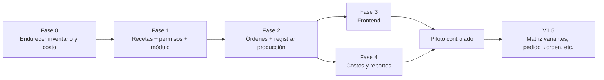

# Plan de implementación incremental — Módulo de Producción

> **Errata posterior (2026-10-13)** — revisión crítica: este roadmap queda **reemplazado** por [PRODUCTION-IMPLEMENTATION-ROADMAP-REVISED.md](PRODUCTION-IMPLEMENTATION-ROADMAP-REVISED.md): la «Fase 0» se dividió en pistas independientes (medición, endurecimiento transversal, costos en sombra, producción, reportes opcionales); faltaban migraciones (costo promedio, `PRODUCTION_IN`, permisos) y la numeración V161–V164 no era confiable.
> Detalle: [PRODUCTION-FINAL-CRITICAL-REVIEW.md](PRODUCTION-FINAL-CRITICAL-REVIEW.md). El texto original se conserva como evidencia del análisis previo.

> Estado: **PLAN PARA APROBACIÓN. No se ha implementado nada.** Depende de [PRODUCTION-MODULE-PROPOSAL.md](PRODUCTION-MODULE-PROPOSAL.md) (§12 decisiones abiertas) y de los hallazgos en [Brechas](PRODUCTION-CURRENT-ERP-GAP-ANALYSIS.md).
> Convenciones del repo (migraciones V161+, deploy `migrate-central` → deploy → `migrate-fleet`, commit directo a main) según [Gap §7] y la memoria del proyecto.

## Fase 0 — Cimientos de inventario (bloqueante)
Objetivo: que mover stock y costear sea seguro **antes** de que producción lo use intensivamente. Beneficia también a ventas/compras.

| Tarea | Detalle | Riesgo |
|---|---|---|
| 0.1 Bloqueo de saldo | En `RecordMovementTx`, leer la fila de stock con `clause.Locking{Strength:"UPDATE"}` (hoy `First` sin lock, `inventory_service.go:134+`). | Deadlocks si el orden de bloqueo varía → bloquear insumos en orden ascendente de `product_id`. |
| 0.2 UNIQUE (producto, sucursal) y (presentación, sucursal) | Migración V161: **detectar duplicados primero** (consulta de solo lectura en prod), consolidar, luego crear índice. | Alto: datos duplicados reales **[NV]**; sin medir no desplegar. |
| 0.3 `average_cost` | Columna en producto; promedio móvil ponderado actualizado en `RecordMovementTx` para entradas con costo; backfill inicial = `purchase_price` (no recalcular histórico). | Medio: define el costo base de ventas; acordar con el usuario que `purchase_price` se conserva. |
| 0.4 Enlace al origen | `production_entry_id` nullable + índice en `tenant_stock_movements` (V162). | Bajo. |
| 0.5 `PRODUCTION_IN` | Alta por migración + `SeedInventoryOperationTypes`; confirmar código SUNAT con contador; decidir `AllowManual` de `PRODUCTION_OUT`. | Bajo. |
| 0.6 Fix `ProfitDetail` con SaleUnit | Multiplicar costo por factor de conversión (`sale_service_calc.go:84-97`, `sale_service.go:2089-2110`). Opcional/aparte si el usuario lo decide. | Medio: cambia utilidades históricas mostradas. |
| 0.7 Verificar variantes | Confirmar cómo se reconcilian stock del producto y de sus presentaciones **[NV]** y qué hace `RecordMovementTx` con `PresentationID` sobre el agregado. | Decide si variantes entran en V1. |

**Pruebas:** test concurrente (N goroutines restando del mismo stock: nunca negativo, saldo = suma de kardex); test de promedio ponderado; test de migración idempotente (patrón `v1xx_*_test.go`); regresión de ventas/compras/traslados.
**Aceptación:** pruebas verdes; sin duplicados en prod tras consolidar; ventas/compras sin regresión; despliegue de la flota completo y verificado (recordar que v150/v151 estaban pendientes de migrate-fleet al 05-oct **[NV]** en prod).

## Fase 1 — Recetas, módulo y permisos
- V163: tablas `tenant_production_boms` y `_lines`.
- Permisos `production.*` en `RoleService.SeedPermissions` + migración de backfill a roles existentes (patrón v131/v143).
- `manufacturing` → `Implemented:true`, `Requires:"products,inventory"`; asignar a planes desde el panel central.
- API: CRUD de recetas con validación servidor (insumo ≠ producto, sin ciclos de un nivel, `ManageStock`, sin series, unidad convertible, % 0-100).
- **Pruebas:** validaciones, conversión rollo→metro, permisos, tenant sin módulo → 403.
- **Aceptación:** receta con costo estimado correcto; roles existentes ven el módulo; ningún cambio de comportamiento para tenants sin módulo.

## Fase 2 — Núcleo: órdenes y registro de producción (backend)
- V164: órdenes, líneas snapshot, registros, consumos, costos manuales. `docseries` para el número (nueva categoría de serie).
- Servicios: crear (snapshot) / editar / iniciar / cerrar / reabrir / anular; **disponibilidad**; **registrar producción** (transacción única, `FOR UPDATE` sobre orden, idempotency key UNIQUE, precarga de stock en lote); **anular registro** (contramovimientos al costo original).
- Auditoría con `TenantID`; contadores acumulados en la orden.
- **Pruebas (críticas):** Casos A-G de la propuesta como tests de integración con los números exactos (21.40; 19.4947; 76 pares; parcial 60+40; anulación bloqueada con 20 vendidas); doble envío; dos usuarios concurrentes; rollback total por falta de un insumo; redondeo a 3 decimales; snapshot inmutable.
- **Aceptación:** criterios 1-7 y 9 del §11 de la propuesta.

## Fase 3 — Frontend (frontend_tenant)
- Ruta lazy + `Protected perm`, entrada en `Sidebar` con `module:'manufacturing'`; `production.service.ts`; estado local/Context (sin store global).
- Pantallas: Recetas, Órdenes (lista), Detalle de orden, modal Registrar producción, Reportes básicos. Reutilizar `ProductPickerModal`/`ProductServerSelect` ampliando la respuesta con unidad base y costo.
- Generar `Idempotency-Key` por apertura del modal y deshabilitar el botón al enviar.
- **Pruebas:** manual guiado con los 7 casos en entorno local; accesibilidad básica; móvil (planta usa celular/tablet).
- **Aceptación:** un usuario nuevo completa el Caso A sin manual, en menos de 5 minutos.

## Fase 4 — Costos y reportes
- Costo previsto vs real, pérdida vs receta, merma por motivo, faltantes de órdenes abiertas.
- Consultas con índices y paginación; evitar O(n²) (lección del incidente de pool agotado).
- **Aceptación:** reportes coinciden con los cálculos de los casos; sin impacto medible de latencia en login/ventas con volumen de prueba.

## Piloto y despliegue
1. Aprobación → Fase 0 sola, desplegada y observada **al menos una semana** antes de seguir.
2. Fases 1-4 detrás del módulo por plan: habilitar solo para 1-2 tenants piloto con una fábrica real.
3. Orden de despliegue por cada migración: `migrate-central` → deploy backend → `migrate-fleet`. Producción sigue la regla de **solo auditoría sin permiso explícito**: cada paso en VPS lo autoriza el usuario.
4. Feedback del piloto → ajustar antes de abrir a todos los planes.

## V1.5 (backlog priorizado por valor, no comprometido)
1. Botón "Producir" desde venta/cotización sin stock + reserva simple para pedido.
2. Matriz de variantes talla×color que genera N órdenes.
3. Defectuosas → ingreso como "segunda calidad".
4. Sugerencia de compra de faltantes (crear borrador de compra).
5. Política de consumo configurable (al iniciar) con WIP informal.
6. Lotes de insumos / trazabilidad (según lo que ofrezca inventario).
7. Importador de recetas del legacy (`item_supplies`).
Más allá: rutas/centros de trabajo, MRP, subproductos, variaciones precio/eficiencia.

## Riesgos transversales
| Riesgo | Mitigación |
|---|---|
| Cambios en `RecordMovementTx` afectan todo el ERP | Fase 0 aislada, tests de regresión, despliegue gradual y observación. |
| Duplicados en tablas de stock en prod | Medición previa en solo lectura (usuario de solo lectura) antes de V161. |
| Alcance creciente (el módulo "perfecto") | Criterio rector; todo lo no listado va a V1.5. |
| Migración olvidada antes del deploy | Checklist: toda columna/tabla nueva con migración V16x registrada en `registry.go` + test. |
| Costos incorrectos por variantes sin costo propio | Variantes habilitadas solo tras 0.7; si no, V1 sin variantes. |
| Percepción de complejidad | Pantalla única de registro con valores precargados; medir tiempo de capacitación en el piloto. |
| Pool de conexiones del tenant | Precarga en lote, transacciones cortas, prueba de carga ligera. |
| Responsabilidad contable | La propuesta no es asesoría contable; validar tratamiento de merma/costo con el contador del piloto. |

## Dependencias y orden estricto
Fase 0 → Fase 1 → Fase 2 → (Fase 3 ∥ Fase 4) → Piloto. Las decisiones 1, 4 y 6 de la propuesta §12 bloquean Fase 0/Fase 2. No se escribe código hasta la aprobación expresa del usuario.

## Nota: caso real disponible para pruebas
El tenant legacy CONSTRUMARKET (ver [caso](PRODUCTION-LEGACY-TENANT-CASE-CONSTRUMARKET.md)) aporta 8 recetas reales (mortero seco, insumos en kg, envase como componente) utilizables como datos de prueba de las Fases 1-2 (por ejemplo: 86 bolsas de Cerámica Gris 20 kg → arena 1,290 kg, cemento 435.16 kg, HPMC 4.558, resina 1.548, envase 86) y como candidato a piloto si migra. Condición del piloto: cargar compras y stock inicial de insumos antes de producir, porque el bloqueo de stock negativo lo haría fallar con su práctica actual.
