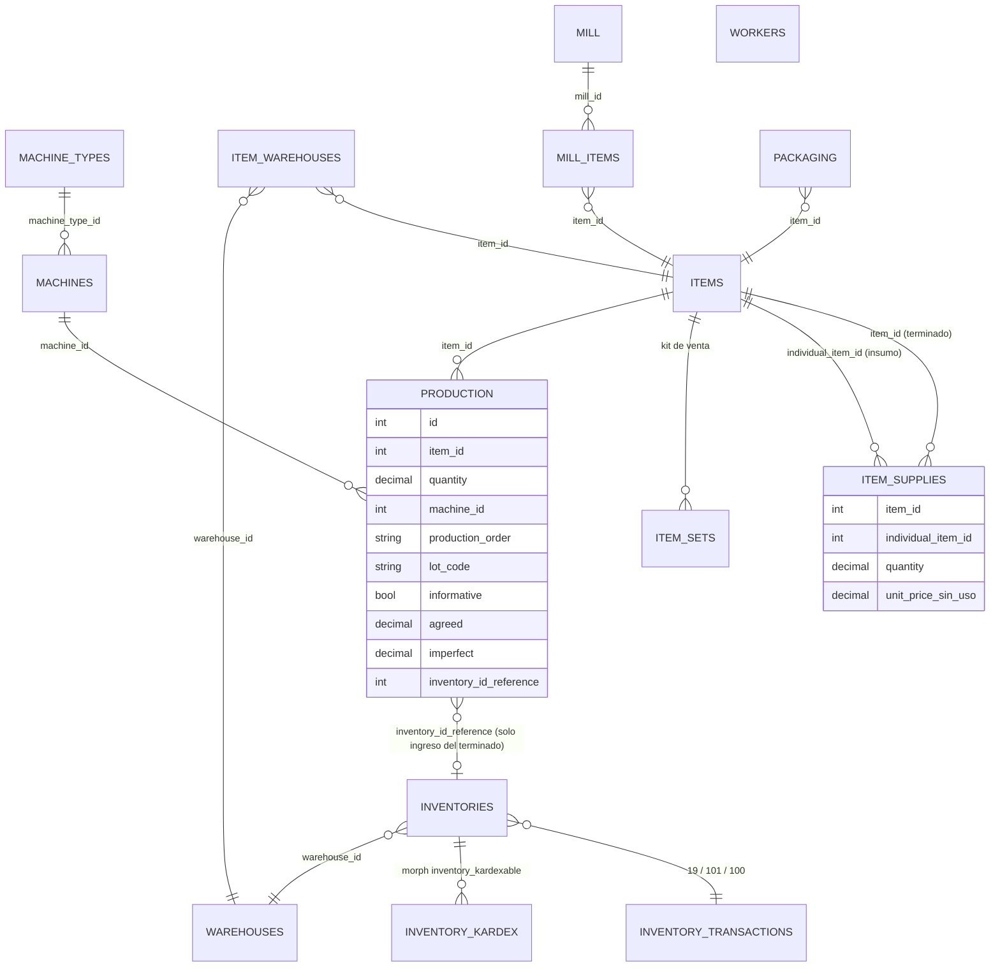

# Análisis del módulo de Producción del facturador legacy (PHP/Laravel)

Repositorio auditado: `C:\xampp\htdocs\facturador-tukifac` (multi-tenant, módulos nwidart).
Tipo de auditoría: **solo lectura de código fuente**. No se ejecutó nada, no se consultó ninguna base de datos, no se probó la UI.
Convención: **[H]** = hecho verificado en código (con `archivo:línea`); **[I]** = interpretación o inferencia mía.
Rutas relativas a la raíz del repo legacy salvo que se indique otra cosa.

---

## 1. Resumen ejecutivo

1. **El "módulo Production" NO es un MRP/BOM clásico.** Es un conjunto de *registros de planta* (ficha de producción, molienda de insumos, empaquetado, máquinas, trabajadores) con un único efecto contable real: la ficha de producción crea un movimiento de inventario de ingreso del producto terminado y movimientos de salida de insumos. [H] `modules/Production/Http/Controllers/ProductionController.php:57-117`.
2. **Sí existe una receta (BOM) de un solo nivel**, pero guardada en una tabla ajena al módulo: `item_supplies (item_id, individual_item_id, quantity)`, editada desde la pestaña "Producción" del formulario normal de productos (flag `items.is_for_production`). [H] `database/migrations/tenant/2021_12_11_170251_create_item_supplies.php`, `app/Models/Tenant/ItemSupply.php`, `resources/js/views/tenant/items/form.vue:408,1085-1215`, `app/Http/Controllers/Tenant/ItemController.php:482-489`.
3. **No existe orden de producción con estados.** El campo `production_order` es un string libre. No hay planificación, estados (borrador/en proceso/terminada), cierre, anulación ni edición: `destroy()` y `update()` están vacíos y no hay rutas para ellos. [H] `ProductionController.php:151-166`, `modules/Production/Routes/web.php:94-103`.
4. **¿Cuándo se descuenta stock?** En el mismo `POST /production/create`, de forma inmediata y en una sola transacción: ingreso del terminado (transacción de inventario `19`) y salida de cada insumo (transacción `101`) = `cantidad_receta × cantidad_producida`. Salvo que se marque "Ficha Informativa", que no mueve stock. [H] `ProductionController.php:61-113`.
5. **¿Cómo se costea?** **No se costea.** Ni el módulo ni el kardex de producción guardan costo. El terminado no recibe costo de los insumos, no se actualiza `purchase_unit_price`, no hay costo promedio, ni merma valorizada. `item_supplies.unit_price` existe en la tabla pero ni siquiera está en `$fillable`. [H] `ItemSupply.php:29-33`, `InventoryKardex` (cantidad solamente, ver 3.4). El kardex valorizado usa `items.purchase_unit_price` actual. [H] `modules/Inventory/Helpers/InventoryValuedKardex.php:31`.
6. **Mermas:** solo hay dos campos informativos (`agreed` = Conformes, `imperfect` = Imperfectos) sin efecto en stock ni validación contra `quantity`. En el sistema legacy también hay un segundo mecanismo de "recetas" (Restaurante, tabla `supplies`) con `waste_percentage`, pero es independiente del kardex principal y tiene sus propios hallazgos (sección 7.4).
7. **Riesgos principales:** la receta que se descuenta la manda el cliente (el servidor no la lee de `item_supplies`); el stock por defecto puede quedar negativo (`stock_control=false`); sin locks; sin enlace entre la ficha y los movimientos de insumos; sin anulación; sin lotes ni costo. Detalle en secciones 6 y 7.

---

## 2. Qué es realmente cada pieza del módulo

| Pieza | Qué hace realmente | ¿Mueve stock? | Evidencia |
|---|---|---|---|
| **Production** (`/production`) | "Ficha" de fabricación de un producto terminado: máquina, fechas/horas de producción y de mezcla, colaboradores (texto libre), lote (texto), conformes/imperfectos, orden (texto). Al guardar crea ingreso del terminado y salidas de insumos. | **Sí** (excepto informativa) | `ProductionController.php:57-117` |
| **Mill** (`/mill-production`, "Insumos/Molino") | Registra molienda: producto-insumo, "cantidad a moler" (`height_to_mill`), "cantidad obtenida" (`total_height`), unidad y color. **Solo suma stock del insumo obtenido** (transacción `100`, "Ingreso insumos por molino"); la cantidad a moler **no se descuenta** de nada. | **Sí, solo ingreso** | `MillController.php:112-163`; migración `2021_12_11_101624_add_data_to_inventory_transactions.php` |
| **Packaging** (`/packaging`) | Registro de empaquetado: ítem, cantidad, N° de paquetes, lote, observación, colaborador. | **No** (solo inserta fila) | `PackagingController.php:58-82`; no hay ninguna referencia a `Inventory::` más allá del `use` (líneas 15-17) |
| **Machine / MachineType** | CRUD de máquinas (nombre, marca, modelo, fuerza de cierre) y tipos. Se usan como FK en `production.machine_id`. | No | `Models/Machine.php`, `MachineController.php` |
| **Worker** | CRUD de trabajadores (documento, ocupación, fechas). **No está enlazado a Production**: los colaboradores de producción/mezcla/empaquetado son texto libre. | No | `Models/Worker.php`; `Production.php:429-455` (`production_collaborator`, `mix_collaborator` son strings); `production/form.vue:329,422` |
| **ItemProductionController** (`/item-production`) | Copia casi literal de `ItemSetController` ("producto compuesto"). **Parece código muerto/roto**: usa `ItemCollection`, `ItemResource` y `Exception` sin importarlos. | No | `ItemProductionController.php:5-25` (imports) vs `:51,107,178` (usos) [I: fallaría en runtime; no ejecutado] |

Activación: módulo `production_app` por usuario/plan. [H] `app/Models/Tenant/Configuration.php:585,606`, `app/Http/Middleware/RedirectModule.php:241-244,349-350`, migración `2021_12_10_130040_create_app_production.php`. La pestaña de receta en el producto solo se ve si `config.production_app` es verdadero (`items/form.vue:1314-1318`).

---

## 3. Mapa de entidades y tablas

### 3.1 Tablas (tenant)

| Tabla | Columnas relevantes | Migración |
|---|---|---|
| `items` | `is_for_production` (bool, "requiere insumos"), `is_set` (kit/combo de venta), `lots_enabled`, `series_enabled`, `purchase_unit_price` | `2021_12_09_182924_add_flag_to_production_for_item.php`; `Item.php:160-178` |
| `item_supplies` (**la receta/BOM**) | `item_id` (producto terminado, FK cascade), `individual_item_id` (insumo, FK), `quantity decimal(13,3)`, `unit_price decimal(12,2)` (sin uso) | `2021_12_11_170251_create_item_supplies.php`, `2022_05_04_150922_..._item_supplies.php` |
| `item_sets` (kit de venta) | `item_id`, `individual_item_id`, `quantity decimal(12,4)` | `2019_10_14_102317_tenant_item_sets_table.php`, `2020_09_04_094513_...quantity_to_item_sets.php` |
| `production` | `user_id, soap_type_id, item_id, inventory_id_reference, quantity decimal(12,4), machine_id, production_order, name, comment, date/time_start/end, mix_date/time_start/end, production_collaborator, mix_collaborator, lot_code, item_extra_data json, informative tinyint, agreed decimal(8,2), imperfect decimal(8,2), proccess_type` | `2021_12_09_182924`, `2022_01_05_170742`, `2022_01_26_175429_create_mi_tienda_pe.php` (agrega columnas de production aquí, nombre engañoso), `2022_02_17_195824`, `2022_05_05_110908` |
| `mill` / `mill_items` | `mill`: `name, date/time_start/end, comment, mill_name, lot_code, user_id, soap_type_id`. `mill_items`: `mill_id, item_id, height_to_mill, total_height, quantity, item json, item_extra_data json` | `2021_12_09_182924`, `2021_12_10_172959`, `2021_12_11_114856`, `2022_01_26_175429` |
| `packaging` | `item_id, item json, establishment_id, quantity, number_packages, lot_code, observation, packaging_collaborator, date/time_*` | `2022_01_29_191503`, `2022_02_17_195824` |
| `machines`, `machine_types` | ver 2 | `2022_01_05_170742` |
| `workers` | documento, nombre, ocupación, fechas | `2022_05_04_155103` |
| `inventory_transactions` | catálogo; id **19** "Ingreso de producción" (input), **100** "Ingreso insumos por molino" (input), **101** "Salida por insumo" (output). También existen 10 "Salida a producción", 13 "Mermas", 14 "Desmedros", 52/91 "Ingreso por transformación" (catálogo SUNAT), **sin uso** en Production. | `2019_09_30_160541_tenant_inventory_transactions_table.php:30,55,58`, `2021_12_11_101624:...` |
| `inventories` | movimiento: `type, description, item_id, warehouse_id, quantity, inventory_transaction_id, lot_code, guide_id, date_of_issue, ...` | `Modules\Inventory\Models\Inventory` |
| `inventory_kardex` (polimórfica) | `inventory_kardexable_*`, `date_of_issue, item_id, warehouse_id, quantity` (solo cantidad, sin costo ni saldo) | `Inventory.php:123-126`; `InventoryTrait.php:360-368` |
| `item_warehouses` | stock vigente por (item, almacén) | `InventoryTrait.php:378-397` |
| `supplies`, `restaurant_item_supplies`, `purchase_supplies` | sistema paralelo de Restaurante (sección 7.4) | `2025_11_24_000001/2` |

Nota [H]: el modelo `ItemSupply` documenta `@property ... ItemSet` en sus docblocks (copy/paste), pero es una tabla distinta de `item_sets`.

### 3.2 Diagrama ER



Observación [H]: **no hay FK ni columna que enlace `production` con las filas de `inventories` de los insumos.** Solo se guarda `inventory_id_reference` del ingreso del terminado (y es `NULL` en fichas informativas). Las salidas de insumos quedan huérfanas respecto de la ficha (`ProductionController.php:85, 97-105`).

---

## 4. Flujos paso a paso

### 4.1 Definir un producto fabricado y su receta [H]

1. En el formulario estándar de producto se marca "Este producto, ¿requiere insumos?" (`is_for_production`), solo visible con `production_app` y unidad distinta de `ZZ` (`items/form.vue:407-410`).
2. Aparece la pestaña "Producción": buscar un insumo y "+ Agregar Producto" (`clickAddSupply`, `form.vue:2180-2200`). La cantidad se edita en una tabla (`el-input-number`, sin mínimo, `:1158-1170`). **No hay acción de eliminar línea** (el botón está comentado).
3. Al guardar, `ItemController::store` recorre `$request->supplies` y hace `ItemSupply::firstOrCreate(['id' => $value['id']], $value)` + `fill` + `save` (`ItemController.php:482-489`). No hay borrado de líneas quitadas, no hay validación de cantidad > 0, de ciclos ni de que el insumo no sea el propio producto.
4. Insumos candidatos en el selector de producción: `Item::ProductEnded()` = `item_type_id='01'`, `unit_type_id!='ZZ'`, `is_for_production=1`, `is_set=0` (`Item.php:2400-2410`). En el selector de insumos del módulo Mill: `scopeProductSupply` = ítems que ya aparecen como `individual_item_id` en alguna receta (`Item.php:2415-2427`).

### 4.2 Registrar producción (ficha) [H]

```mermaid
sequenceDiagram
    autonumber
    participant UI as production/form.vue
    participant API as POST /production/create
    participant DB as DB tenant (transacción)
    participant Ev as Inventory::created (listener)
    participant Stk as item_warehouses / inventory_kardex

    UI->>API: GET /production/tables (items terminados con supplies, almacenes, máquinas)
    UI->>UI: al elegir producto, supplies = item.supplies (editable: cantidad y almacén)
    UI->>API: {item_id, warehouse_id, quantity, supplies[], informative, lot_code, agreed, imperfect, ...}
    API->>API: ProductionRequest (solo required, sin numeric/min/exists)
    API->>DB: BEGIN
    alt informative == false
        API->>DB: INSERT inventories (tx 19 "Ingreso de producción", qty = quantity)
        DB->>Ev: created
        Ev->>Stk: kardex +qty ; stock + qty
    end
    API->>DB: INSERT production (inventory_id_reference = id del ingreso)
    loop por cada supply enviado por el cliente
        API->>DB: INSERT inventories (tx 101 "Salida por insumo", qty = supply.quantity * quantity, almacén del supply o el de cabecera)
        DB->>Ev: created
        Ev->>Stk: kardex -qty ; stock - qty (excepción si stock_control y queda <0)
    end
    API->>DB: COMMIT (o ROLLBACK si hay excepción)
```

Referencias [H]: transacción `DB::connection('tenant')->transaction` en `ProductionController.php:61`; tx 19 en `:70`; tx 101 en `:97`; cantidad de insumo `(float)($qty * $quantity)` en `:103`; el listener de stock en `modules/Inventory/Providers/InventoryChangeServiceProvider.php:49-85` (rama `default` por `inventory_transaction.type`, `:68-83`); `updateStock` en `modules/Inventory/Traits/InventoryTrait.php:378-397`.

Detalles verificados:
- El front exige `quantity >= 1` (`form.vue:604`), el backend no valida nada más que `required` (`ProductionRequest.php:20-32`). Requeridos: item, cantidad, almacén, nombre/"Número de ficha", fechas y horas de producción, máquina.
- Si `informative=true`: **no** se crea el Inventory, no se descuentan insumos, `inventory_id_reference` queda `NULL` y la UI avisa "No se contabilizará el stock" (`form.vue:430-436`; `ProductionController.php:73,91`). Hay un reporte aparte de "producción en proceso" (`excel2`, `informative=1`) y otro de producción real (`excel`, `informative=0`) (`:296-331`). [I] "Ficha informativa" se usa de facto como estado "en proceso/borrador", pero no se puede convertir luego en real: no existe edición.
- Los insumos mostrados y descontados provienen de `item.supplies` cargado en el navegador y reenviado tal cual (`form.vue:610,638`). **El servidor no consulta `item_supplies`.**
- Almacén de cada insumo: el del renglón o, si viene vacío/0, el de cabecera (`ProductionController.php:94-95`).
- La fecha del kardex es `date('Y-m-d')` del servidor, no la fecha de producción (`InventoryTrait.php:362-367`).

### 4.3 Molienda / ingreso de insumos [H]

```mermaid
sequenceDiagram
    participant UI as mill/form.vue + partials/item.vue
    participant API as POST /mill-production
    participant DB as DB tenant
    UI->>API: {name, fechas, items[{item_id, height_to_mill, total_height, quantity=total_height, unit_id, item_extra_data}]}
    API->>DB: INSERT mill
    loop por ítem
        API->>DB: INSERT mill_items
        API->>DB: INSERT inventories tx 100 (input) qty = quantity * ItemUnitType.quantity_unit
        Note over DB: stock del insumo obtenido SUBE; "height_to_mill" no descuenta nada
    end
```

- Sin transacción: `MillController::store` (`:112-163`) no usa `DB::transaction`; un fallo a mitad deja la cabecera y parte de los ítems guardados.
- El almacén por defecto es `\Auth::user()->establishment->id` (`:124-125`), es decir, **un id de establecimiento usado como id de almacén** (solo coincide por convención). [I]
- Los endpoints `record`, `voided`, `destroy` de Mill son restos de copiar el módulo de Gastos (`Expense*`): `record()` llama a `ExpenseResource` sin importarlo (`:386-392`), `voided()` anula un `Expense` (`:394-415`). [H]

### 4.4 Empaquetado [H]
`PackagingController::store` (`:58-82`): crea `packaging` con snapshot JSON del ítem. **Cero movimiento de inventario.** El `use Inventory...` es sobrante.

### 4.5 Kits de venta (`is_set`, no es producción) [H]
Un ítem `is_set` se vende y **en el momento de la venta** se descuentan sus componentes (`item_sets`) en el almacén por defecto, no en el del documento: `modules/Inventory/Providers/InventoryKardexServiceProvider.php:104-147` (documento), `:244-280`, `:324-360`, `:373-410`, `:430-470` (notas de venta/pedido/despacho). Anulación: `InventoryTrait::voidedDocumentItemSet` (`:615-630`). Es una explosión de BOM **en la venta**, sin producir ni almacenar el kit. Se crea con `ItemSetController` (`app/Http/Controllers/Tenant/ItemSetController.php:146-152`). No tiene relación con `item_supplies`.

---

## 5. Reglas de negocio reales (verificadas)

1. Receta = lista plana de (insumo, cantidad por 1 unidad de terminado), un nivel, sin unidad de medida propia, sin merma, sin rendimiento de lote, sin versiones. [H] `item_supplies`.
2. Consumo = `cantidad_receta × cantidad_producida`, con cantidad y almacén editables por renglón en la pantalla. [H] `ProductionController.php:103`, `form.vue:491-510`.
3. Ingreso del terminado = `quantity` completo (incluye "imperfectos"); `agreed`/`imperfect` son solo datos. [H] `ProductionController.php:78`, no hay lógica con `agreed/imperfect` fuera de listados.
4. Validación de existencias: **solo** la del `updateStock` y **solo si** `inventory_configurations.stock_control = true` (default `false`). Con el default, la producción puede dejar insumos en negativo. [H] `InventoryTrait.php:384-390`; migración `2019_04_29_111659_tenant_inventory_configurations_table.php:18`, `2019_04_29_164935:19`. No hay verificación previa en UI ni en controlador (a diferencia de `InventoryController::store_transaction`, que sí compara con `item_warehouse->stock` en salidas manuales, `modules/Inventory/Http/Controllers/InventoryController.php:232-237`).
5. Modo "Ficha Informativa": registra todo menos stock. [H]
6. No hay edición ni anulación de una ficha; corregir implica ajustes manuales de inventario. [H] rutas `web.php:94-103`, métodos vacíos.
7. Lote de la ficha (`production.lot_code`): texto libre, **no** crea `ItemLotsGroup`/`ItemLot` ni se escribe en `inventories.lot_code`. Productos con `lots_enabled`/series no quedan con lote en inventario. [H] `ProductionController.php:74-80` (no setea `lot_code`); contraste con `InventoryController::store_transaction` (`:218-228,304-312`) que sí crea lotes.
8. Sin costos: la ficha y sus movimientos no guardan precio/costo. [H]
9. Todo el módulo es por tenant y por `soap_type_id` (demo/prod) en las cabeceras. [H] `Production.php:454`, `ProductionController.php:87`.

---

## 6. Integración con otros módulos

| Módulo | Integración real |
|---|---|
| **Inventario / Kardex** | Se apoya 100% en `Inventory::create` + listener que genera `inventory_kardex` y actualiza `item_warehouses`. Usa las transacciones 19/100/101. No genera guía de remisión interna (la entrada manual sí: `InventoryController.php:262-285`). |
| **Productos** | Flag `is_for_production`, receta `item_supplies`, scopes `ProductEnded/ProductSupply` (`Item.php:2400-2427`). |
| **Compras** | No hay integración de producción con compras del flujo principal: una compra normal sube stock del ítem vía `PurchaseItem::created` (`InventoryKardexServiceProvider.php:56-71`). No hay "requerimiento de compra" por faltantes. |
| **Ventas** | Una venta del terminado descuenta stock del terminado como cualquier ítem; el kit (`is_set`) es otro mecanismo. No hay reserva ni vínculo pedido→producción. |
| **Almacenes** | Se elige almacén en cabecera y por insumo. Sin traslados automáticos. |
| **Contabilidad/Costos** | Ninguna. |
| **Reportes** | Excel/PDF de producción: el detalle de insumos que muestran es la **receta actual del producto × nada** (muestra `item->supplies` actual con su cantidad unitaria, no lo realmente consumido ni histórico): `Production.php:487`, `production/partial/export.blade.php:172-185`. Si cambia la receta, los reportes antiguos cambian. [H] |

---

## 7. Hallazgos

### 7.1 Lo que funciona bien (utilizable como referencia)
- Transacción única para ingreso del terminado + salidas de insumos: si el stock se vuelve negativo con `stock_control`, la excepción hace rollback de toda la ficha. [H] `ProductionController.php:61-113` + `InventoryTrait.php:385-390`.
- Receta editable por ficha (ajuste real de cantidades y almacén por insumo): útil para recetas con variación. [H]
- Trazabilidad operativa rica de planta: máquina, tiempos de producción y de mezcla, colaboradores, lote, conformes/imperfectos, color (`item_extra_data`). [H]
- Separación de "producción real" vs "informativa" en reportes. [H]

### 7.2 Incompleto / ausente
- Sin órdenes de producción con estados, planificación ni cierre; sin consumo parcial; sin multinivel (semi-elaborados); sin reserva de insumos; sin explosión de materiales para compras.
- Sin costeo (costo de insumos, mano de obra, CIF, costo unitario del terminado, costo promedio) y sin actualización del costo del producto.
- Sin mermas/desperdicio reales: no se usan las transacciones 13/14, no hay merma esperada vs real.
- Sin anulación/edición/reversión de fichas.
- Sin lote/vencimiento/series en el terminado ni consumo de lotes en insumos.
- Sin vínculo ficha ↔ movimientos de insumo, y el reporte no muestra lo consumido.
- Trabajadores no enlazados a las fichas; sin horas-hombre.
- Empaquetado sin efecto en inventario (no convierte granel → empaquetado).
- Sin permisos finos (solo módulo `production_app`).

### 7.3 Peligroso / riesgos de inconsistencia

| # | Riesgo | Evidencia | Severidad |
|---|---|---|---|
| R1 | **El servidor confía en la receta del cliente**: cualquier request puede enviar `supplies` arbitrarios (otros ítems, cantidades 0 o negativas, o no enviarlos). Cantidad negativa en salida (`tx 101`) **suma** stock del insumo. | `ProductionController.php:92-106`, sin validación en `ProductionRequest` | Alta |
| R2 | **Stock negativo por defecto** (`stock_control=false`). | `InventoryTrait.php:384-390`, migración default `false` | Alta |
| R3 | **Sin locks / lectura-modificación-escritura**: `ItemWarehouse::firstOrNew` + `stock = stock + qty` + `save` sin `lockForUpdate` ni UPDATE atómico → pérdidas de actualización en concurrencia. | `InventoryTrait.php:378-397` | Alta |
| R4 | **Doble envío = doble descuento**: sin idempotencia (ni token ni unicidad por `name`/`production_order`); el botón usa `loading` pero el backend no protege. | `ProductionController.php:57-117`; `form.vue:602-632` | Media-Alta |
| R5 | **Sin anulación**: un error de captura obliga a ajustes manuales sin vínculo con la ficha. | métodos vacíos | Alta |
| R6 | **Validación débil**: `quantity` solo `required` (puede ser 0, negativo o texto), `item_id`/`machine_id`/`warehouse_id` sin `exists`, el flag `informative` se toma de `$request->informative` sin validar. | `ProductionRequest.php:20-32` | Media |
| R7 | **Ficha sin enlace a salidas de insumo** y reportes con receta actual (no histórica). | sección 3.2 / 6 | Media |
| R8 | **Colisión de IDs al guardar recetas**: el front agrega el objeto *ítem* completo y su `id` es el del **ítem insumo**, y el backend hace `ItemSupply::firstOrCreate(['id' => $value['id']], $value)`. Si ya existe una fila `item_supplies` con ese id (de otro producto), se reutiliza y `fill` le **sobrescribe** `item_id/individual_item_id/quantity`. Para filas nuevas, el `id` no es fillable y se autogenera. | `items/form.vue:2180-2200`, `ItemController.php:482-489`, `ItemSupply.php:29-33` | Media [I: deducido de lectura, no reproducido] |
| R9 | **Recetas sin borrado** de líneas (UI sin botón; backend sin `delete`), sin validar `quantity > 0` (la migración original era `integer`, luego decimal(13,3) con `->change()`). | `items/form.vue:1146-1176`; migración `2022_05_04_150922` | Media |
| R10 | **Mill sin transacción**, almacén = id de establecimiento, "cantidad a moler" no descuenta el material de entrada (inventario de insumo inflado respecto a la realidad física). | `MillController.php:112-163` | Media |
| R11 | **Kardex con fecha del servidor** (`date('Y-m-d')`), imposible registrar producción retroactiva con la fecha real; `production.date_*` solo informativos. | `InventoryTrait.php:362-367` | Baja-Media |
| R12 | **Búsqueda de producto terminado** rompe el filtro: `where(...like...)->orWhere(...)` sin agrupar, tras el scope `ProductEnded`, devuelve ítems que no son terminados. | `ProductionController.php:207-211` | Baja |
| R13 | **Código muerto/copiado**: `ItemProductionController` (imports faltantes), `MillController` con restos de Gastos (`ExpenseResource`, `voided`). | ver 4.3 y sección 2 | Baja |
| R14 | `agreed`/`imperfect` son `decimal(8,2)` por default de `decimal()` en la migración (máx 999 999,99) mientras `quantity` es `decimal(12,4)`; inconsistencia de precisión. | migración `2022_01_26_175429:33-34` | Baja |

### 7.4 Segundo sistema de "recetas": Restaurante [H]
Tablas `supplies` (con **stock propio**, `cost`, `waste_percentage`, `minimum_stock`) y `restaurant_item_supplies` (receta de platos). No usa kardex ni `item_warehouses`.
- Compra de insumos: `PurchaseController::processSupplies` suma `quantity × (1 − merma%)` al `supplies.stock` (`app/Http/Controllers/Tenant/PurchaseController.php:480-505`). Al **editar** la compra, se borran y re-crean `purchase_supplies` y se vuelve a sumar stock sin revertir el anterior (`:712-716`); no hay ningún decremento en ese controlador (`grep` solo encuentra `+=` en `:501`). [H] → riesgo de doble conteo.
- Descuento por venta: existe `RestaurantItemSupplyController::discountSuppliesStock` (`modules/Restaurant/Http/Controllers/RestaurantItemSupplyController.php:105-172`, con transacción y verificación de stock) pero **no encontré ningún invocador** en `app`, `modules` ni `resources` (búsqueda de `discount-stock`/`discountSuppliesStock`). [H para la búsqueda; I para la conclusión de que no se descuenta automáticamente]; no revisé los bundles compilados en `public/`.
- `Item::getRestaurantStock()` calcula platos posibles = `min(floor(stock_insumo / cantidad))` (`Item.php:705-732`); `getRestaurantStockSet` análogo para combos (`:759-778`).
- `Supply::getEffectiveCost()` = `cost × (1 + merma%)` (`modules/Restaurant/Models/Supply.php:68-72`), mientras la compra aplica la merma como `(1 − merma%)` sobre cantidad: dos convenciones distintas de merma. [H]
Es el único lugar del legacy con concepto de merma porcentual y costo de insumo, pero es un sistema separado y de otro dominio (restaurante).

---

## 8. Qué trasladar y qué descartar al sistema nuevo

### 8.1 Conceptos a trasladar (adaptados)
- Receta (BOM) por producto terminado con líneas (insumo, cantidad por unidad), **versionada** y con cantidad base y rendimiento; permitir **override por orden** como hace el legacy, pero validado contra la receta o auditado.
- Ingreso del terminado + consumo de insumos en **una sola transacción**, con rollback ante stock insuficiente.
- Datos de planta útiles: máquina, tiempos de producción/mezcla, responsables, lote, conformes/no conformes, número de ficha/orden.
- Distinción real vs informativa (convertida a **estados** de orden: borrador → en proceso → terminada/cerrada → anulada).
- Almacén de consumo por insumo distinto del de ingreso.
- Merma porcentual por línea de receta (idea tomada del módulo Restaurante) y transacciones de inventario específicas (producción, consumo, merma) en lugar de reutilizar "Salida por insumo" genérica.

### 8.2 Descartar / no replicar
- Receta tomada del cliente sin recalcular en servidor (R1).
- Dependencia de `stock_control` opcional para impedir negativos; decidir política explícita por empresa/almacén.
- Read-modify-write de stock sin bloqueo (R3); usar UPDATE atómico o `SELECT ... FOR UPDATE`.
- Ausencia de anulación/edición; ausencia de enlace orden↔movimientos.
- Reportes con receta actual en lugar de consumo histórico (guardar snapshot de consumo real).
- Colaboradores como texto libre sin vínculo a trabajadores; lote como texto sin crear lote real.
- Módulo Mill tal cual (molienda como ingreso sin consumo del material origen); si el negocio de molienda/reciclaje es requisito, modelarlo como **transformación** (salida de origen + ingreso de obtenido + merma = diferencia).
- Código copiado (Expense en Mill, ItemProductionController), tablas con nombre engañoso (`mi_tienda_pe` agregando columnas de production), "informativa" como booleano, `item_supplies.unit_price` sin uso.
- Doble sistema de insumos (`item_supplies` vs `supplies` de Restaurante); unificar en un solo catálogo de insumos/BOM.
- Fecha de kardex = fecha del servidor; usar fecha efectiva de producción con control de periodos.

### 8.3 Que el legacy no tiene y el nuevo debería diseñar
Costeo (promedio ponderado, costo de producción por orden, mano de obra/CIF), mermas esperadas vs reales, lotes/vencimientos/series, multinivel (semi-elaborados), idempotencia, permisos finos, reserva/faltantes, integración con compras (explosión de requerimientos) y con ventas (pedido→orden).

---

## 9. Limitaciones de la auditoría (qué NO verifiqué)

- Este análisis es de código, sin BD. Posteriormente se consultó (solo lectura) un único tenant, CONSTRUMARKET (RUC 20611901608): ver [PRODUCTION-LEGACY-TENANT-CASE-CONSTRUMARKET.md](PRODUCTION-LEGACY-TENANT-CASE-CONSTRUMARKET.md). Ese tenant usó solo la «ficha de producción» con recetas (`item_supplies`), tuvo stock negativo y no usó molino, empaquetado, máquinas, trabajadores ni lotes. Sigo sin saber cuántos otros tenants usan `production_app` ni los valores de `stock_control` en cada uno.
- No ejecuté el código ni la UI; todo es lectura estática. Las conclusiones marcadas [I] (R8, el fallo de `ItemProductionController`, que el descuento de insumos de Restaurante no se invoca) son deducciones.
- No revisé los bundles compilados (`public/`) ni vistas Blade de menú para confirmar qué rutas son visibles al usuario final. Las vistas Vue de `Resources/assets/js` sí se leyeron (form de producción, mill y su partial de ítem; index/machine/workers/packaging solo se ojearon por nombres de campo).
- No audité en profundidad: `InventoryTransfer`/traslados, `Devolution`, series y lotes (`ItemLot`, `ItemLotsGroup`) más allá de lo citado, ni cómo cambia el costo del producto (`purchase_unit_price`) al comprar.
- No analicé tests, jobs, colas, observers de `Item`, ni módulos Hotel/Order/Dispatch salvo las referencias a `is_set` en `InventoryKardexServiceProvider`.
- No revisé `Exports/*` más allá de la plantilla PDF de producción, ni permisos por rol (solo el módulo `production_app`).
- Las referencias de línea corresponden al estado del repositorio al momento de la auditoría (2026-10-13).
