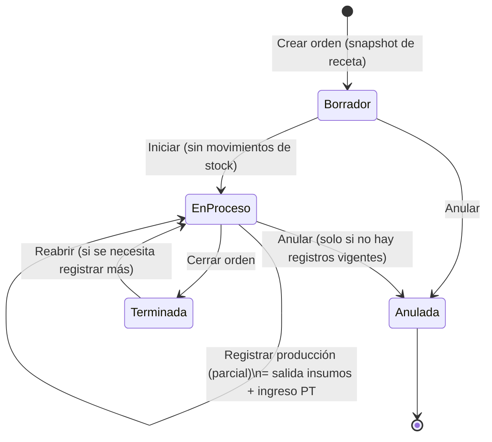
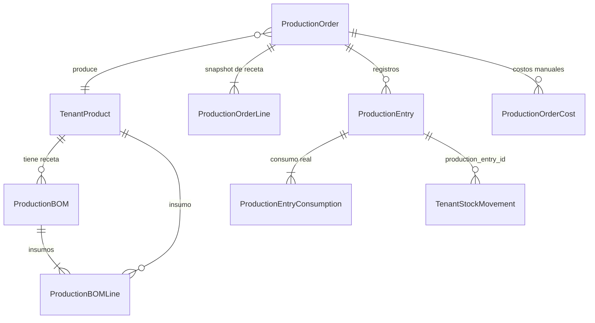

# Propuesta del módulo de Producción — Bendey ERP

> **Errata posterior (2026-10-13)** — revisión crítica: este documento queda **superado** por [PRODUCTION-APPROVED-SCOPE-CANDIDATE.md](PRODUCTION-APPROVED-SCOPE-CANDIDATE.md) en lo siguiente: mano de obra por registro (no a nivel de orden, §7); costo promedio **por (producto, sucursal) en sombra**, no global (§7); «producido» = buenas; sin «Reabrir» (§4); variantes fuera de V1 (§2.1, Caso F, criterio 3); la afirmación de que el costo del terminado «alimenta el costo de ventas» (§7) es **incorrecta** sin cambiar `resolveSaleItemPurchasePrice` (decisión D-03); fórmula de desperdicio fijada como neto×(1+%); numeración de orden con contador propio; la conclusión de §14 sobre «Producir desde una venta» **no está sustentada** por el caso CONSTRUMARKET.
> Detalle: [PRODUCTION-FINAL-CRITICAL-REVIEW.md](PRODUCTION-FINAL-CRITICAL-REVIEW.md). El texto original se conserva como evidencia del análisis previo.

> Estado: **PROPUESTA PARA APROBACIÓN. No hay código implementado.**
> Fecha: 2026-10-13. Documentos hermanos (misma carpeta):
> [Legacy](PRODUCTION-LEGACY-ANALYSIS.md) · [Investigación real](PRODUCTION-REAL-WORLD-MANUFACTURING-RESEARCH.md) · [Benchmark ERP](PRODUCTION-ERP-BENCHMARK.md) · [Brechas del ERP actual](PRODUCTION-CURRENT-ERP-GAP-ANALYSIS.md) · [Roadmap](PRODUCTION-IMPLEMENTATION-ROADMAP.md)
>
> Convención de evidencia: **[V]** verificado en código/documentación por los documentos hermanos; **[I]** interpretación o recomendación mía; **[NV]** no verificado.

---

## 1. Resumen y criterio de diseño

Lo que sabemos, en cuatro líneas:

1. **El legacy no sirve como base.** Solo tiene una receta de un nivel (`item_supplies`), no tiene orden con estados, no se puede editar ni anular, no costea, el servidor confía en la receta que manda el cliente y no hay lock ni idempotencia [V, Legacy §hallazgos]. Se traslada el *concepto* (receta simple + descuento de insumos en una transacción), no el código.
2. **El ERP actual no tiene nada de BOM/producción**, pero sí las piezas correctas: producto + unidad base + `SaleUnit`, stock por (producto, sucursal), un único escritor de stock (`InventoryService.RecordMovementTx`), tipo de operación `PRODUCTION_OUT`, migraciones versionadas, módulo `manufacturing` ya reservado [V, Gap §1-2].
3. **Los tres ERP estudiados convergen** en: BOM → orden → disponibilidad → consumo (editable) → salida parcial/total → costo real, y las pymes (Katana, MRPeasy) lo simplifican a ~3-4 estados [V, Benchmark].
4. **El ERP actual tiene tres defectos que hay que corregir ANTES de construir producción**, porque producción amplifica su impacto: (a) `RecordMovementTx` lee el saldo sin `FOR UPDATE` y no hay UNIQUE (producto, sucursal) → pérdida de actualizaciones; (b) no hay costo persistido en las salidas ni promedio → el costo de producción no sería reproducible; (c) los movimientos no se pueden vincular a una orden salvo por texto en `reference` [V por lectura de código; confirmado por mí en `inventory_service.go:134-205`: `tx.Where(...).First(&stock)` sin locking].

**Criterio rector (del usuario):** no el módulo más completo; el que resuelva lo habitual con la menor complejidad sin comprometer inventario ni arquitectura.

### Decisión en una frase

> **Receta simple de un nivel → Orden de producción con 4 estados → "Registrar producción" (cada registro descuenta insumos reales y da ingreso al producto terminado en una sola transacción idempotente) → costo real automático por registro → anulación por contramovimientos.**

---

## 2. Alcance

### 2.1 Incluido en V1
| # | Capacidad | Justificación |
|---|---|---|
| 1 | Receta (BOM) de un nivel por producto (opcional por variante), con unidad por línea y % de desperdicio por línea | Todos los casos reales y los 3 ERP lo tienen [V]. |
| 2 | Orden de producción: Borrador → En proceso → Terminada / Anulada | Pymes usan 3-4 estados [V Benchmark]. |
| 3 | Receta **congelada (snapshot)** en la orden al crearla | Odoo/ERPNext/BC lo hacen; los reportes del legacy mostraban la receta actual y no lo consumido [V]. |
| 4 | Semáforo de disponibilidad (necesario / disponible / faltante) y "puedes producir hasta N" | Caso B. |
| 5 | **Registrar producción** (parcial o total): cantidad buena, defectuosa, consumo real editable, motivo | Casos C, D. |
| 6 | Consumo automático proporcional al registro (backflush por registro), con cantidades reales editables y aviso de diferencia vs receta | [I] equilibrio simplicidad/exactitud; ver §6.1. |
| 7 | Costos: materiales (real), mano de obra y otros costos manuales por orden; costo unitario | Caso D, §7. |
| 8 | Referencia opcional a pedido/cliente (texto + fecha compromiso) | Caso E sin reservas complejas. |
| 9 | Anulación de un registro y de una orden por contramovimientos | Caso G. |
| 10 | Semiterminados = productos normales con su propia receta; se encadenan con órdenes separadas | Evita WIP formal y multinivel [V Research]. |
| 11 | Permisos, auditoría, módulo por plan | §9. |
| 12 | Reportes mínimos: órdenes, faltantes, costo estimado vs real, merma por motivo | Los que aportan valor [V Research]. |

### 2.2 Fuera de V1 (diferido deliberadamente)
Rutas/centros de trabajo/operaciones, MRP multinivel y sugerencia automática de compras, WIP contable, reserva dura de stock, entrega de material al iniciar (política alternativa), subproductos y regrind, lotes y vencimientos de insumos, matriz masiva talla×color en una sola orden (V1.5), botón "Producir" desde una venta sin stock (V1.5), ingreso de defectuosos como "segunda calidad" (V1.5), variaciones precio/eficiencia automáticas, subcontratación, desarmado (unbuild), importación del `item_supplies` legacy (herramienta opcional aparte).

---

## 3. Modelos de fabricación cubiertos

| Modelo | Cobertura V1 | Cómo |
|---|---|---|
| Para stock (100 pares) | ✅ | Orden sin pedido. |
| Bajo pedido (50 juguetes) | ✅ parcial | Orden con referencia a cliente/pedido; **sin reserva** del stock resultante (V1.5). |
| Por lotes | ✅ | Una orden = un lote; N registros parciales. Sin trazabilidad de lote de insumo. |
| Ensamblaje | ✅ | Receta con componentes comprados. Caso más simple. |
| Por etapas (corte→armado→acabado) | ⚠️ por encadenamiento | Un semiterminado por etapa, cada uno con su receta y orden. Sin rutas ni tiempos. |
| Con variantes | ⚠️ parcial | Orden por variante; receta común + override por variante. Matriz = V1.5. |

Un **único flujo** sirve a todos; no hay "tipos de módulo". No se cambia la forma de trabajar: lo que varía es si la orden tiene pedido, variante o semiterminados.

---

## 4. Flujo de trabajo



```mermaid
sequenceDiagram
    actor U as Responsable de producción
    participant UI as Pantalla "Registrar producción"
    participant API as /production/orders/:id/entries
    participant DB as Transacción tenant
    participant K as RecordMovementTx (kardex)
    U->>UI: buenas=60, defectuosas=2, ajusta consumo real
    UI->>API: POST + Idempotency-Key
    API->>DB: BEGIN; SELECT orden FOR UPDATE
    DB-->>API: valida estado = En proceso
    API->>DB: ¿clave ya usada? → devolver el registro existente
    loop cada insumo
        API->>K: out PRODUCTION_OUT (cant real, costo promedio)
        K-->>API: error si stock insuficiente → ROLLBACK total
    end
    API->>K: in PRODUCTION_IN (60 u @ costo unitario calculado)
    API->>DB: guarda entry + consumos + costos; actualiza acumulados; COMMIT
    API-->>UI: registro creado + resumen de costo
```

---

## 5. Pantallas mínimas (frontend_tenant)

Menú **Producción** (visible solo con módulo `manufacturing` y permiso `production.view`) con tres entradas:

| # | Pantalla | Qué hace el usuario |
|---|---|---|
| 1 | **Recetas** (lista + edición) | Elige producto → "Agregar insumo" (selector de productos existente, filtra `ManageStock` y tipo producto) → cantidad por 1 unidad producida + unidad (base o SaleUnit del insumo) + % desperdicio. Ve **costo estimado por unidad** al instante. Guarda. Una sola pestaña, sin wizard. |
| 2 | **Órdenes** (lista) | Filtra por estado/producto/fecha; ve avance (producido/planificado), faltantes (ícono), costo. Botón "Nueva orden". |
| 3 | **Orden — detalle** | Cabecera (producto, variante, sucursal, cantidad, fecha, pedido/cliente opcional). Tabla **Materiales** (necesario con desperdicio / disponible / faltante / consumido). Tabla **Registros** (fecha, buenas, defectuosas, costo unitario, anular). Pestaña **Costos** (materiales real, mano de obra, otros, unitario, estimado vs real). Botones por estado: Iniciar, Registrar producción, Cerrar, Anular. |
| 3a | Modal **Registrar producción** | Buenas, defectuosas (+motivo), fecha. Consumo **pre-llenado** proporcional a receta×(buenas+defectuosas); editable por línea; aviso si difiere >X% de la receta. Un solo botón "Registrar". |
| — | **Reportes** (tab dentro de Órdenes) | Faltantes de materiales para órdenes abiertas; estimado vs real; merma/defectos por motivo. |

Reglas de UX: no hay formularios obligatorios más allá de producto+cantidad; costos extra son opcionales; los datos se reutilizan (receta → orden → registro) sin retipear.

---

## 6. Reglas de negocio e inventario

### 6.1 Cuándo se mueve el stock — alternativas y decisión

| Alternativa | Pros | Contras | Veredicto |
|---|---|---|---|
| A. Descontar todo al **iniciar** la orden | Refleja entrega de material | Exige WIP (insumos "en limbo"); cancelar es complejo; producción parcial reparte mal | ❌ V1 |
| B. Descontar todo al **terminar** | Simple | No soporta parcial; el consumo real sale tarde; órdenes largas ocultan stock | ❌ |
| C. **Por registro de producción** (consumo proporcional a lo producido, editable) | Soporta parcial naturalmente; sin WIP; movimiento ligado a un hecho real; anulación por registro | Sin reserva de material durante la espera (otra orden puede consumirlo) | ✅ **Recomendada** |
| D. Política configurable A/B/C | Cubre todo | Triple complejidad de pruebas | V1.5 si hay demanda |

**Reglas de C:**
- **Borrador / En proceso no mueven stock.** Solo informan disponibilidad.
- Cada **registro** ejecuta, en una transacción: salidas `PRODUCTION_OUT` por insumo (cantidad real) + ingreso `PRODUCTION_IN` del terminado (cantidad **buena**). Todo o nada.
- Falta de stock → **error y rollback** (lo rechaza `RecordMovementTx` [V]); no se permite negativo.
- El consumo se calcula sobre el **total del registro** (no unidad por unidad) y se redondea a 3 decimales una sola vez, para no acumular error en cantidades pequeñas (columna `decimal(15,3)` [V]).
- Sobre-producción: se permite registrar más que lo planificado con aviso; la orden queda con producido > planificado.
- Insumos con unidad distinta a la base (rollo/metro): la línea guarda unidad y se convierte a base con `saleunit.ResolveForLine`-equivalente al crear el snapshot [V Gap §5]; el stock siempre se mueve en unidad base.
- Productos con `ManageSeries` no se admiten como insumo ni terminado en V1 (series requieren cantidades enteras y números de serie [V Gap]).
- **Concurrencia:** el registro bloquea la fila de la orden (`FOR UPDATE`) y, tras el endurecimiento de la Fase 0, cada fila de stock; la clave de idempotencia (UNIQUE) impide doble descuento por doble clic/reintento.
- **Sucursal = almacén** [V]: todos los insumos y el terminado se mueven en la sucursal de la orden. Producir en una sucursal y consumir de otra se resuelve con traslados existentes.

### 6.2 Producto en proceso (WIP)
No se maneja explícitamente en V1. Una orden "En proceso" es WIP *informal* (visible en el listado, sin valor contable). Razones [V Research]: el WIP contable solo es necesario si hay trabajos abiertos entre cierres contables y multinivel de etapas; el público objetivo (pyme) rara vez lo requiere y duplicaría kardex/reportes. Cuando una etapa debe valorarse, se modela como semiterminado (producto con stock real). Revisar al aparecer clientes con órdenes de semanas.

### 6.3 Mermas y defectuosos
- **Desperdicio normal** (esperado): % por línea de receta; entra en la cantidad necesaria `base × (1 + %)` [V Research: fórmula de requerimiento bruto]. Su costo se **absorbe** en el costo unitario.
- **Consumo real ≠ planificado:** se registra el real; la diferencia se muestra (no se bloquea).
- **Defectuosas:** cantidad aparte con motivo (catálogo corto: costura, material defectuoso, error de máquina, otro). **No ingresan al stock de producto terminado en V1**; sus insumos ya se consumieron, por lo que su costo se reparte entre las buenas (§7). Dejan registro en el kardex solo como parte del consumo; el detalle de merma queda en el registro de producción.
- **Merma de insumo no ligada a unidades** (derrame, corte): se anota en el consumo real (mayor que lo teórico) con motivo opcional.

### 6.4 Anulaciones y correcciones
- **Anular registro:** contramovimientos exactos: entrada de cada insumo al **mismo costo con que salió** (el costo se guardó en el registro) y salida del terminado. Si el terminado ya se vendió y no hay stock suficiente → se **bloquea** con mensaje claro; la solución es ajuste/devolución previa. No se borra nada: el registro queda en estado `anulado` con usuario/fecha/motivo.
- **Anular orden:** solo si no tiene registros vigentes.
- **Corregir:** "anular + volver a registrar" con datos precargados (un botón). No hay edición de un registro ya aplicado.
- **Editar orden:** en Borrador, todo; en Proceso, solo cantidad planificada, fecha, referencia y costos extra (con auditoría). La receta del snapshot no cambia; botón "Actualizar a la receta vigente" solo en Borrador.

---

## 7. Costos

Definiciones:

| Concepto | Cómo se calcula |
|---|---|
| **Costo previsto** | Σ (cantidad necesaria con desperdicio × costo unitario vigente del insumo) al crear/refrescar la orden. Informativo. |
| **Costo real de materiales** | Σ (consumo real × costo promedio del insumo **al momento del registro**), guardado en cada línea de consumo (reproducible). |
| **Costo total de fabricación** | Materiales reales + mano de obra manual + otros costos directos manuales (cargados a la orden; prorrateados por registro según unidades buenas+defectuosas). |
| **Costo unitario** | Costo del registro ÷ **unidades buenas** → es el `UnitCost` del `PRODUCTION_IN`. |

- **Mermas/defectos:** su costo no se pierde: va al costo de las unidades buenas (alineado con NIC 2: merma normal en el costo; la anormal se lleva a gasto — *[NV] solo de resúmenes de terceros*; esto es contexto, no asesoría contable). En V1 se **muestra** la "pérdida vs receta" (consumo real − teórico por unidades buenas) en el reporte, sin asiento aparte. Confirmar tratamiento con el contador del cliente.
- **Encaje con la valoración actual:** hoy `purchase_price` es el *último* costo de compra y no hay promedio persistido [V Gap §5.2]. Propuesta (Fase 0): agregar `average_cost` (decimal 15,6) al producto, actualizado **dentro** de `RecordMovementTx` en entradas con costo (compras, producción) como promedio móvil ponderado; las salidas lo usan como `UnitCost`. Producción usa `average_cost`, con fallback a `purchase_price` si es 0. No se cambia el campo `purchase_price` ni la lógica de compras existente.
- **Rentabilidad:** el costo del producto terminado alimenta `average_cost`, y por tanto el costo base de ventas. **Precondición**: corregir la conversión de `SaleUnit` en `ProfitDetail` (utilidad inflada si se vende por caja/docena [V por lectura, NV en ejecución, Gap §5.4]) antes de mostrar "utilidad de lo fabricado".

Ejemplo numérico: ver Caso A y D.

---

## 8. Modelo de datos conceptual

No se diseñan tablas definitivas hasta confirmar la Fase 0; esto fija responsabilidades.



| Entidad (propuesta) | Responsabilidad | Por qué no basta algo existente |
|---|---|---|
| `tenant_production_boms` + `_lines` | Receta por producto (y opcional `presentation_id`), línea: insumo, `presentation_id` opcional, cantidad, `sale_unit_id` opcional, % desperdicio | `TenantComboGroup` es selección del cliente en venta, sin costo ni inventario de producción [V Gap §5.5]; `restaurant_recipes` es un stub sin backend [V]. |
| `tenant_production_orders` | Cabecera, estado, sucursal, producto/variante, cant. planificada, acumulados (buenas, defectuosas), fechas, `source_type/source_id` + `customer_id` opcionales, usuarios, número vía `docseries.ReserveNext` | No hay entidad equivalente; patrón de estados y lock copiado de `TenantInventoryDocument` [V Gap]. |
| `tenant_production_order_lines` | **Snapshot** de la receta: insumo, cantidad base ya convertida, % desperdicio, costo previsto | Congelar la receta (el legacy no lo hacía). |
| `tenant_production_entries` | Cada registro: buenas, defectuosas, motivo, costo total/unitario, `idempotency_key` UNIQUE, estado (vigente/anulado), usuario/fechas | Unidad atómica de movimiento, anulación e idempotencia. |
| `tenant_production_entry_consumptions` | Consumo real por insumo y su costo unitario aplicado | Reproducibilidad de costos; vínculo con kardex. |
| `tenant_production_order_costs` | Mano de obra / otros costos manuales (descripción, monto) | Sin equivalente. |
| Cambios en existentes | `tenant_stock_movements.production_entry_id` (nullable, indexado); `tenant_products.average_cost`; UNIQUE en tablas de stock (tras deduplicar); tipo de operación `PRODUCTION_IN` | Kardex consultable por orden sin depender de `reference LIKE` [V Gap §5.6]. |

Tablas `tenant_*` por tenant (sin `tenant_id`); migraciones versionadas V161+ con `tenantmigrations` **antes** del deploy [V convención; memoria del proyecto].

---

## 9. Arquitectura, seguridad y permisos

- **Capas:** `internal/production/{routes.go,handler/,service/}`, registro en `routes/routes.go`, rutas bajo `RequireModule("manufacturing")` (pasar a `Implemented:true`, `Requires: "products,inventory"`) [V Gap §7].
- **Tenant:** `tenantDB` del contexto en cada handler; nunca guardar `*gorm.DB` en singletons.
- **Permisos** (migración de catálogo + backfill como v131/v143; no se usa puente `restaurantperm` salvo que Tukichef consuma estos endpoints):
  - `production.view` (ver órdenes y recetas) · `production.recipes` (crear/editar recetas) · `production.manage` (crear/editar/cerrar/anular órdenes) · `production.execute` (registrar producción) · `production.void` (anular registros) · `production.costs` (ver costos).
  - `production.manage` implica el resto (patrón `splitModuleAction`). Los roles Administrador existentes reciben backfill explícito.
- **Auditoría:** no existe bitácora en el tenant (`AuditLog` es central [V]); escribir `WriteAuditLog` con `TenantID` explícito en crear/iniciar/cerrar/anular/registrar/anular registro, y mantener `created_by/confirmed_by/voided_by` + fechas en las tablas.
- **Transacción:** una sola `db.Transaction` por registro; el pool de tenant es pequeño (6-8 conexiones [V]) → minimizar lecturas en bucle (precargar productos/stock de las N líneas en una consulta) para no repetir el incidente de pool agotado.
- **Validación en backend** de todo: la receta/snapshot se lee del servidor (jamás del cliente, defecto del legacy); cantidades > 0; sucursal pertenece al usuario; productos con `ManageStock`.
- **`PRODUCTION_OUT` manual:** hoy `AllowManual: true`; decidir si se bloquea para que solo lo use producción (requiere migración que actualice la fila, porque el seed no actualiza [V]).

---

## 10. Casos de uso con datos numéricos

**Datos base (se reutilizan).** Producto terminado: *Zapatilla Runner* (unidad par). Receta por 1 par:
| Insumo | Cant./par | % desperdicio | Costo unit. |
|---|---|---|---|
| Tela (se compra en rollo de 50 m; la receta usa m) | 0.5 m | 5% | S/ 8.00 /m |
| Suela | 1 u | 0% | S/ 12.00 /u |
| Pegamento | 0.05 L | 10% | S/ 40.00 /L |

Costo previsto por par: 0.5×1.05×8 = 4.20; 12.00; 0.055×40 = 2.20 → **S/ 18.40**.

### Caso A — Producción sencilla (100 pares)
- **Entrada:** orden de 100 pares. **Necesario:** tela 52.5 m, suela 100 u, pegamento 5.5 L. **Stock:** tela 60, suela 150, pegamento 8 → todo ✔.
- Se inicia (sin movimientos). Registro: buenas=100, defectuosas=0, consumo = lo propuesto. Mano de obra manual S/ 300.
- **Movimientos:** OUT tela 52.5 (@8.00), OUT suela 100 (@12), OUT pegamento 5.5 (@40); IN 100 pares @ **21.40** ((420+1200+220+300)/100).
- **Resultado:** stock tela 7.5, suela 50, pegamento 2.5, pares +100. Costo real S/ 2,140; previsto S/ 1,840 (+300 de mano de obra).
- **Validaciones:** cantidad >0; estado En proceso; stock suficiente; idempotencia.

### Caso B — Falta de materiales
- **Stock:** tela 40 m, suela 80 u, pegamento 8 L. Orden de 100 pares.
- **Pantalla:** Tela: necesario 52.5 / disponible 40 / **faltan 12.5 m**; Suela: 100/80/**faltan 20**; Pegamento ✔. Mensaje: "Puedes producir hasta **76** pares" (min(⌊40/0.525⌋=76, 80, ⌊8/0.055⌋=145)).
- **Comportamiento:** la orden se puede crear en Borrador (informativo). Registrar >76 es **rechazado** (stock insuficiente, rollback, sin movimientos). Opciones: registrar 76 (parcial) o comprar y esperar. *El botón "generar compra" es V1.5.*
- **Movimientos:** ninguno hasta registrar.

### Caso C — Producción parcial (60 + 40)
- Orden 100. Registro 1: buenas 60 → OUT tela 31.5, suela 60, pegamento 3.3; IN 60 @ 18.40 (sin mano de obra). Orden: producido 60/100, En proceso.
- Registro 2 (otro día): buenas 40 → OUT tela 21, suela 40, pegamento 2.2; IN 40 @ costo del día. Producido 100/100 → "Cerrar orden" → Terminada.
- Cerrar con <100 es posible (se confirma "faltan 40, ¿cerrar igual?"); reabrir permitido.
- Cada registro tiene su costo; el costo de la orden es la suma.

### Caso D — Mermas y defectuosos
- Se consumen para 100 unidades: tela **54 m** (real; +1.5 vs 52.5), suela 100, pegamento 5.5. Resultado: **95 buenas, 5 defectuosas** (motivo: costura).
- **Aviso:** "Tela +2.9% vs receta". 
- **Costos:** materiales reales 54×8=432 + 1,200 + 220 = **1,852** → costo unitario **1,852 / 95 = S/ 19.4947**. IN 95 pares @ 19.4947. Pérdida vs receta = 1,852 − 95×18.40 = **S/ 104.00** (reporte).
- **Movimientos:** OUT ×3 (cantidades reales), IN 95. Las 5 defectuosas **no** entran al stock (V1.5: ingresarlas como "segunda").

### Caso E — Producción por pedido
- Cliente "Calzados Sur" pide 30 pares para el 25-oct. Orden de 30 pares con cliente y fecha compromiso (`source_type=pedido`, texto/ID opcional).
- Mismo flujo que A. Al terminar: IN 30 pares. **No hay reserva**: la venta posterior descuenta stock normalmente; si otro vendió esos pares antes, falta stock (limitación V1 documentada). La lista de órdenes filtra "por pedido" y muestra vencimientos.

### Caso F — Productos con variantes
- *Zapatilla Runner* tiene variantes (presentaciones) 38, 39, 40. La receta es del producto; la talla 40 tiene override (tela 0.55 m).
- **Orden por variante:** 3 órdenes de 10 pares (38, 39, 40). Cada IN va a `PresentationID` correspondiente (`TenantProductPresentationStock`) [V RecordMovementTx soporta `PresentationID`].
- Insumos con variante (tela roja) → la línea fija `presentation_id` del insumo.
- **Limitaciones/riesgos:** una variante no tiene costo propio hoy [V Gap]; el costo promedio se lleva al producto padre. **[NV]** cómo se reconcilia stock de producto vs suma de presentaciones: verificar en Fase 0 antes de habilitar variantes en producción. Matriz de tallas×colores en una orden = V1.5.

### Caso G — Corrección o cancelación
- **G1:** orden en Borrador mal creada → editar o Anular (sin movimientos).
- **G2:** orden En proceso sin registros → Anular (sin movimientos).
- **G3:** registro 1 (60 pares) tenía mal el consumo → "Anular registro": IN tela 31.5 @8, suela 60 @12, pegamento 3.3 @40; OUT 60 pares. Si ya se vendieron 20 y quedan 40 → **bloqueado** ("stock insuficiente del producto terminado: requiere 60, hay 40"). Solución: devolución/ajuste previo, luego anular. Tras anular, "Corregir" abre el modal con datos precargados.
- **G4:** doble clic en "Registrar" → mismo `Idempotency-Key` → devuelve el registro existente; **un solo** juego de movimientos.
- Todo queda en el historial con usuario/fecha/motivo.

---

## 11. Criterios de aceptación (V1)

1. Registrar producción mueve stock **exactamente** una vez (prueba de reintento/doble clic y de dos usuarios simultáneos sobre el mismo insumo: stock final correcto, nunca negativo).
2. Falta de un solo insumo ⇒ ningún movimiento (rollback total).
3. Kardex: cada movimiento de producción trae `production_entry_id`, operación `PRODUCTION_OUT/IN`, `UnitCost`, y el saldo cuadra con `tenant_product_stocks`.
4. Anular un registro restaura insumos al costo original y retira el terminado; bloquea si no hay stock del terminado.
5. Costo unitario del Caso A = 21.40 y del Caso D = 19.4947 (4 decimales) en pruebas automatizadas.
6. Receta del snapshot no cambia si se edita la receta maestra.
7. Insumo comprado en rollo y consumido en metros se descuenta correctamente en unidad base.
8. Permisos: usuario sin `production.execute` no puede registrar; roles existentes con backfill ven el módulo; tenants sin el módulo en su plan no lo ven.
9. Auditoría: cada acción de estado deja `AuditLog` con tenant y usuario.
10. Tiempo de "Registrar" con 15 insumos < 1 s sin agotar el pool de conexiones (prueba de carga ligera).

---

## 12. Decisiones que necesito de ti

1. **¿Aprobar la Fase 0** (endurecer `RecordMovementTx` con lock+UNIQUE, `average_cost`, `production_entry_id`, `PRODUCTION_IN`)? Es prerrequisito de seguridad de inventario y afecta a *todo* el ERP (ventas/compras), no solo producción; requiere desplegar y migrar la flota.
2. **Política de consumo V1:** ¿confirmas "descuento por registro de producción" (recomendado) vs. "al iniciar"?
3. **Defectuosas:** ¿V1 sin ingreso a stock (recomendado) o ingreso como "segunda" ya en V1?
4. **Código SUNAT de `PRODUCTION_IN`:** consultar al contador (¿`99 Otros`?).
5. **Corrección de `ProfitDetail` con SaleUnit:** ¿dentro de este proyecto o aparte?
6. **Variantes en V1:** ¿orden por variante (recomendado) o esperar a V1.5 con matriz?
7. **Importar recetas del legacy** (`item_supplies`) para clientes que migran: ¿herramienta de una sola vez? Evidencia: el único tenant legacy consultado (CONSTRUMARKET) tiene 10 recetas, y está por darse de baja; no sé si otros tenants usan producción [NV]. Probablemente baste cargar sus 8 recetas activas a mano o con un script puntual.

## 13. Límites de esta propuesta
- Nada se probó en ejecución; todo se basa en lectura de código y documentación [V/NV marcados en los documentos hermanos].
- El benchmark no cubrió Dolibarr, Zoho, NetSuite, SAP B1, Fishbowl [Benchmark].
- Las cifras de ejemplo son inventadas para validar reglas.
- No se consultó normativa tributaria peruana sobre mermas; los comentarios de NIC 2 provienen de resúmenes de terceros.

## 14. Contraste con un caso real (tenant legacy CONSTRUMARKET)
Detalle y evidencia en [PRODUCTION-LEGACY-TENANT-CASE-CONSTRUMARKET.md](PRODUCTION-LEGACY-TENANT-CASE-CONSTRUMARKET.md). Resumen de cómo encaja (o no) la propuesta:

| Observación del uso real | ¿La propuesta lo cubre? |
|---|---|
| Fabrica 8 pegamentos para cerámica/porcelanato (bolsas de 20/25 kg); receta de 4-7 insumos por bolsa; 123 fichas, 6,645 bolsas (feb-abr 2026) | Sí: receta de un nivel + registro de producción (Caso A es equivalente). |
| Insumos comprados en sacos, consumidos en kg; los dieron de alta en kg con precio por kg | Sí: receta en unidad base del insumo o SaleUnit; para clientes así lo más simple es mantener el insumo en kg. |
| El envase (bolsa) es un insumo más de la receta, uno distinto por marca | Sí: insumo normal con unidad (NIU). |
| Las variantes son **productos separados** (por marca y peso), no tallas/colores | Variantes del catálogo no son necesarias para este cliente; el modelo «orden por producto» basta. El Caso F (variantes) queda como necesidad de otros rubros (calzado, ropa), no demostrada con este tenant. |
| Descuento de insumos y alta del terminado en el mismo instante de la ficha (transacciones 101 y 19) | Coincide con la decisión «por registro de producción». La propuesta añade lo que faltó: costo, bloqueo de negativos, vínculo ficha↔movimientos, idempotencia. |
| Sin merma/defectos (`imperfect`=0 siempre), sin lotes, sin máquinas, un solo responsable | Confirma diferir lotes/máquinas/centros de trabajo; defectuosos opcionales. |
| La receta cambió en el tiempo; las fichas viejas ya no coinciden con la receta actual | Valida el snapshot de receta en la orden. |
| Stock negativo masivo (arena −90,361 kg; terminados −582 y −273) y 2 compras en todo el sistema | Confirma: bloquear negativos en backend; mostrar faltantes al planificar. Un cliente así chocaría con ese bloqueo si no carga compras: documentar en la capacitación que las compras de insumos son requisito. |
| Vendían sin tener el producto terminado registrado | Sustenta el botón «Producir desde una venta sin stock» (V1.5). Sigue siendo diferido. |
| Dejaron de registrar producción en abril y siguen solo facturando | Señal de fricción/abandono; el piloto debe medir tiempo de registro y fricción del stock negativo. |

**Límite:** es un único tenant, ya en baja. No demuestra necesidades de calzado, ropa o muebles; esos casos dependen de la investigación externa. Si el cliente migra al sistema nuevo, sus 8 recetas serían un piloto natural, con la advertencia de que habría que cargar compras y stock inicial antes de producir.
