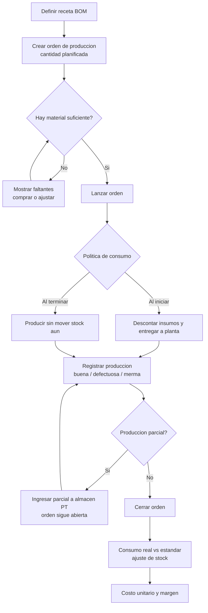
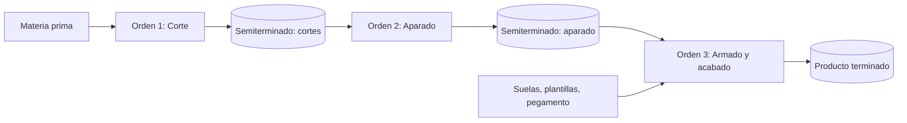
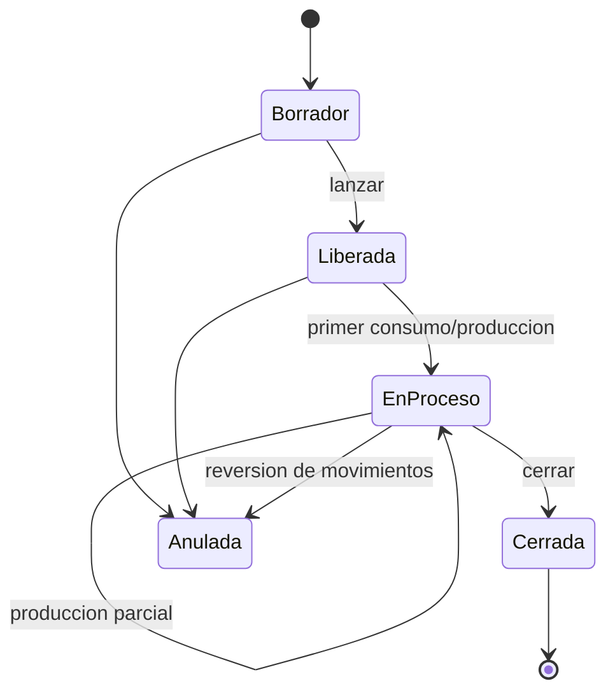
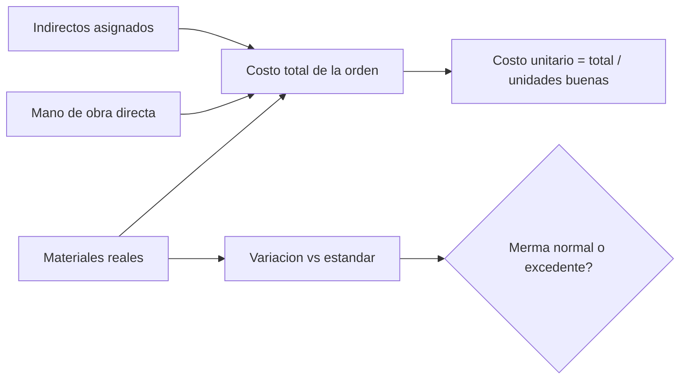

# Producción en pymes manufactureras: investigación del mundo real para un módulo ERP simple

Fecha: 2026-10-13. Propósito: insumo para diseñar la V1 del módulo de Producción de Tukifac.
Convenciones: **[F]** = hecho respaldado por una fuente consultada (ver sección 12). **[I]** = interpretación/criterio propio. Todos los números de los ejemplos son **ilustrativos inventados por mí**, salvo los marcados con [F]. No es asesoría contable.

---

## 0. Resumen ejecutivo

1. En una pyme, "producción" casi siempre se reduce a: *definir receta (BOM) -> abrir orden -> sacar material -> producir -> recibir producto terminado (PT) -> saber cuánto costó*. [I]
2. Los conceptos que realmente se repiten en todas las industrias revisadas: BOM con desperdicio/merma, orden de producción con cantidad planificada vs real, producción parcial, y costo = materiales + mano de obra + indirectos. [F+I]
3. Variantes talla/color, etapas múltiples (corte -> aparado -> armado), reciclado/regrind y WIP formal son **casos importantes pero no necesarios para una V1** si el diseño deja la puerta abierta. [I]
4. Calidad de la evidencia: muchas fuentes son blogs de proveedores de software, tesis y documentación de ERP. No hallé manuales de operaciones de pymes peruanas concretas ni cifras de mermas por rubro con respaldo sólido (ver límites, sección 13).

---

## 1. Modelos de fabricación

| Modelo | Definición | Ejemplo simple (ilustrativo) | Qué necesita el ERP | ¿Lo cubre un MVP con flujo común configurable? |
|---|---|---|---|---|
| Para stock (MTS) | Se produce según pronóstico/stock mínimo y se vende desde almacén [F: PlanetTogether, MRPeasy] | 100 pares de zapatillas modelo X, talla 40 | Orden de producción sin cliente, ingreso a almacén PT | **Sí** (es el caso base) |
| Bajo pedido (MTO) | Se produce solo tras recibir el pedido [F] | 50 juguetes tras pedido de una cadena | Orden con referencia opcional a un pedido/cotización/venta | **Sí**, con un campo "referencia/cliente" opcional; la vinculación fuerte pedido->orden puede ser posterior |
| Ensamblaje (ATO) | Componentes comprados en stock; el armado final se hace al llegar el pedido [F: MRPeasy, Espresso Tutorials] | Kit: 1 caja + 4 piezas compradas + 1 manual | BOM de solo componentes comprados, sin routing | **Sí** (BOM + orden; el más simple de todos) |
| Por lotes | Se produce un lote de tamaño fijo que rinde N unidades | Receta de 20 kg de resina -> 400 piezas | BOM con "cantidad base" y "rendimiento" | **Sí** si la BOM permite cantidad base distinta de 1 |
| Por etapas | Varias operaciones secuenciales, con semiterminados entre ellas [F: cadena corte/aparado/montado/acabado en calzado] | Calzado: cortado -> aparado -> armado -> acabado | Productos intermedios con su propia BOM y orden; opcionalmente routing | **Parcial**: se resuelve en V1 encadenando órdenes con semiterminados como productos normales; sin routing/centros de trabajo |
| Con variantes | Mismo producto base en tallas/colores (matriz) [F: Ecosire/Aptean; 8 tallas x 6 colores = 48 SKU] | 30 prendas: 10 S, 12 M, 8 L | Variantes de producto y cantidades por variante | **Parcial/V1.5**: una orden por variante o líneas de producto terminado por variante; consumo por talla distinto es la complicación real |

[I] Conclusión: un flujo común "BOM -> orden -> consumo -> ingreso PT -> costo" cubre MTS, MTO, ensamblaje y lotes. Etapas se logran encadenando; variantes requieren una decisión explícita.

---

## 2. Casos por industria

### 2.1 Calzado
- **Etapas [F]**: diseño, patronaje, corte, aparado (costura del corte), montado (unir con horma y suela), acabado (fuentes: programas formativos Ecuador/España; libro de N. Martín). Los nombres de operaciones varían por autor.
- **Ejemplo [I]**: 100 pares talla 40, para stock. BOM por par: 0.35 m² de cuero sintético, 0.08 m² de forro, 1 suela, 1 par de plantillas, 2 pasadores, 15 g de pegamento. Merma de corte supuesta 12 % -> cuero real a pedir: 0.35 / (1-0.12) = 0.398 m² por par = 39.8 m² para 100 pares.
- **Tallas [I]**: la talla cambia el consumo y la horma/suela (otro SKU de suela). Muchas pymes producen "series" (ej. 38-43 con curva 5-10-15-15-10-5 %).
- **Dolor típico [I]**: el material se saca para cortar el lote completo y el producto sigue meses "en proceso" informalmente entre áreas.
- **Para V1 [I]**: BOM por modelo/talla (o por modelo con factor), orden única, sin routing. Etapas -> V2.

### 2.2 Juguetes (plástico inyectado y por pedido)
- **Costo de material en inyección [F: everycalculators, aPriori]**: peso por pieza + parte proporcional del sistema de canales (runner) + tasa de scrap; regrind (molido reutilizable) reduce el desperdicio efectivo. Sus fuentes dan rangos de scrap alrededor de 3-5 % (RJG, calculadora) y un foro con runner de ~30 % como dato anecdótico; UL 746D limita regrind a 25 % en cierto contexto [F, según el resumen de la búsqueda; no abrí la norma].
- **Ejemplo [I]**: pieza 20 g, 4 cavidades, canal 12 g por disparo = 3 g/pieza, scrap 3 %. Peso bruto = (20+3) x 1.03 = 23.7 g por pieza. Para 50 juguetes de 3 piezas plásticas = 150 piezas x 23.7 g = 3.56 kg de resina, contra 3.0 kg "teóricos".
- **Regrind [I]**: si se vuelve a moler y usar el canal, el costo real baja, pero modelarlo bien exige un "insumo recuperado" con costo propio. Para V1: tratarlo como merma recuperable informativa o ignorarlo; no bloquear el módulo por esto.

### 2.3 Confección de ropa
- **Corte/tendido [F]**: el tendido apila capas de tela para cortar varias prendas a la vez; se debe calcular proporción de tallas por tendido, número de tendidos y largo (material de práctica citado en la búsqueda). Merma de corte reportada: 10-30 % del peso en tejido de punto (una fuente), ~13-15 % por orden en un caso de sarga (13.86 % total, Cooper-Acción), y consumo de tela hasta 65 % del costo de la prenda (nota de prensa).
- **Tallas/colores [F]**: las tallas grandes consumen más tela; optimizar el trazo puede bajar desperdicio de 15-20 % a 8-12 % (fuente de proveedor: Ecosire, evidencia débil).
- **Ejemplo [I]**: 30 polos: 10 S, 12 M, 8 L, en 2 colores. Consumo por talla: S 0.62 m, M 0.68 m, L 0.75 m de tela (ya con merma). Total = 10x0.62 + 12x0.68 + 8x0.75 = 20.36 m (el cálculo "uno solo" de 0.68 m daría 20.4 m: casi igual aquí, pero con curvas sesgadas a tallas grandes la diferencia crece).
- **Para V1 [I]**: cada variante es un producto distinto con su BOM (o BOM compartida con un factor por variante). Evitar un motor de matrices en V1.

### 2.4 Muebles (corte -> armado -> acabado)
- **Fuentes [F]**: la plancha es el costo mayor de la lista de materiales de un mueble de melamina; el aprovechamiento (superficie útil/plancha) sube de ~80 % a >90 % con optimizador de corte (guías prácticas y un caso en Portugal con +10 % de eficiencia). Las fuentes no concuerdan en umbrales "buenos" (>85 % vs >80 %).
- **Ejemplo [I]**: placa de 18 mm a S/ 160. Un velador usa 0.55 m² de los 5.03 m² (183x275 cm [F, medida citada para Argentina]) -> 11 %; con aprovechamiento 85 % el costo de placa = S/ 160 x 0.11 / 0.85 = S/ 20.7 por velador. Herrajes S/ 12, mano de obra S/ 25.
- **Etapas [I]**: corte (seccionadora), canteado, armado, acabado/tapizado. Rara vez se lleva control formal entre etapas en una pyme; la merma real está en retazos no reutilizados.
- **Para V1 [I]**: BOM con cantidad por unidad + % de desperdicio; sin optimizador de corte (herramienta externa).

### 2.5 Ensamblaje de piezas compradas
[I] El caso más simple y más rentable para V1: sin merma de proceso significativa, BOM corta, entrega y consumo inmediatos. Ejemplo: 40 luminarias = 40 bases + 40 sockets + 40 cables + 40 cajas; el consumo teórico debería coincidir con el real salvo daños.

### 2.6 Make-to-order vs make-to-stock en pymes
[F] Muchas pymes terminan en híbrido: algunos productos a stock, otros bajo pedido (MRPeasy y foros Epicor/Odoo). [I] Por eso el campo "para pedido de..." debe ser **opcional** en la orden.

---

## 3. Procesos A-F (con criterio de V1)

### A. Planificación
- **Cómo funciona [F+I]**: MRP explota la BOM sobre demanda (pedidos o pronóstico), resta stock y órdenes abiertas, y genera sugerencias de compra/producción (descripción de MRP en la búsqueda sobre MTO/MTS; la mecánica es conocimiento general, no de una fuente específica).
- **Ejemplo [I]**: pedido de 50 juguetes; stock PT 10 -> producir 40 (más stock de seguridad si existe). Por unidad: 3 piezas x 23.7 g -> 2.84 kg de resina; stock de resina 2 kg -> falta 0.84 kg -> comprar.
- **Por qué existe / problema [I]**: evitar parar la producción por falta de insumo y evitar sobreproducir.
- **Realidad en pymes [I]**: se planifica en Excel o "de memoria" en función de pedidos y stock visible.
- **V1**: **solo** el cálculo "necesidades de material de esta orden vs stock disponible" (faltantes) al crear o lanzar la orden. **No** MRP multinivel, no sugerencias automáticas de compra, no stock de seguridad automático. Es un check muy barato y de alto valor.

### B. Materiales y componentes
- **Cómo funciona**: BOM = lista de insumos por unidad producida; cada línea con cantidad, unidad de medida y desperdicio. [F] Infor LN: requerimiento bruto = neto x (1 + % scrap/100); alternativa de scrap fijo por cantidad. Deacom: 100 unidades con 5 % scrap -> 105 piezas a entregar.
- **UM [I]**: se compra en rollos/kg/planchas, se consume en m, g, m². Un error frecuente es no tener conversión (ver dolores, sección 10).
- **Sustitutos [I]**: ocurren a diario (otro color de hilo, otra marca). V1: permitir **cambiar el insumo en la ejecución** (registrar lo realmente consumido) en lugar de modelar sustitutos formales en la BOM.
- **Variantes**: ver 2.3.
- **V1**: BOM de un nivel (permitir que un componente sea un semiterminado con su propia BOM, pero sin explosión automática), % de desperdicio por línea, UM de consumo con conversión simple.

### C. Ejecución
- **Cómo funciona [I]**: la orden pasa por borrador -> liberada -> en proceso -> terminada/cerrada. Se entrega material (requisición), se produce, se registra consumo real, producción buena, defectuosos/segundas, merma.
- **Producción parcial [F]**: Odoo permite fabricar parte de la cantidad y crea un backorder con el resto (doc oficial; ejemplo: 10 unidades, componentes para 5). [I] En pymes ocurre porque falta un insumo o porque se entrega por tandas.
- **Consumo real vs estándar [F+I]**: un módulo de terceros de Odoo (no core) marca variación cuando lo consumido difiere de la BOM; la idea es útil. En V1: el sistema propone el consumo estándar (cantidad x BOM x (1+desperdicio)) y el usuario **puede editarlo** al cerrar; la diferencia se muestra.
- **Defectuosos/segundas [I]**: ejemplo: se planearon 100 pares, salen 92 de primera, 5 segundas (se venden a 60 %), 3 desechados. V1: campos "cantidad buena" y "cantidad desperdicio/defectuosa" con motivo; las segundas como producto distinto opcional (V1.5).
- **Cierre [I]**: no permitir más movimientos; calcular costo final; liberar lo no consumido.

### D. Inventario y trazabilidad
- **Cuándo se consume la materia prima**: dos políticas [F: Cleverence/Sage, Microsoft, Infor]:
  - *Consumo al iniciar/entregar (issue)*: baja inventario cuando sale a planta. Más exacto con lead time largo [F: el stock es incorrecto entre la salida real y el backflush].
  - *Backflush al terminar*: baja al registrar producción, calculando por BOM. Menos transacciones; riesgo si la BOM está desactualizada o hay scrap impredecible, o sustituciones frecuentes [F].
- **Criterio mixto [I, la búsqueda lo sugiere como práctica]**: backflush de insumos baratos de alto volumen; entrega explícita de caros o variables. Muchos ERP lo configuran por componente [F: Sage 100].
- **Ingreso de PT**: al cerrar (o por parciales) como entrada a almacén con costo calculado.
- **Lotes/series [F]**: trazar el lote de materia prima hasta el lote de PT es una necesidad frecuente que Excel no cubre [F: Qoblex/otras]. En V1 de una pyme peruana, **opcional**: [I] solo si el módulo de inventario ya soporta lotes.
- **Correcciones sin perder trazabilidad [I]**: no editar ni borrar movimientos; usar movimientos de **ajuste/reversión** con motivo, y anular la orden cierra con contra-movimientos (mismo principio que el sistema de anulación de ventas de Tukifac).
- **V1**: política configurable por orden o por insumo: "descontar al lanzar" vs "descontar al terminar". Por defecto: al terminar (backflush con consumo editable).

### E. Costos
- **Fórmula [F: NIC 2 párr. 10 y 12, según resumen de búsqueda]**: costo = adquisición + transformación; la transformación incluye mano de obra directa y una porción sistemática de costos indirectos fijos y variables.
- **Merma normal vs anormal [F]**: la merma normal forma parte del costo; las cantidades anormales de desperdicio se reconocen como gasto del periodo (Universidad Andina, PUCP, Misha.pe sobre NIC 2 párr. 16 según esas fuentes; **no pude abrir el texto oficial** para verificar la numeración).
- **Capacidad normal [F]**: los indirectos fijos se asignan según capacidad normal; la baja producción no debe encarecer la unidad (EY Perú; resumen NIC 2). 
- **Ejemplo numérico [I]**: orden de 100 pares. Materiales reales S/ 3,150; mano de obra directa 8 operarios-día x S/ 60 = S/ 480; indirectos asignados S/ 370 (p.ej. 77 % del costo de MOD o un monto por par). Total S/ 4,000; salen 100 buenos -> S/ 40 por par. Si se consumió 6 % más material del estándar y el estándar de material era S/ 2,970, la variación de material = +S/ 180: se divide en cantidad (cuánto de más) y precio (si el insumo subió). Si esa merma se considera anormal, contablemente iría a gasto (decisión del contador, no del sistema).
- **Estándar vs real [I]**: estándar = costo según BOM; real = lo consumido. Mostrar ambos y la variación ya es muy valioso; análisis por precio/cantidad/eficiencia es V2 (la búsqueda no halló fuentes para variaciones; el desglose en precio/cantidad es práctica general).
- **Rentabilidad [I]**: margen = precio de venta - costo unitario. Mostrarlo por producto y por orden.
- **V1**: costo de materiales (real, usando el costo del inventario) + campo de **mano de obra** y **otros costos indirectos** ingresados por orden (monto manual) + costo unitario + comparación con el estándar de la BOM + marcar merma "normal" (dentro del % de la BOM) vs "excedente". **No** costeo por actividad, no tasa de asignación automática de indirectos, no contabilización automática.

### F. Gestión cotidiana
- **Roles [I]**: dueño/gerente (ve costos y margen), jefe de producción/planta (crea y cierra órdenes), almacenero (entrega y recibe), operarios (a veces solo reportan cantidad). V1: tres permisos: ver, operar, ver costos.
- **Reportes que aportan [I]**: (1) órdenes abiertas y atrasadas; (2) consumo real vs estándar por orden; (3) costo unitario por producto en el tiempo; (4) faltantes de material para órdenes planificadas; (5) producción del periodo y merma %. Evitar tableros complejos.
- **Qué se hace en Excel hoy [F+I]**: BOM y listas de costos en hojas; fuentes señalan que se rompen con subensambles, cambios que hay que replicar en varias hojas, faltantes invisibles y múltiples fuentes de verdad (MRPeasy, Qoblex, peerlist).
- **Errores operativos frecuentes**: ver sección 10.

---

## 4. Cuándo hace falta WIP

- **Criterio [F]**: si hay trabajos sin terminar al cierre de periodo (días o semanas) se necesita WIP; si todo termina el mismo día, el WIP es casi cero y no vale la pena rastrearlo en detalle (guías de Cleverence/Shopify/Craftybase).
- **Costeo por órdenes [F]**: la orden actúa como "mini-libro" que acumula materiales, mano de obra e indirectos; el WIP = suma de saldos de órdenes abiertas.
- **Alternativas para pyme [I]**:
  1. **Backflush al terminar** (sin WIP): no hay saldo en proceso; se asume que todo lo consumido está en la orden hasta el cierre. Simple, pero entre inicio y fin el stock de materia prima aparece "de más".
  2. **Consumo al iniciar** (con WIP implícito): el material sale del almacén al lanzar; la orden abierta *es* el WIP (se puede listar "valor en órdenes abiertas") sin cuenta/almacén de WIP formal.
  3. **WIP formal con almacén y stock de semiterminados por etapa**: solo cuando hay etapas largas con producto intermedio almacenable.
- **Recomendación V1 [I]**: opción 2 como alternativa a 1 (configurable), y reporte "valor de materiales en órdenes abiertas" como WIP informal. Semiterminados reales (p.ej. corte listo) como productos normales con su orden, que el usuario encadena. Sin cuentas contables de WIP.

---

## 5. Normativa/contabilidad básica en Perú (solo contexto)

- NIC 2 aplicable en Perú desde 2006 [F: Gestiopolis]; versiones oficiales: MEF (`mef.gob.pe`) y Uruguay (`gub.uy`) fueron localizadas, pero **no logré leer el PDF** (compresión binaria en la herramienta). Los párrafos 10-13 se verificaron solo por resúmenes de terceros.
- Puntos que impactan al diseño [F según resúmenes]: el costo incluye materiales, MOD y indirectos asignados; desperdicio anormal fuera del costo; indirectos fijos por capacidad normal.
- **Impuesto a la renta/IGV y mermas**: la búsqueda aclara que el tratamiento tributario es distinto del contable y que debe consultarse (no hallé la norma tributaria peruana; ver límites). [I] El ERP debe **guardar el dato de merma** (cantidad, motivo, normal/anormal) y dejar al contador decidir el tratamiento; en SUNAT suele exigirse sustento de mermas (sin fuente consultada: **verificar con contador**).
- Registro de costos (PCGE, cuentas 6/7/9 y 2) y Libro de inventarios: **no investigado**.

---

## 6. Diagramas

### 6.1 Flujo general (orden de producción)

### 6.2 Etapas encadenadas (calzado/muebles) sin routing

### 6.3 Estados de la orden

### 6.4 Costo de una orden

---

## 7. Ejemplos numéricos completos (ilustrativos)

**Zapatillas para stock, 100 pares**: ver 2.1 y E. Material con 12 % de merma de corte: 39.8 m² a entregar vs 35 m² teóricos (0.35 x 100); el punto es que el sistema calcule la cantidad a entregar con el desperdicio de la BOM.

**Juguetes bajo pedido, 50 unidades**: ver 2.2. Orden vinculada a "pedido X"; cierre produce 48 buenas, 2 defectuosas (reciclables) -> se entregan 48; se puede crear nuevo pedido remanente o producir 2 más (backorder).

**Ropa, 30 prendas**: ver 2.3. Costo: tela 20.36 m x S/ 14 = S/ 285; hilo y etiquetas S/ 30; MOD S/ 180; costo S/ 495 / 30 = S/ 16.5 por prenda.

**Mueble**: ver 2.4. Costo velador: 20.7 + 12 + 25 = S/ 57.7 (más indirectos).

---

## 8. Evaluación de qué entra en V1

| Capacidad | V1 | Razón |
|---|---|---|
| BOM de un nivel, con UM y % de desperdicio | Sí | Núcleo en todas las fuentes |
| Orden de producción con estados, cantidad plan vs real | Sí | Núcleo |
| Verificación de faltantes al crear/lanzar | Sí | Barato, alto valor |
| Consumo editable (real vs estándar) | Sí | Resuelve sustituciones y mermas reales |
| Política: descontar al iniciar o al terminar | Sí (configurable) | Cubre dos estilos de pyme |
| Producción parcial (varios ingresos de PT) | Sí | Muy común |
| Defectuosos/merma con motivo | Sí | Base de costos y control |
| Costo: materiales + MOD manual + indirectos manual | Sí | Responde "cuánto me cuesta" |
| Referencia opcional a pedido/cliente (MTO) | Sí | Híbrido MTS/MTO |
| Semiterminados como productos (encadenar órdenes) | Sí (sin explosión automática) | Cubre calzado/muebles |
| Anulación/reversión de orden con contra-movimientos | Sí | Trazabilidad |
| Variantes con matriz talla/color | No (V1.5) | Complejidad alta; usar productos separados |
| Routing, centros de trabajo, tiempos de máquina | No | Excede una pyme inicial |
| MRP multinivel, compras sugeridas | No | Sobrepasa alcance |
| WIP formal con cuentas/almacén de WIP | No | Alternativa: valor en órdenes abiertas |
| Lotes/series de materia prima a PT | Opcional | Depende del módulo de inventario |
| Sustitutos formales en BOM | No | Se resuelven editando consumo real |
| Regrind/subproductos/coproductos | No (V2) | Raro y complejo |
| Costeo estándar con variaciones por precio/eficiencia | No (V2) | Solo diferencia estándar vs real |
| Asignación automática de indirectos | No | Fuerte dependencia contable |
| Optimizador de corte | No | Herramienta externa |
| Control de calidad con inspecciones | No | Solo defectuosos con motivo |

---

## 9. Qué se hace hoy en Excel [I, apoyado en F de la sección 3F]

BOM y costos por producto en hoja; lista de pedidos; conteo físico de materia prima; consumo real a ojo; cálculo de merma al cierre del mes. Los fallos reportados: BOM anidadas, desactualización en varias hojas, imposibilidad de rastrear lotes, sin visibilidad de faltantes.

---

## 10. Dolores operativos frecuentes

[F] = reportado en fuentes consultadas; [I] = mi inferencia.
1. BOM desactualizada que hace "mentir" al backflush [F: Cleverence].
2. Faltantes que se descubren cuando ya se debe producir [F: peerlist/Qoblex].
3. Mermas reales distintas de las cotizadas, sin que se midan [F: tesis UNI sobre interlock].
4. Material entregado a planta que nadie registra; inventario que no cuadra con el físico [I].
5. Unidades de medida inconsistentes (rollo vs metro vs kg) [F: MRPeasy/Genius sobre unidades inconsistentes y limpieza de datos].
6. Multiples fuentes de verdad (ERP + Excel) [F].
7. Cambios de ingrediente/insumo sin actualizar la receta [F/I].
8. Producción parcial sin registrar y órdenes "eternamente abiertas" [I].
9. Costos que no incluyen mano de obra ni indirectos, por lo que el margen parece mayor [I].
10. Correcciones borrando o editando registros en vez de ajustar con trazabilidad [I].
11. Retazos/semiterminados sin ubicación ni valor [I].
12. Capacitación insuficiente y resistencia al cambio [F: Smart Manufacturing Week, Cetec].
13. Sobre-personalización del ERP [F: Genius, Cetec].

---

## 11. Recomendaciones de diseño (interpretación)

1. Un solo flujo: BOM -> orden -> (entrega opcional) -> producción (parciales) -> cierre -> costo.
2. Políticas por configuración, no por módulos distintos: *cuándo se descuenta*, *si exige aprobar faltantes*, *si requiere pedido*.
3. Guardar siempre cantidad estándar y cantidad real, y el motivo de la diferencia.
4. Costos con tres cubos (materiales, MOD, indirectos) editables; no automatizar la asignación de indirectos en V1.
5. Semiterminados = productos normales; etapas = órdenes encadenadas. Sin routing.
6. Anulación por contramovimientos; nunca borrar.
7. Dejar campos para futuro: variante, lote, centro de trabajo (nulos).
8. Respetar la lección interna del proyecto: toda tabla nueva de tenant necesita migración versionada antes de desplegar; y endpoints que use el POS de PIN necesitan puente de permisos (ver memoria del proyecto).

---

## 12. Fuentes realmente consultadas

Todas vía WebSearch (resúmenes devueltos por la herramienta); **no abrí todas las páginas completas**. Fetch directo intentado solo del PDF MEF (ilegible).

Costos y NIC 2
- MEF Perú, NIC 2: https://www.mef.gob.pe/contenidos/conta_publ/con_nor_co/vigentes/nic/SpanishRedBV2019_NIC02_GVT.pdf (localizada; no legible en la herramienta)
- NIC 2 (Uruguay): https://www.gub.uy/ministerio-economia-finanzas/sites/ministerio-economia-finanzas/files/2020-06/nic_02.pdf
- KPMG Perú, costos indirectos de fabricación: https://assets.kpmg.com/content/dam/kpmg/pe/pdf/disposiciones-legales-2020/costos-indirectos-de-fabricacion-aspectos-contables-y-tributarios.pdf (solo listado en resultados)
- EY Perú, costos indirectos en pesca: https://www.ey.com/es_pe/insights/assurance/costos-indirectos-pesca-bajo-niif-efectos-nino-2023
- Misha.pe, asiento de mermas: https://misha.pe/contable/asiento-contable-mermas
- Revista Integración (U. Andina): https://revistas.uandina.edu.pe:443/index.php/integracion/article/download/868/428/3045
- Revista Lidera (PUCP): https://revistas.pucp.edu.pe/index.php/revistalidera/article/download/23594/22564
- Gestiopolis, NIC 2: https://www.gestiopolis.com/normas-internacionales-contabilidad-nic2/

BOM, scrap, backflush, MTO/MTS
- Cleverence (Sage 100), backflush: https://cleverence.com/articles/sage-documentation/defining-the-backflush-issue-method-sage-100-help-4827
- Infor LN, material to issue: https://docs.infor.com/ln/10.4.in/en-us/lnolh/help/ti/cst/ticst0101m100.html
- Deacom, scrap factors: https://help.deacom.com/Content/Topics/Research_and_Development/Utilizing_Scrap_Factors.htm
- Microsoft Dynamics 365 blog (backflush/timing): https://www.microsoft.com/en-us/dynamics-365/blog/?p=43097
- MRPeasy, MTO y ATO: https://manufacturing-software-blog.mrpeasy.com/mto-and-ato-manufacturing-process/
- PlanetTogether, MTO vs MTS: https://planettogether.com/blog/make-to-order-vs-make-to-stock-what-are-the-key-differences
- Espresso Tutorials: https://www.espresso-tutorials.com/learning-content/make-to-stock-vs-make-to-order-vs-assemble-to-order
- Odoo, backorders: https://www.odoo.com/documentation/master/applications/inventory_and_mrp/manufacturing/workflows/manufacturing_backorders.html
- Ecosire, Odoo backflush (módulo de terceros): https://ecosire.com/apps/odoo/odoo-manufacturing-backflush

WIP y gestión
- Cleverence, inventario para manufactura pequeña: https://www.cleverence.com/articles/business-blogs/manufacturing-small-business-inventory-5274/
- Shopify, WIP: https://www.shopify.com/blog/work-in-process-inventory
- Craftybase, WIP: https://craftybase.com/blog/work-in-progress-wip-inventory
- MRPeasy, errores con software de inventario: https://www.mrpeasy.com/blog/mistakes-manufacturers-make-with-inventory-software/
- Qoblex, BOM para pymes: https://qoblex.com/blog/bom-software-for-small-manufacturers/
- Smart Manufacturing Week, errores ERP: https://www.smartmanufacturingweek.com/news/top-10-mistakes-small-manufacturers-make-erp-software
- Genius ERP: https://www.geniuserp.com/resources/blog/erp-implementation-mistakes/
- Cetec ERP: https://cetecerp.com/blog/common-reasons-erp-implementations-fail-for-manufacturers/

Industria
- Perfil de producción de calzado (Ecuador): https://educacion.gob.ec/wp-content/uploads/downloads/2026/03/perfil-profesional-produccion-de-calzado.pdf
- Fundae TCPF006PO (calzado): https://www.fundae.es/docs/default-source/convocatorias-de-subvenciones/especialidades-2025/especialidades/TCPF006PO.pdf
- Tesis UNI (mermas de tela): https://repositorio.uni.edu.pe/bitstream/20.500.14076/9486/1/leon_qd.pdf
- Repositorio UTN Ecuador (corte/tendido): https://repositorio.utn.edu.ec/jspui/bitstream/123456789/3784/1/04%20IT%20163%20TESIS.pdf
- Ecosire, ERP moda: https://ecosire.com/es/blog/erp-for-fashion-apparel-industry
- Softland (curvas de talles): https://softland.com/ar/soluciones-por-industria/industria-textil/
- aPriori, material utilization en moldeo: https://www.apriori.com/Collateral/Documents/English-US/online_help/2019_R2/COST_MODEL_GUIDE/AP_CMG0653Material_Utilization_for_Plastic_Molding.html
- Everycalculators, calculadora de moldeo: https://everycalculators.com/molding-calculator.html
- RJG ROI calculator: https://rjginc.com/wp-content/uploads/2023/04/rjg_roi_calculator_final_working.html
- UNLP, optimizar placa de melamina: https://unlp.edu.ar/wp-content/uploads/2026/03/Optimizar-una-placa-de-melamina.pdf
- RECIPP (Portugal, nesting): https://recipp.ipp.pt/entities/publication/41f3a686-1489-4db3-acd4-1c862ab043eb

---

## 13. Límites de esta investigación

- Caso real propio (no publicado): el tenant legacy CONSTRUMARKET (fabricante de pegamentos para cerámica, ver PRODUCTION-LEGACY-TENANT-CASE-CONSTRUMARKET.md) valida el flujo receta de un nivel + consumo + terminado en una pyme peruana. Fuera de él, no hallé manuales de operaciones ni casos publicados de pymes peruanas concretas (calzado de Trujillo/Lima, textil de Gamarra, muebles de Villa El Salvador); lo específico de Perú es sobre NIC 2 y tesis.
- No pude leer el texto oficial de NIC 2: los párrafos y su numeración provienen de resúmenes de terceros; verificar antes de citar.
- No investigué: normativa tributaria peruana sobre mermas (IR/IGV, SUNAT), PCGE, libros obligatorios de costos, ni exigencias de SUNAT sobre guías de remisión para traslado entre plantas.
- Cifras de merma por industria (10-30 %, 13-15 %, 15-20 % -> 8-12 %, scrap de inyección 3-5 %, runner 30 %) provienen de fuentes heterogéneas (tesis, blogs de vendors, foros): son órdenes de magnitud, no benchmarks.
- Sobre variaciones estándar vs real no hallé fuentes dedicadas; lo descrito es práctica general.
- Muchos hallazgos vienen de blogs de proveedores de software con sesgo comercial.
- Los ejemplos numéricos son inventados para ilustrar; no usar como datos de mercado.
- Algunas afirmaciones de los resúmenes de búsqueda (p. ej. UL 746D, 65 % del costo de la prenda) no fueron verificadas abriendo la página fuente.
