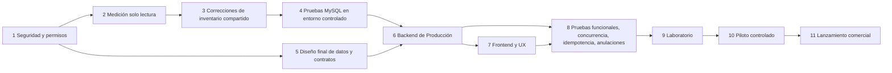

# Roadmap revisado — Producción desacoplada con Inventario oficial

> **Plan para aprobación. No se ejecutó nada.** Sustituye en lo que difiera a [PRODUCTION-IMPLEMENTATION-ROADMAP-REVISED.md](PRODUCTION-IMPLEMENTATION-ROADMAP-REVISED.md) (se conserva como evidencia). Base: [auditoría de opciones](PRODUCTION-ARCHITECTURE-OPTIONS-AUDIT.md), [contrato de integración](PRODUCTION-DECOUPLED-INVENTORY-INTEGRATION.md), [modelo de datos](PRODUCTION-DATA-MODEL-REVISED.md) y [ADR](PRODUCTION-ARCHITECTURE-DECISION-RECORD.md).
> **Regla transversal:** cada acceso a producción, migración o despliegue requiere **autorización expresa y específica**; aprobar este plan no la otorga. Desplegar código del módulo **no lo habilita** para ningún tenant ni plan.

## Mapa de etapas

Paralelismo permitido: 5 puede avanzar junto con 2–4 (solo documentos); el **desarrollo** de 6–7 puede empezar tras 5 con migraciones aditivas **sin habilitar** el módulo. Lo que no puede adelantarse: **habilitar Producción sobre datos reales exige 3 y 4 completados y verificados en ese tenant.**

---

## Etapa 1 — Revisión de seguridad y permisos de acceso
- **Qué:** (a) modelo de amenazas del módulo: aislamiento por tenant, alcance por sucursal (`branch.ResolveWriteBranchID`; nunca la sucursal del body), IDOR en órdenes/registros de otra sucursal, ocultación de costos sin permiso, abuso de idempotencia (clave reutilizada con otro payload), permisos de anulación; (b) definir permisos `production.view/manage/execute/void/costs` y backfill solo al Administrador; (c) confirmar el comportamiento de módulos: `RequireModule` lee el **JWT** (activar/desactivar no es inmediato; re-login), `Implemented:false` no bloquea backend; (d) limpieza de seguridad pendiente del servidor antiguo (gestionada fuera de este repositorio) — acción del usuario.
- **Dependencias:** ninguna. **Riesgos:** dar por seguro un módulo que por JWT sigue visible tras desactivarlo. **Aceptación:** documento de amenazas y matriz de permisos firmada por usted; lista de rutas con su combinación módulo+permiso+sucursal.
- **Autorización:** ninguna para el análisis de código. Los pendientes de seguridad del servidor antiguo se gestionan fuera de este repositorio.

## Etapa 2 — Medición de solo lectura de inventario
- **Qué:** consultas del [Anexo B](PRODUCTION-FINAL-REVIEW-ANNEX-B-CODE-VERIFICATION.md) (duplicados de saldo, diferencias saldo/kardex, saltos de `Balance`, movimientos con `unit_cost=0`, productos sin costo, negativos, líneas de compra con IGV incluido, `sql_mode`/aislamiento/`max_connections`/`innodb_lock_wait_timeout`, versión de esquema, tipos de operación) **más**: tenants con `manufacturing` activo en `tenant_modules`/`saas_plan_modules` (central) y uso manual de `PRODUCTION_OUT`.
- **Cómo:** muestra de tenants, usuario de solo lectura temporal, horario valle, consultas pesadas acotadas, sin leer `.env`, túnel cerrado y credenciales destruidas al terminar.
- **Dependencias:** decisión D-01. **Riesgos:** carga sobre el pool; exposición de datos. **Aceptación:** informe con tenants afectados; cero escrituras.
- **Autorización específica:** D-01 (alcance de la muestra, usuario, ventana horaria).

## Etapa 3 — Correcciones de inventario compartido (entregas separadas)
Separadas por naturaleza:
| Entrega | Tipo | Detalle | Reversión |
|---|---|---|---|
| **3a Redondeo/epsilon** | Necesaria para cualquier operación | Redondear a 3 decimales y comparar con tolerancia | Revert de código |
| **3b Contrato aditivo** | Imprescindible para Producción | `SourceType/SourceID` + columnas nullable e índice; `RecordMovementResultTx`; lectura de stock por lista dentro de `tx`; `PRODUCTION_IN` | Columnas quedan inertes; revert de código |
| **3c Bloqueo de saldo** | Necesaria para cualquier operación | *Ensure-row* + `FOR UPDATE` (o `UPDATE` atómico) + `RecordMovementsTx` ordenado; reintento a cargo del llamador; **flag** `INVENTORY_STRICT_LOCKING` | Apagar el flag |
| **3d Informe de duplicados y conciliación** | Necesaria | Herramienta de solo lectura + procedimiento manual de consolidación con aprobación; **nunca automática** | — |
| **3e UNIQUE de saldos** | Necesaria | Migración que **aborta por tenant** si hay duplicados, sin tocar datos | Script `DROP INDEX` |
| **3f Costo promedio en sombra** | Imprescindible para costo reproducible | Columnas por (producto, sucursal) y actualización en `RecordMovementTx` bajo flag; backfill por lotes fuera de migración; **no cambia reportes** | Apagar flag |
| 3g `Transfer()` atómico | Mejora que puede esperar | Una sola transacción | — |
| 3h Fix `ProfitDetail` con `SaleUnit` | **Afecta reportes existentes** | Decisión D-09; independiente del módulo | — |
| 3i Costo de ventas con costo de producción | **Afecta reglas comerciales** | Decisión D-03; fuera de V1 | — |

- **Dependencias:** 3a antes que todo; 3c requiere 2; 3e requiere 3c y 3d; 3f requiere 3b y 3c. **Riesgos:** regresión en Compras/Ventas/Traslados/Documentos; deadlocks; pool de 6. **Mitigación:** flags, canary de 3 tenants 48 h, métricas (errores 1213/1205, p95 de venta, tasa de «stock insuficiente», conciliación saldo-kardex).
- **Aceptación:** suite existente verde; pruebas de la etapa 4 verdes; 0 pérdidas de actualización en 1,000 repeticiones con el flag; p95 de venta sin degradación > 10 %.
- **Autorización específica:** por **cada** release: despliegue, `migrate-central`, `migrate-fleet`, encendido del flag y canary.

## Etapa 4 — Pruebas de integración con MySQL real en entorno controlado
- **Qué:** infraestructura local desechable (nunca producción) con `INVENTORY_MYSQL_DSN` y `t.Skip` si falta (precedente: `pkg/saas/docusage/concurrency_test.go`). Pruebas: N goroutines restando de un saldo (esperado `SUM = saldo − N`, balances del kardex estrictamente decrecientes); creación concurrente de fila de saldo (1 sola fila); pares cruzados A/B–B/A (sin errores no reintentados); consumo exacto de stock con cantidades decimales; carga con pool de 6; migración UNIQUE con y sin duplicados. SQLite **no** sirve para locks.
- **Dependencias:** 3a–3c (las pruebas se escriben primero y deben **fallar** antes del cambio). **Riesgos:** pruebas flaky; diferencias de versión MySQL/MariaDB. **Aceptación:** pruebas reproducen el defecto actual y pasan tras el cambio, repetidas 20 veces.
- **Autorización:** ninguna (entorno local); si se usa una BD compartida de pruebas, su autorización.

## Etapa 5 — Diseño final de datos y contratos
- **Qué:** congelar tablas, índices, columnas, tipos, códigos de error (`STOCK_SHORTAGE`, `IDEMPOTENCY_KEY_REUSED`, `DB_TRANSIENT`…), formato de error estructurado de faltantes (necesario para el panel de faltantes del frontend), permisos y textos.
- **Dependencias:** aprobación del ADR. **Riesgos:** cambios tardíos de alcance. **Aceptación:** documentos 3 y 5 actualizados y aprobados; matriz de decisiones cerradas.
- **Autorización:** su aprobación del ADR y del modelo de datos.

## Etapa 6 — Backend de Producción
- **Contenido V1:** recetas (CRUD y validaciones), órdenes (estados), disponibilidad, registrar producción (transacción única, idempotencia, adaptador `StockGateway`), anular registro, anular orden, cerrar, costos por registro, permisos, columnas de auditoría, `RequireModule("manufacturing")` + `RequirePermission` + sucursal. Migraciones aditivas e idempotentes con test; `manufacturing` a `Implemented:true` y `Requires: products,inventory`, **sin asignar a ningún plan** (y sin migraciones tipo «otorgar a todos»).
- **Dependencias:** 3b, 5 y 4 para validar concurrencia. **Riesgos:** transacciones largas (muchos insumos); falta de timeout de transacción [V-código]. **Mitigación:** límite de líneas por registro, lecturas en lote, prueba de carga.
- **Aceptación:** criterios del [alcance candidato](PRODUCTION-APPROVED-SCOPE-CANDIDATE.md) §8 (1–21) en lo que corresponde; invariantes del contrato §8.
- **Autorización:** despliegue de migraciones y backend (módulo apagado).

## Etapa 7 — Frontend y experiencia de usuario
- **Estructura (de la auditoría):** `pages/production/*` (recetas, órdenes, detalle), `components/production/*` (modal de registro mobile-first, panel de faltantes, badge de estado, celda de costo que se oculta sin `production.costs`), `services/production.service.ts`. Rutas en `AppRouter` con `Protected perm`; grupo en `Sidebar` con `module: 'manufacturing'`.
- **Reutilizar sin acoplar:** `Modal`, `ConfirmDialog`, `RowMenu`, `SearchSelect`, `RequireModule`, `UnitQuantityInput`, `useBranch`, `idempotencyKey`, `datesPeru`, `money`, `sonner`, `api.ts`. **No acoplar:** `InventoryDocumentPage` y subcomponentes, `ProductPickerModal`, `PurchaseSaleUnitSelector`, `components/pos/*`, páginas de Ventas/Compras/Cotizaciones.
- **Notas:** clave de idempotencia al abrir el modal (hoy va en el body en ventas; Producción define si body o cabecera); tablas con scroll horizontal no bastan para planta: el modal de registro debe ser usable en tablet/celular; no hay tests de frontend ni eslint: validar con `tsc` strict y pruebas manuales guiadas (añadir pruebas es decisión aparte).
- **Dependencias:** 6 (contratos estables). **Aceptación:** un usuario nuevo completa el caso sencillo en < 5 minutos; mensajes de faltantes claros; costos ocultos sin permiso.
- **Autorización:** despliegue del frontend.

## Etapa 8 — Pruebas funcionales, concurrencia, idempotencia y anulaciones
Matriz mínima (automatizada donde aplica, con MySQL real para concurrencia):
| Área | Pruebas |
|---|---|
| Casos de negocio | Casos A–G del alcance con números exactos (21.40; 21.40/21.40; 76; 19.4947; pérdida 104; bloqueo con 20 vendidas) |
| Idempotencia | doble clic; reintento tras timeout simulado (commit hecho, respuesta perdida); misma clave con payload distinto (409); carrera de dos peticiones con la misma clave |
| Concurrencia | dos usuarios sobre la misma orden; dos órdenes con insumos comunes; pares cruzados de insumos; deadlock con reintento |
| Fallas | falta de un insumo (rollback total, lista completa de faltantes); `PRODUCTION_IN` ausente; falla al grabar el `IN` tras los `OUT` (rollback de todo) |
| Anulaciones | reversa con costos originales; terminado vendido (bloqueo con mensaje); anular en orden distinto al cronológico; doble anulación |
| Cantidades/unidades | consumo exacto del stock con decimales (0.018 × 86); saco→kg; redondeo en parciales; producido = buenas |
| Seguridad | permisos por acción; tenant sin módulo → 403; sucursal ajena; costos ocultos |
| Datos | invariantes del contrato §8 (conciliación orden/registros/kardex) |
| Migraciones | idempotencia, tenant nuevo vs existente, aborto a mitad |
- **Aceptación:** 100 % de la matriz verde; repetición de concurrencia ≥ 20 veces sin fallos.

## Etapa 9 — Laboratorio
- Tenant de laboratorio con datos de prueba basados en las 8 recetas reales de CONSTRUMARKET y un caso de ensamblaje/calzado inventado; módulo habilitado solo ahí (recordar re-login por JWT). Carga de compras, stock inicial por conteo y costos sin IGV.
- **Aceptación:** dos semanas de uso interno sin duplicados ni descuadres (consultas de conciliación) y criterios de usabilidad.
- **Autorización:** habilitar el módulo en el tenant de laboratorio.

## Etapa 10 — Piloto controlado
- Un cliente manufacturero real **elegido por usted** (no se asume CONSTRUMARKET), con 3 condiciones previas: compras de insumos cargadas, stock inicial validado por conteo físico, costos sin IGV aclarados. Etapa 3 completa y verificada en ese tenant.
- **Aceptación:** criterios de éxito del piloto (alcance candidato §9) + costo unitario de 2 registros validado con el contador del cliente + sin incidentes de inventario.
- **Autorización:** habilitar el módulo en ese tenant (plan o cortesía manual), con ventana y plan de reversión (apagar módulo por plan y permisos).

## Etapa 11 — Lanzamiento comercial
- Posterior a su aprobación explícita: asignación a planes, precios, documentación y capacitación, comunicación del re-login necesario, soporte. Fuera de alcance técnico de esta auditoría.
- **Autorización:** decisión comercial D-12.

---

## Riesgos transversales y sin resolver
| Riesgo | Estado |
|---|---|
| Regresión en módulos existentes por endurecer el núcleo | Mitigado con flags/canary; **sigue abierto hasta medir** |
| Duplicados y descuadres reales en producción | **No verificado** — etapa 2 |
| Costos con IGV, traslados sin costo | Abierto: D-04 y decisión de traslados |
| Costo mal interpretado como contable | Rotulado «costo de gestión»; validación del contador pendiente |
| Módulo visible/invisible según JWT | Documentado; re-login al activar |
| Falta de pruebas y lint en frontend | Abierto; se compensa con `tsc` y pruebas manuales |
| Terminado vendido impide anular | V1 bloquea; «ajuste de consumo» en V1.5 |
| Alcance creciente | Todo lo no listado va a V1.5 |

## Qué requiere autorización específica (resumen)
D-01 (medición), cada release de la etapa 3, `migrate-central`/`migrate-fleet` de cada migración, encendido de flags, habilitación en laboratorio y en piloto, y cualquier acción sobre servidores. Ninguna está concedida.
